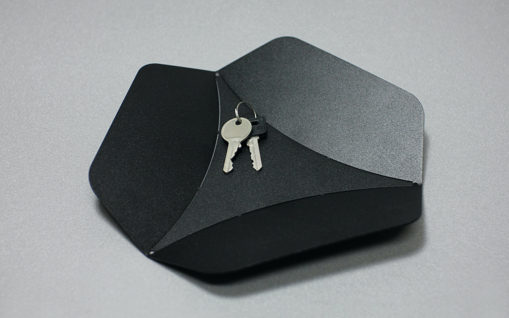
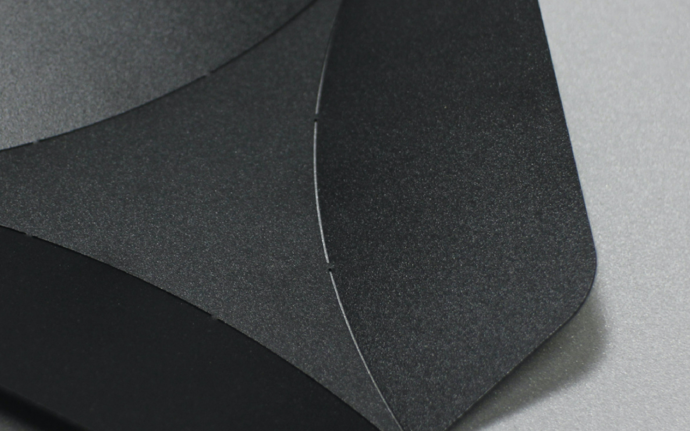
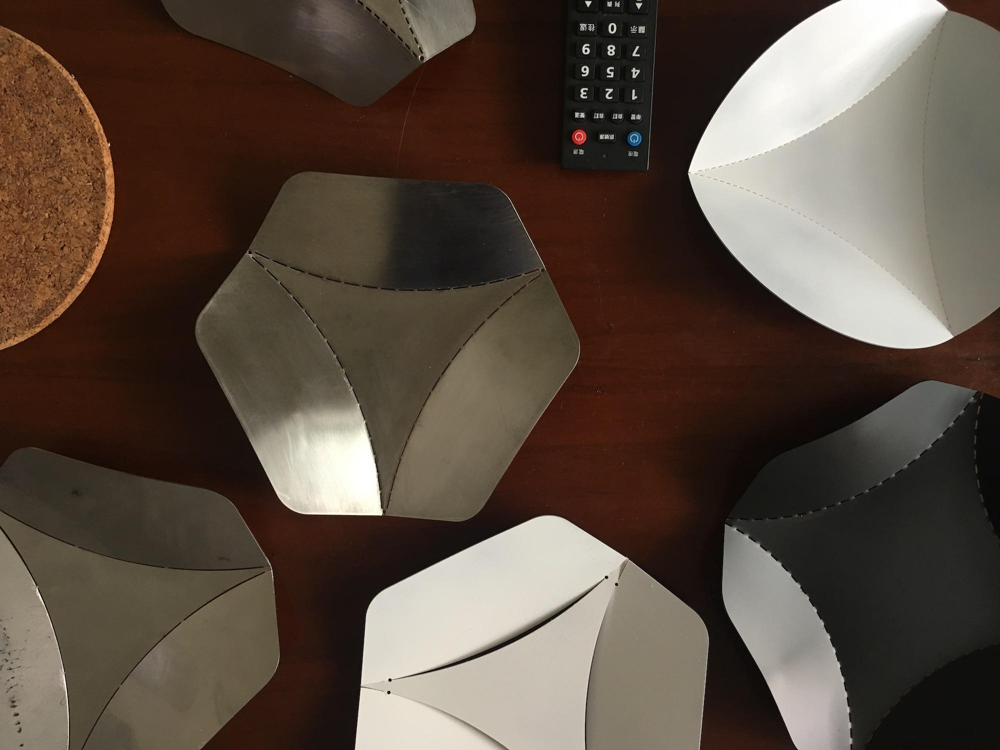
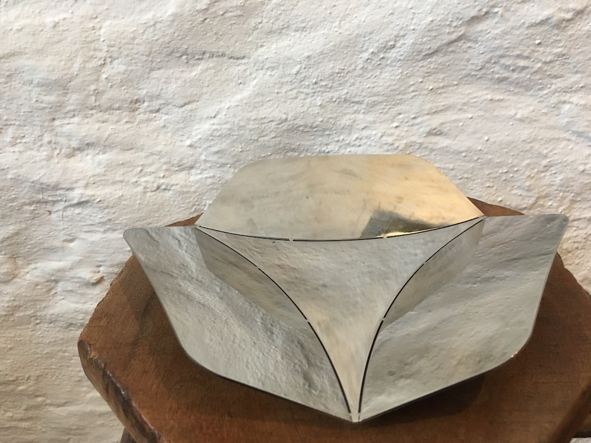
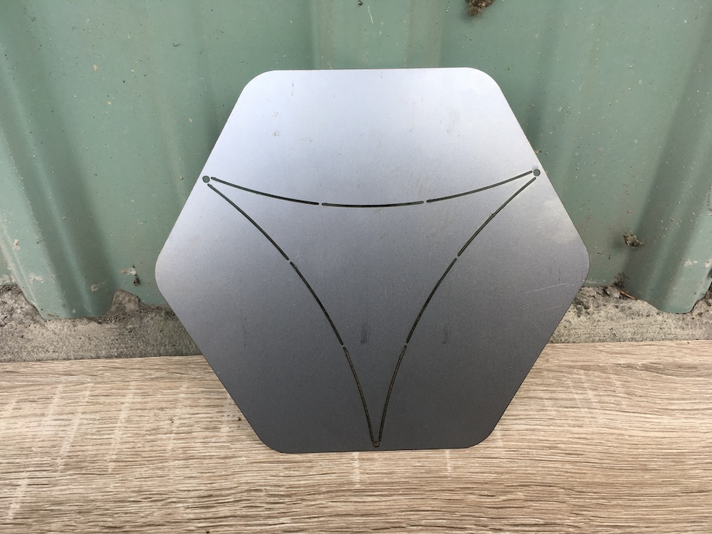
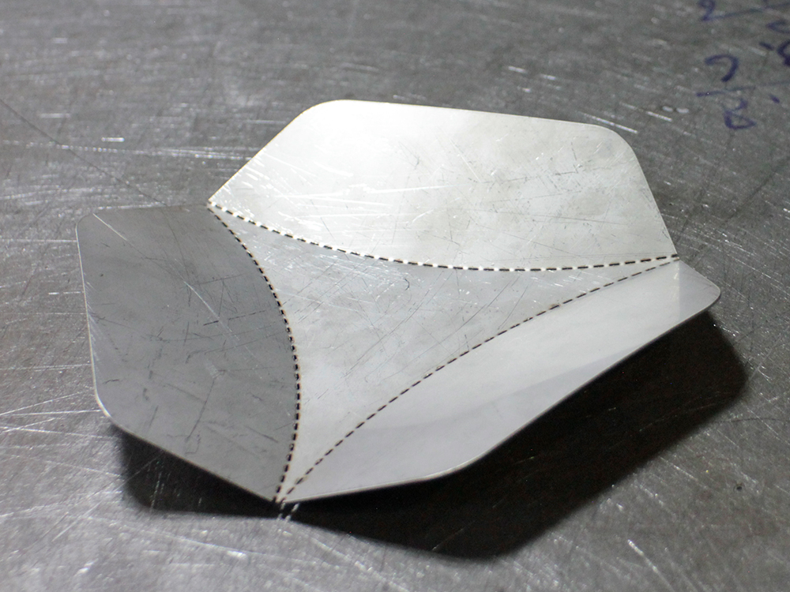

# Concept概念

  Tension

  張力成形

  
      Asterisk explores how the geometric principles of origami can be translated into sheet metal fabrication. By folding a flat metal sheet into a three-dimensional structure, the project investigates how the material's inherent tension and rigidity can contribute to both form and structural stability. The design was developed through digital modeling and physical prototyping, experimenting with folding angles, dimensions, and sheet thickness. Rather than relying entirely on additional structural components, Asterisk explores how the tension generated through folding can help the object maintain its shape.
  

  
    <u>Asterisk / 星盤</u>探索如何將摺紙的幾何原理應用於金屬鈑金，利用材料本身的彈性與張力，將平面板材轉化為穩定的立體結構。作品不使用焊接，而是透過金屬折彎後產生的張力，使各個部分相互支撐並維持造形。設計過程結合數位建模與實體打樣，反覆調整折彎角度、幾何尺寸與板材厚度，尋找材料張力與結構剛性之間的平衡。星盤藉由簡潔的構成方式，探索如何讓材料本身的物理特性參與造形生成，並在藝術表現與結構工程之間建立連結。
  

  

  

  

  

  

# Process製作過程

  Laser cutting

  雷射切割

  
      Asterisk was developed in collaboration with a Taiwanese OEM factory with 25 years of manufacturing experience, specializing in metal enclosures and structural components for industrial machinery. Working with the factory's existing techniques, including laser cutting, sheet metal bending, and welding, the project explores how industrial fabrication methods can be applied to experimental objects. The collaboration provided an opportunity to investigate the relationship between digital geometry, material behavior, and the practical constraints of sheet metal manufacturing.
  

  
    此系列與台灣一家擁有 25 年製造經驗的 OEM 工廠合作開發。工廠長期專注於機械設備的金屬外殼與結構製造，具備雷射切割、鈑金折彎及焊接等加工技術。作品運用雷射切割與鈑金折彎，將平面金屬板材加工成立體結構，無須透過焊接固定。透過與工廠的技術交流及反覆打樣，研究折彎角度、材料回彈與結構穩定性之間的關係，探索如何將既有的工業製程轉化為實驗性的造形方法。
  

  

  

Prototypes

實驗打樣

  

  

  

  

  

  

  

Further reading
延伸閱讀

            <a href="../Hopper/"><u>Hopper</u></a>
            - Pen holder made from folded sheet metal

