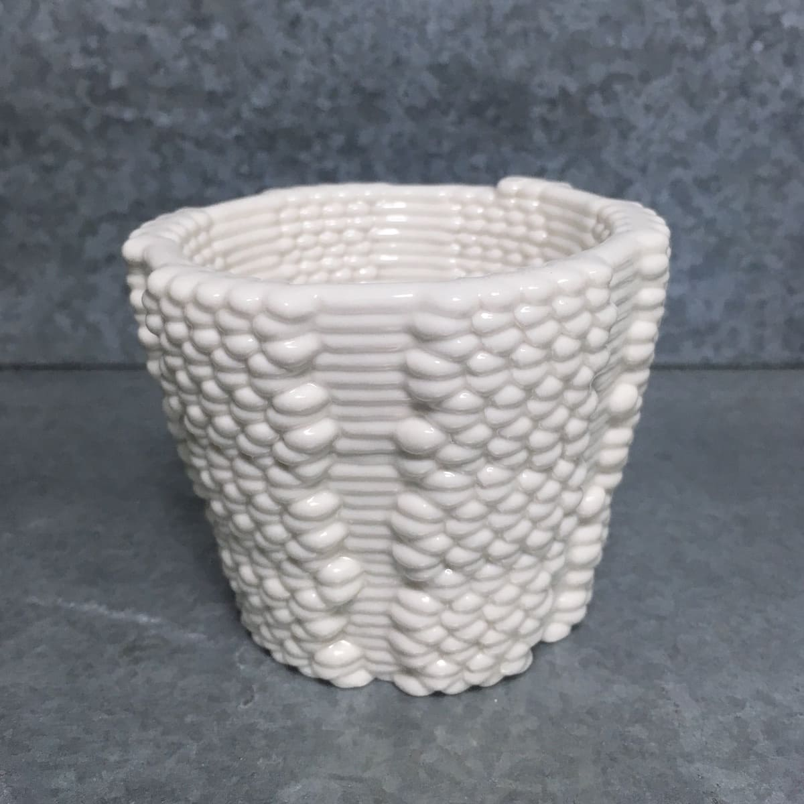
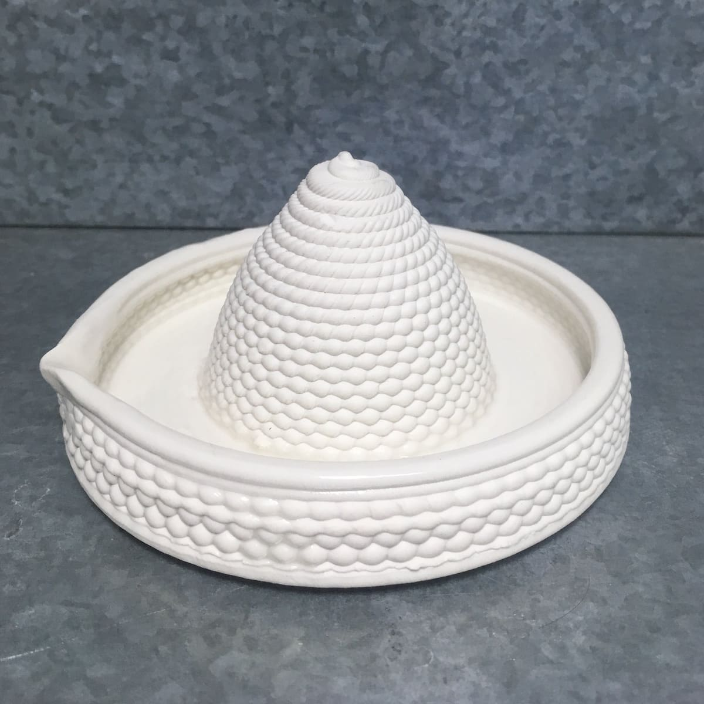
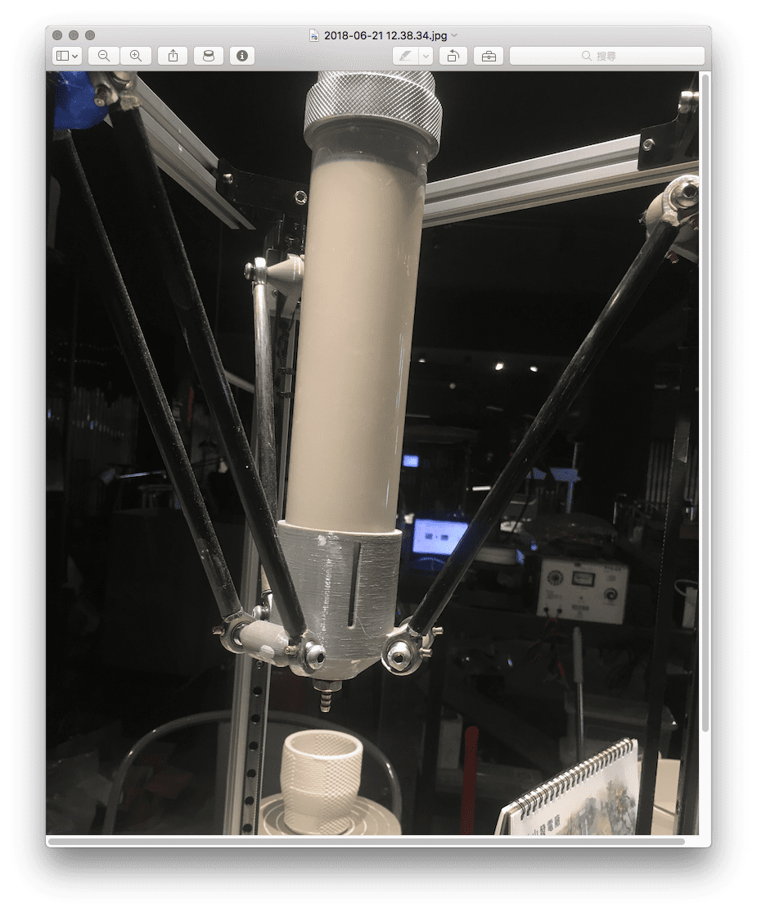
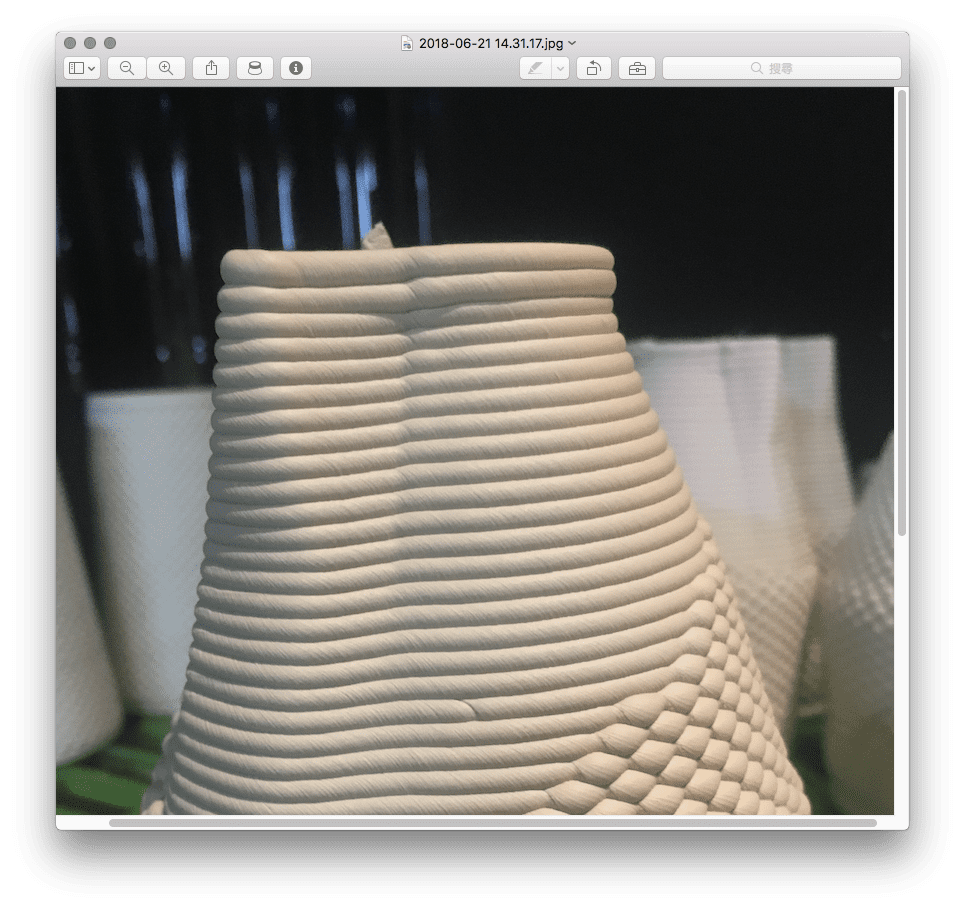
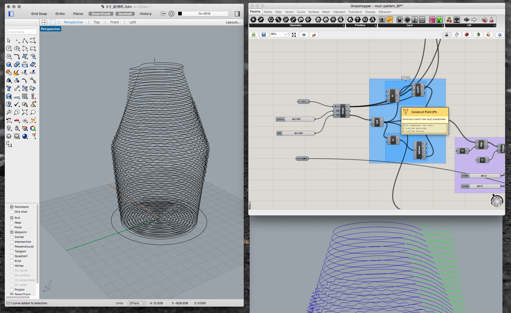
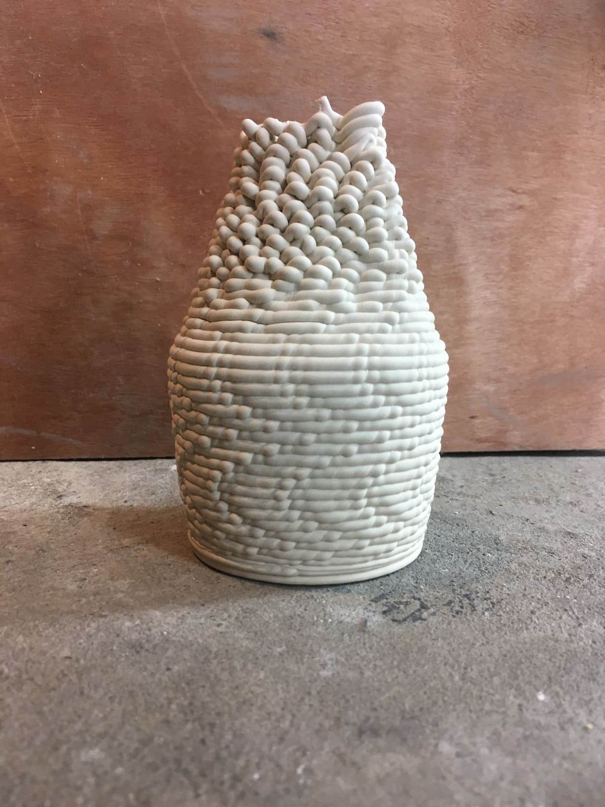
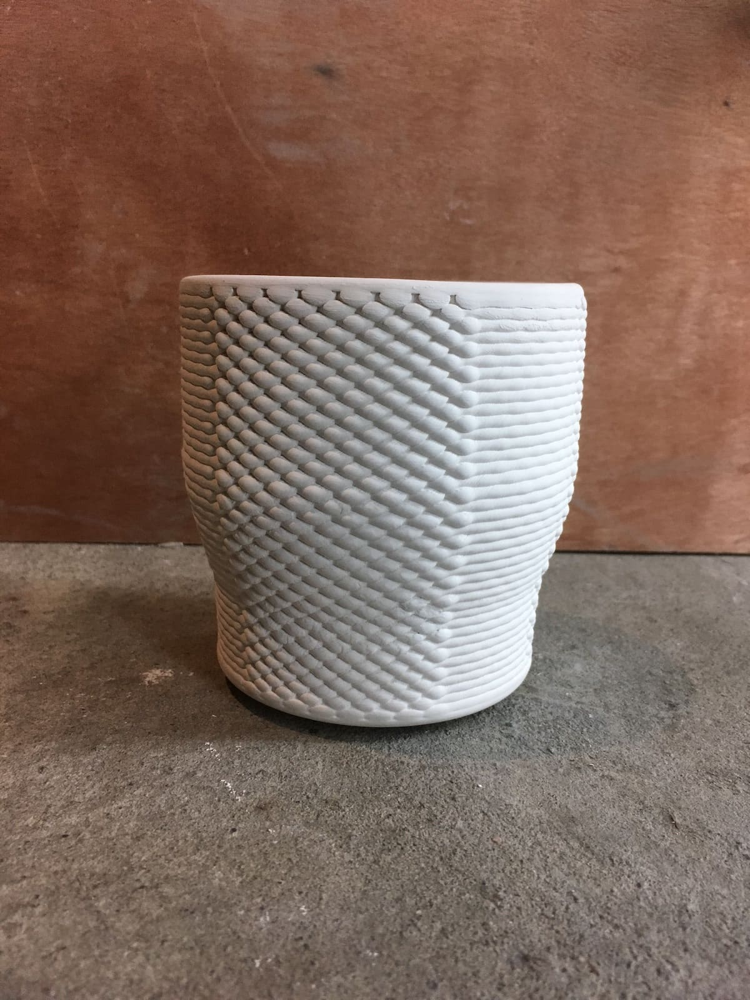
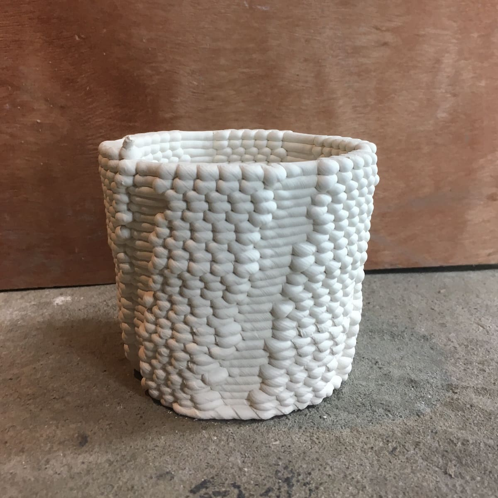
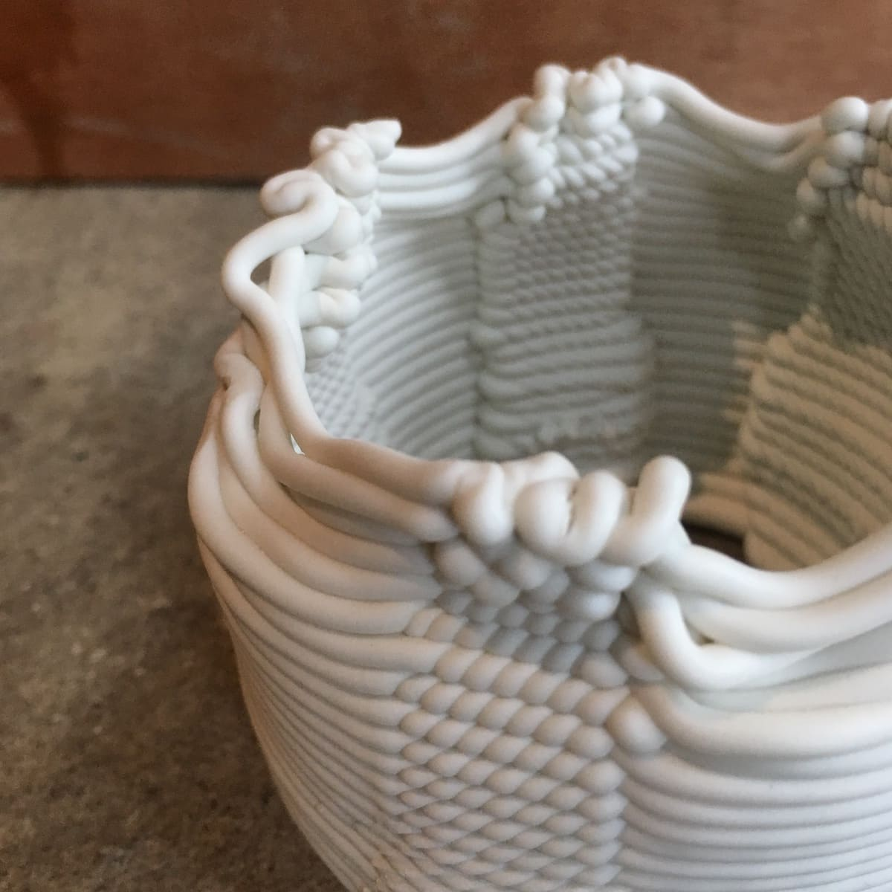

# Introduction概念簡介

  Digital craftsmanship

  數位工藝

  
    Commissioned by Binary Pottery, a studio specializing in ceramic 3D printing, this project builds on their years of research into the making process, from clay composition to extrusion machinery. They have also developed their own toolpaths to lay down clay coils in an interactive way, creating distinctive surface patterns while strengthening the structure of the objects.
  

  
    這項作品受專注於陶瓷 3D 列印的 Binary Pottery 委託開發。工作室多年來持續研究陶瓷列印的製作過程，從陶土配方比例到擠出設備的開發，逐步建立自己的製造方法。他們也發展出獨特的列印路徑，透過控制陶土泥條的堆疊方式，不僅在物件表面形成特殊的紋理，也能強化整體結構。
  

  

  

  

  

  

# Process發展過程

  3D ceramic printing

  陶瓷3D列印

  
      However, the self-built machine has certain limitations, particularly in terms of printing width. Based on these constraints, the design follows three specifications:  
      i. The width must be less than 18 cm, and the height must not exceed 25 cm. 
      ii. Allow for approximately 15–20% shrinkage after firing. 
      iii. Preserve or further develop the dot pattern.  
      They also hope to develop a tableware series based on these specifications. This is where Erco Lai began his design and research process.One advantage of this approach is that both prototypes and final products can be made using the same machine. On the other hand, the process requires generating G-code through Grasshopper. 
  

  
    然而，這台自製機器仍有一些限制，例如列印寬度的限制。因此，設計必須遵循幾項條件：寬度小於 18 公分，高度不超過 25 公分；同時考慮燒製後約 15–20% 的收縮率；並保留或進一步改善點狀紋理。Binary Pottery 也希望以這些規格為基礎發展一系列餐具，而這也成為開始進行設計與研究的切入點。這個專案的一項優勢，是可以使用同一台機器製作產品與原型。另一方面，則需要透過 Grasshopper 建立 G-code。憑藉過去數位製造的經驗，設計師能夠處理這個製程。然而，他也認為這樣的方式讓人看見了一種未來工廠與製造者的可能形式。
  

  

  

  

  

  

  

  

# Objects作品系列

  Binary jugs

Further reading 延伸閱讀

  

          <a href="Fieldstone"><u>Fieldstone</u></a>
          - The 3d-sand-printed table
  

