

# Introduction研究簡介

Faking Nature

師法自然

  
    Inspired by nature, this research explores alternative materials and manufacturing processes through geomimicry&mdash;the imitation of Earth's geological processes. By studying how natural forces shape and transform matter, it questions conventional manufacturing systems and considers the possibility of growing objects like Earth.
      
    The research began with an interest in geomorphology and the processes that continuously shape our surroundings: water dripping under gravity, rain gradually eroding and decomposing materials, evaporation driven by sunlight, and landscapes shaped by wind. Further investigation into minerals revealed other promising processes, including petrification, crystallization, and mineral accretion. By experimenting with these natural mechanisms, the research seeks to expand the possibilities of future material production.
  
  
    從自然界的運作方式汲取靈感，這項研究試圖透過模仿地球的地質作用（Geomimicry），探索材料與製造過程的其他可能性。與其依循既有的工業製造模式，是否能像地球一樣，透過物質的累積與轉化，讓物件逐漸「生長」出來？
      
    在研究地形地貌的過程中，重力造成的滴落、雨水的侵蝕與分解、陽光帶來的蒸發，以及風的塑形作用，都成為值得觀察的自然現象。進一步從礦物的角度來看，石化、結晶與礦物增積（Mineral Accretion）等過程，則提供了更具體的材料實驗方向。透過模擬這些自然作用，研究試圖拓展未來物件生產與材料製造的可能性。
  

  

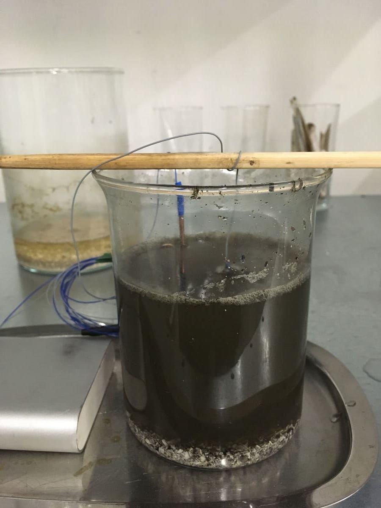

Electrolysis

  

  

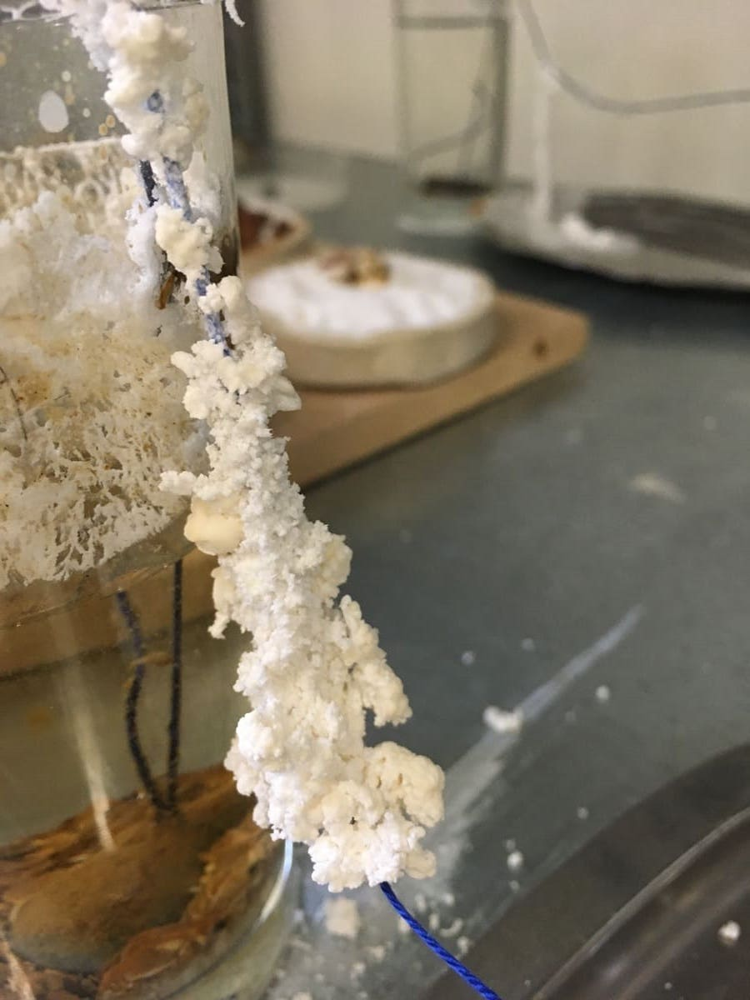

Crystallization

  

  

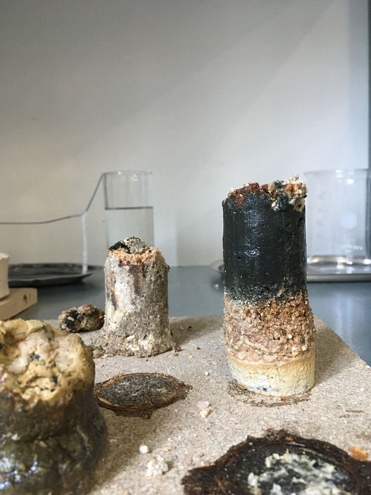

Sedimentation

  

# About研究背景

Electrolysis

電解作用

  
    Biorock is a technique developed by Wolf Hilbertz in 1979 that uses electrochemical mineral accretion to support the formation of artificial coral reefs. By applying a low electrical current to conductive structures such as steel submerged in seawater, dissolved minerals gradually accumulate on their surfaces, forming a solid mineral layer that can provide a foundation for coral growth.
      
    A related phenomenon can be found in everyday appliances: limescale, the hard mineral deposit commonly formed inside kettles, pipes, and boilers. Some water-heating systems also contain sacrificial anode rods, which help protect metal components from corrosion through electrochemical reactions.
      
    Although these processes serve different purposes and involve different mechanisms, they reveal how dissolved ions interact with surfaces under particular chemical and electrical conditions. In suitable environments, calcium and other mineral components can form hard, stone-like deposits. This observation became the starting point for investigating artificial mineral growth.
  
  
    Biorock 是一種利用電化學礦物增積（Electrochemical Accretion）促進人工珊瑚礁形成的技術，由 Wolf Hilbertz 於 1979 年發展。透過在海水中設置鋼材等導電結構並施加微弱電流，使海水中的礦物逐漸沉積於結構表面，形成堅固的礦物層，同時為珊瑚生長提供基礎結構與較有利的環境條件。
      
    另一個相似的現象則存在於日常生活中：熱水壺、水管與鍋爐內壁經常出現的水垢。這些堅硬的沉積物來自水中的礦物質，而部分熱水設備也會使用犧牲陽極棒（Sacrificial Anode）來減緩金屬腐蝕。
      
    雖然兩者的應用目的不同，但都涉及水中離子與金屬表面之間的電化學作用。在適當條件下，鈣離子等礦物成分可以逐漸形成堅硬、近似石材的沉積物。這個現象成為研究人工礦物生長的起點。
  

  

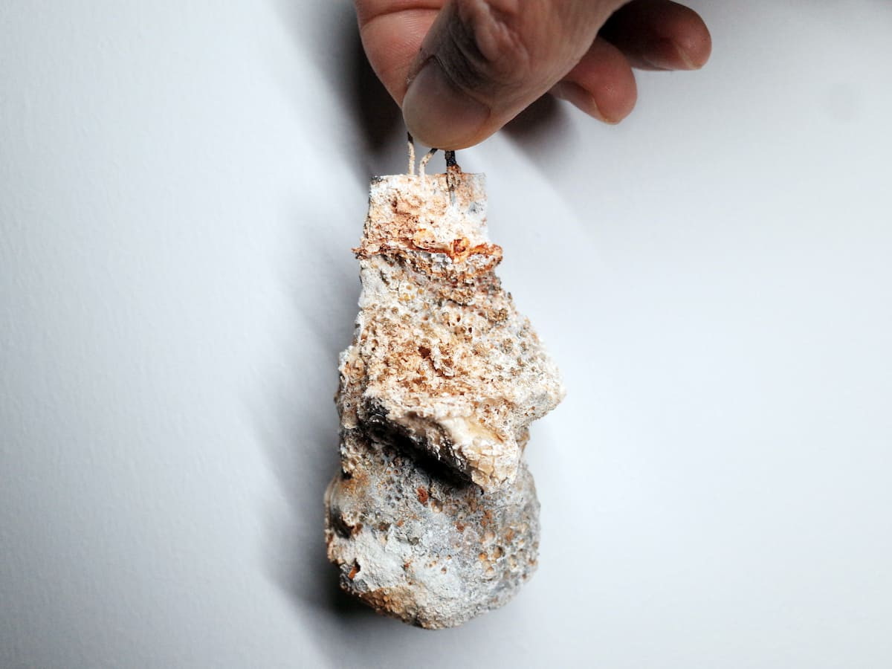

  

# Process過程

Setting Up

實驗建置

  
    The experiment began by reproducing the Biorock process in a simplified setting. Seawater was collected from Zuiderstrand in The Hague, the Netherlands. A glass cup served as the electrolysis container, while two 1.5V batteries connected in series provided the power supply.
      
    The initial result was extremely subtle and difficult to observe with the naked eye. Nevertheless, small traces of deposition suggested that the experimental setup was producing an effect.
      
    The experiment also revealed the limitations of working with a small volume of seawater. Unlike the ocean, where dissolved minerals are continuously replenished through water movement, a single cup contains a finite supply of available minerals.
      
    To increase mineral deposition within this limited environment, additional ingredients would be required. Since coral reefs primarily rely on calcium-based minerals for growth, possible sources included seashells, limestone, or calcium supplements. These became potential directions for further experimentation.
  
  
    研究從簡化 Biorock 的形成條件開始。首先，在荷蘭海牙的 Zuiderstrand 海灘採集海水，接著以玻璃杯作為電解容器，並將兩顆 1.5V 電池串聯，提供實驗所需的電力。
      
    最初的實驗成果十分微弱，幾乎難以用肉眼辨識，但仍可觀察到細微的礦物沉積跡象，顯示這套簡易裝置具有一定的作用。
      
    實驗也揭示了容器尺度所帶來的限制。相較於珊瑚礁生長的海洋環境，一杯海水所包含的礦物質總量十分有限，無法像開放的海洋系統一樣持續獲得物質補充。
      
    因此，若要在有限的海水體積中增加礦物沉積量，就需要額外提供可參與反應的成分。由於珊瑚礁的形成主要仰賴海水中的鈣質，研究開始考慮加入貝殼、石灰岩或含鈣補充劑等材料，作為後續實驗的可能方向。
  

  

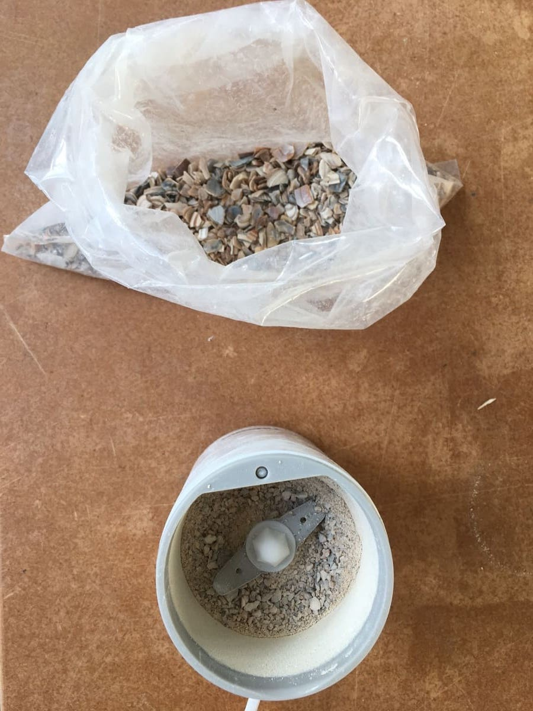

Preparation

  

  

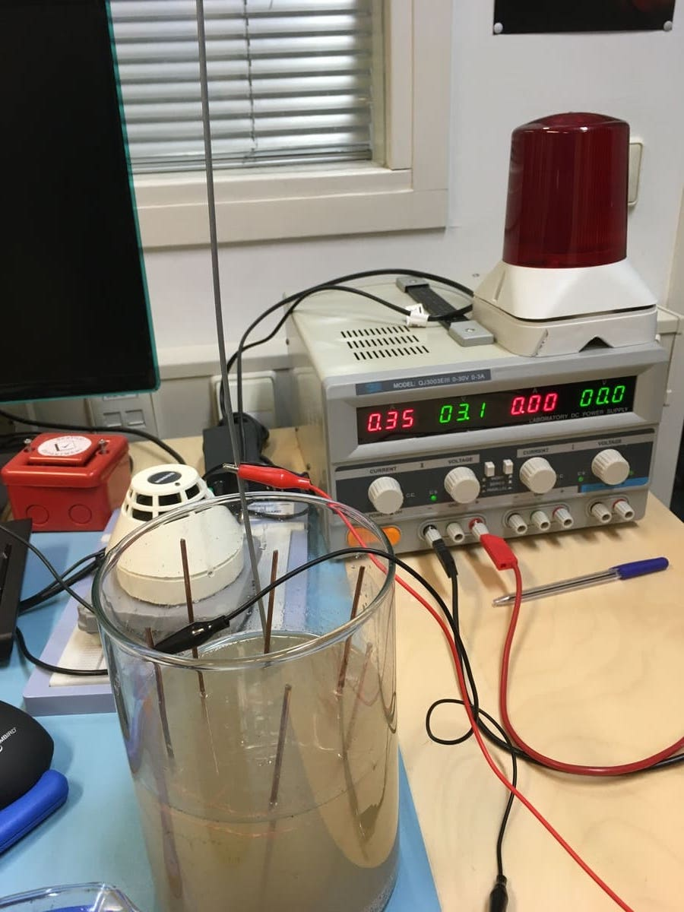

DC power supply

  

  

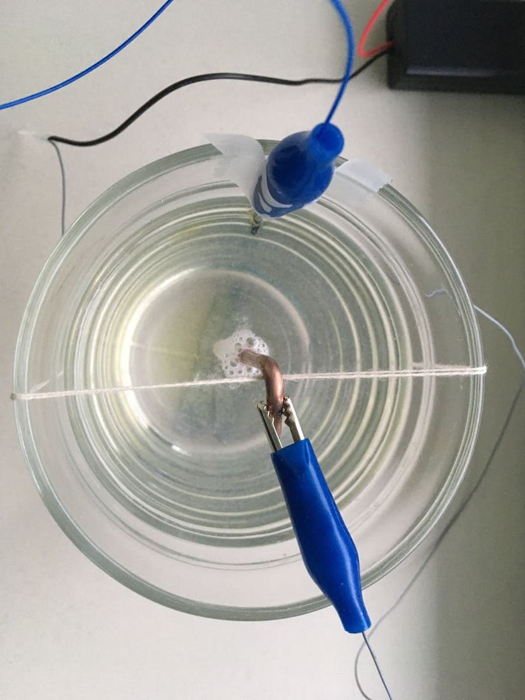

Sea water

  

# Reflection實驗反思

Electroforming

電鑄成形

  
    In industrial manufacturing, one of the main distinctions between electroplating and electroforming concerns whether the deposited material remains attached to the cathode or is separated from its original substrate.
      
    However, this research proposes another way of understanding these processes from the perspective of form-making: through the thickness and development of the deposited layer.
      
    In this interpretation, electroplating produces a relatively thin and even mineral coating that largely follows the shape of an existing object. Electroforming, by contrast, allows a thicker layer to accumulate, gradually extending beyond the original surface and developing into a new form.
      
    An intriguing aspect of this process is how the strength and distribution of the electric field may influence the shape of mineral accretion. From this perspective, the resulting mineral formation can be understood as a physical record of the electric field&mdash;as if the invisible field had been frozen into a tangible form.
      
    This observation raises a further question: if a computer could simulate the electric field generated by an object's geometry and power supply, could it also help predict the resulting mineral formation? At a later stage, controlling the distribution of the electric field might offer a way to influence the direction and shape of mineral growth.
  
  
    在工業製程中，電鍍（Electroplating）與電鑄（Electroforming）的主要區別之一，在於沉積形成的材料是否需要與原本的陰極基底分離。
      
    然而，這項研究試圖從造形生成的角度，重新理解兩者的差異：電鍍是在既有物件表面形成一層薄而相對均勻的礦物沉積，塗層大致延續原有物件的形狀；電鑄則是讓沉積層持續增厚，使礦物逐漸超越原本的表面輪廓，形成新的造形。
      
    實驗中一個值得關注的現象是，電場強度與分布可能影響礦物沉積的形態。從這個角度來看，電鑄形成的礦物結構，可以被想像成物件周圍電場的一種「凝固」紀錄。
      
    這也引出下一階段的研究假設：如果能透過電腦模擬物件形狀與供電條件所形成的電場，是否就有機會預測礦物增積的形態？進一步而言，若能控制電場的分布，或許也能間接控制礦物生長的方向與最終造形。
  

  

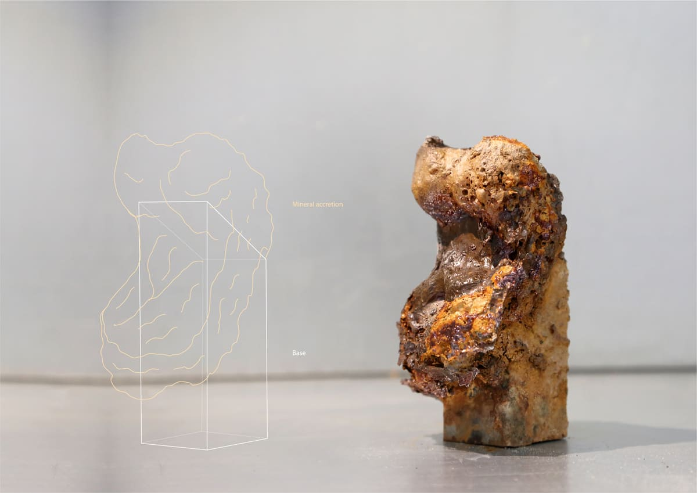

  

  

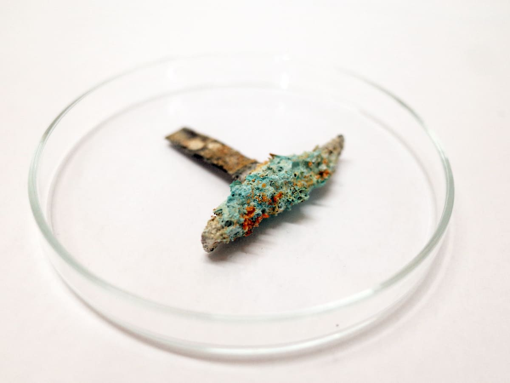

  

  

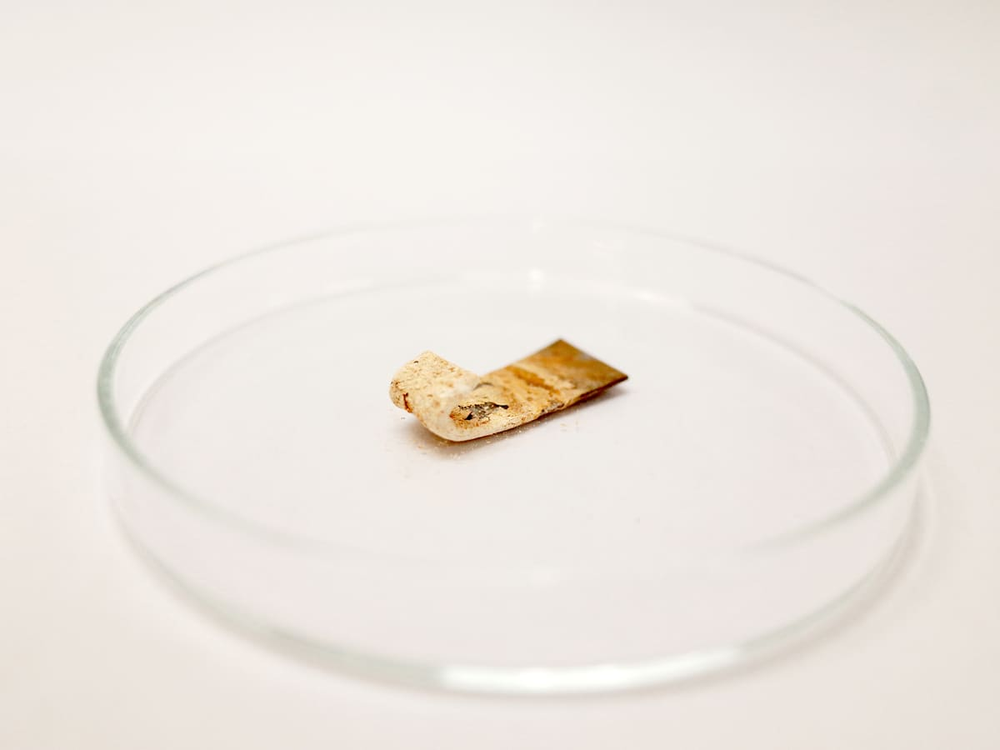

  

  

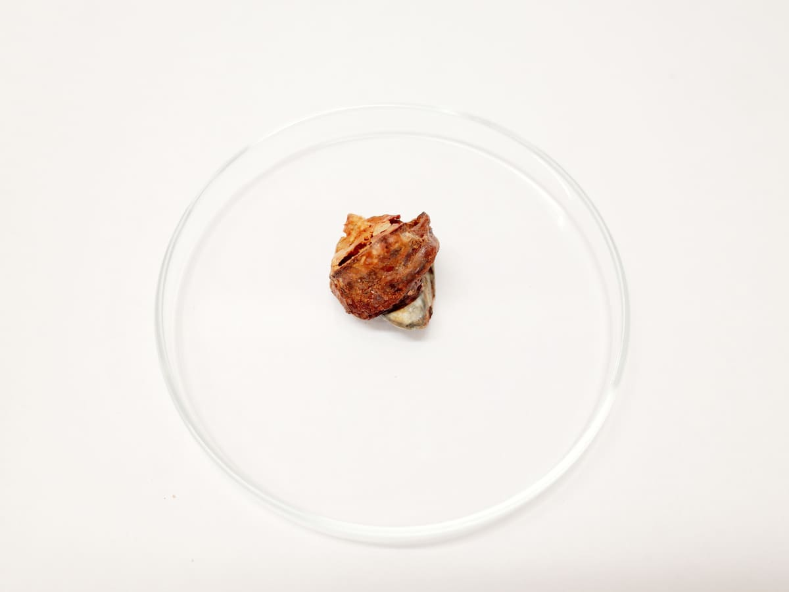

  

  

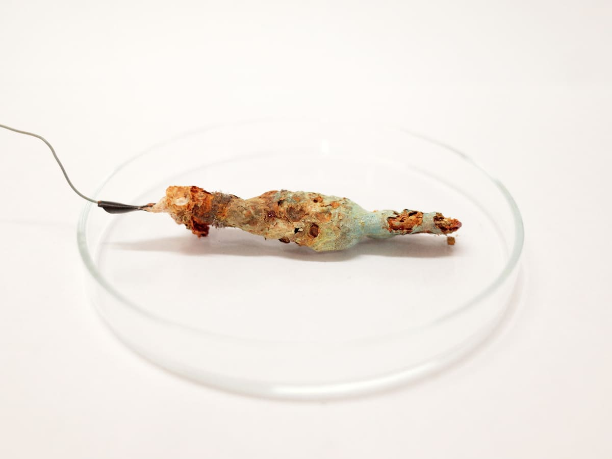

  

# Speculation假想

Island Making

造島計畫

  
    Following the initial electroplating and electroforming experiments, the research proposes a two-phase approach to working with Earth.
      
    Phase I involves observing geological processes and reproducing them as practical experiments within simplified, controlled environments.
      
    Phase II explores the connections between geological processes and human manufacturing, considering how Earth's natural systems might become active participants in production.
      
    In the context of this experiment, Phase I could involve establishing a small electrochemical deposition factory in an urban environment, reproducing natural mineral formation through artificial means. Phase II could relocate this manufacturing process to the ocean, where seawater and environmental conditions would contribute directly to the growth of objects.
      
    This proposal introduces the idea of <em>outsourcing to nature</em>. Rather than treating Earth merely as a source of raw materials, it imagines Earth as a partner in the manufacturing process.
  
  
    經過電鍍與電鑄的初步實驗，研究提出一個與地球共同製造的兩階段構想。
      
    第一階段是觀察地質作用，並在簡化、可控制的環境中重現這些過程，將自然現象轉化為可實際操作的材料實驗。
      
    第二階段則是尋找地質作用與人類製造活動之間的連結，進一步思考如何讓地球本身參與物件的生產。
      
    以這項研究為例，第一階段可以是在城市中建立一座小型電化學沉積工廠，透過人工設備模擬自然界的礦物形成；第二階段則是將製造過程移至海洋環境，利用海水中的礦物資源與自然條件，讓物件在環境中逐漸生長。
      
    這是一種將製造過程「外包給自然」（Outsourcing to Nature）的想像：不再只是從地球提取原料，而是將地球視為參與製造的合作夥伴。
  

  

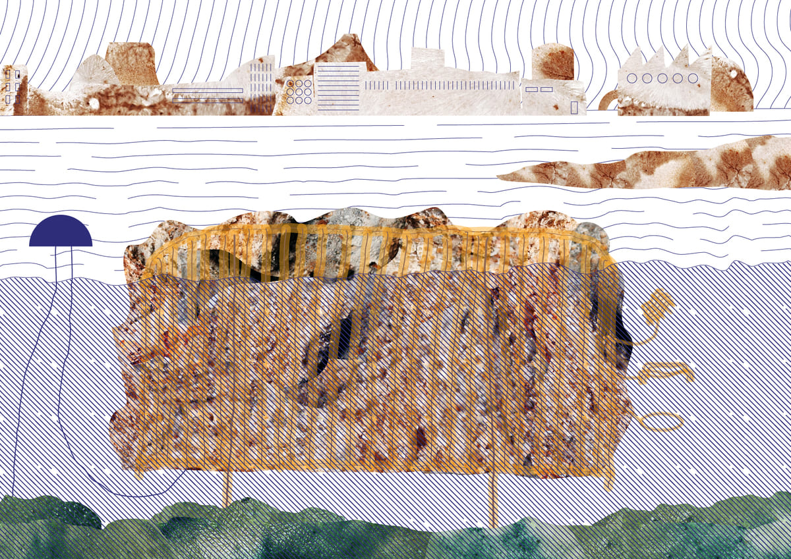

  

# Speculation假想

Neo Scholar&#x27;s Stones

新怪石供

  
    Today's metal hardware could become tomorrow's sculpture.
      
    Traditional scholar's stones are naturally formed rocks appreciated for their distinctive shapes, cavities, and textures. Through their sculptural qualities, they have long served as symbolic connections between humans and the natural world.
      
    Building on this tradition, the research imagines what might happen when industrial metal hardware&mdash;the standardized components of contemporary manufacturing&mdash;becomes part of a mineral-growing process.
      
    Screws, joints, and other manufactured components could gradually accumulate mineral deposits, allowing their precise industrial geometries to interact with irregular natural formations. The resulting hybrid objects would exist somewhere between manufactured products and naturally grown structures.
      
    Neo Scholar's Stones proposes a different relationship between industrial production and geological processes, where objects are no longer shaped entirely by human intention but emerge through the interaction of manufactured structures and mineral growth. It offers a speculative image of a manufacturing system in which objects grow like minerals.
  
  
    今日的金屬五金，可能成為明日的雕塑。
      
    傳統文人石以天然石材的特殊形態作為欣賞對象，透過長時間的自然作用形成獨特的孔洞、紋理與輪廓，成為人與自然之間的象徵性連結。
      
    延續這個概念，研究試圖重新想像工業五金的角色。螺絲、接頭與其他標準化金屬零件，原本是現代工業製造系統的基本元素；如果讓這些物件參與礦物增積的過程，會形成什麼樣的新形態？
      
    當規格化的金屬零件逐漸被礦物包覆，原本精確的人造輪廓便可能與不規則的自然沉積相互交織，形成介於工業製品與自然生成物之間的混合物件。
      
    「新怪石供」藉此提出另一種製造想像：物件不再完全由人類預先決定形狀，而是透過工業結構與礦物生長共同形成，作為下一階段製造系統的可能象徵。
  

  

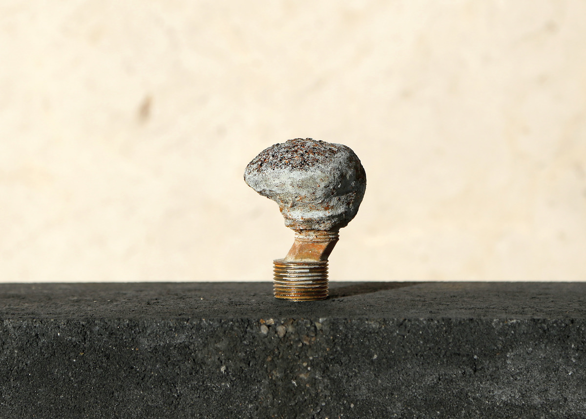

  

# Exhibition展覽紀錄

Design Research, KABK

Design Research, KABK

  

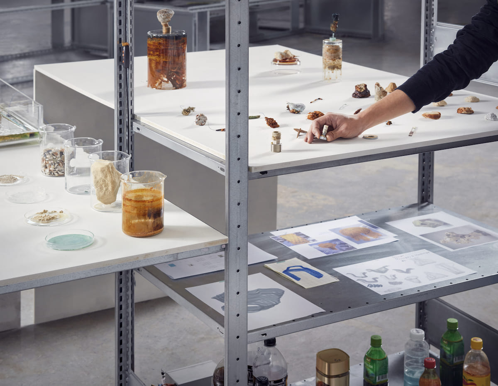

  

  

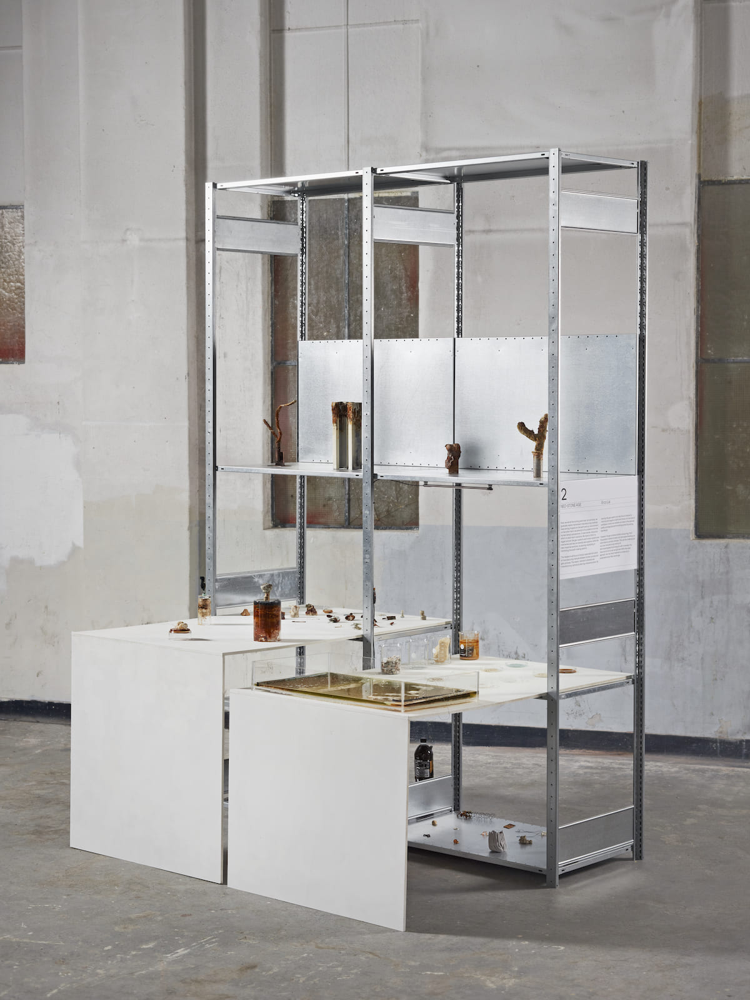

  

Further reading延伸閱讀

  <a href="https://drive.google.com/file/d/1-4K-WnUOZ2rArZj6l3nOkwsP3IA3l2TL/view?usp=share_link"><u>Research document</u></a> - Full document of the project 
  <a href="https://www.behance.net/gallery/112357807/Crystallization-mineral-Formation-1"><u>Mineral formation#1 - Crystallization</u></a> - Prestudy of crystallization 
  <a href="https://www.behance.net/gallery/112365655/Accretion-Mineral-Formation-2"><u>Mineral formation#2 - Accretion</u></a> - More about electrolysis 
  <a href="../Neo-Stone-Age"><u>Neo Stone Age</u></a> - The next chapter of the design research 

  <a href="https://drive.google.com/file/d/1-4K-WnUOZ2rArZj6l3nOkwsP3IA3l2TL/view?usp=share_link"><u>Research document</u></a> - Full document of the project 
  <a href="https://www.behance.net/gallery/112357807/Crystallization-mineral-Formation-1"><u>Mineral formation#1 - Crystallization</u></a> - Prestudy of crystallization 
  <a href="https://www.behance.net/gallery/112365655/Accretion-Mineral-Formation-2"><u>Mineral formation#2 - Accretion</u></a> - More about electrolysis 
  <a href="../Neo-Stone-Age"><u>Neo Stone Age</u></a> - The next chapter of the design research 

