

# Concept概念簡述

Geometry of Leaves

葉片幾何

  
    Ginkgo is a wooden chair inspired by the fan-shaped form of ginkgo leaves. Its quarter-circle seat translates the gentle curves of the leaf into a simple geometric design, combining botanical inspiration with everyday functionality.The compact seat allows the chair to fit into corners and adapt to different spatial arrangements. Through its minimal form, Ginkgo explores how a familiar natural shape can become part of a functional piece of furniture.
  
  
    <u>Ginkgo / 銀杏椅</u> 的設計靈感來自銀杏葉扇形展開的輪廓，將葉片柔和的曲線轉化為近乎四分之一圓的座面，以簡潔的幾何形式結合自然形態與家具功能。四分之一圓的座面使椅子能貼合室內角落，也能因應不同的空間配置。作品透過精簡的造形，探索自然形態如何轉化為日常使用的家具。
  

  

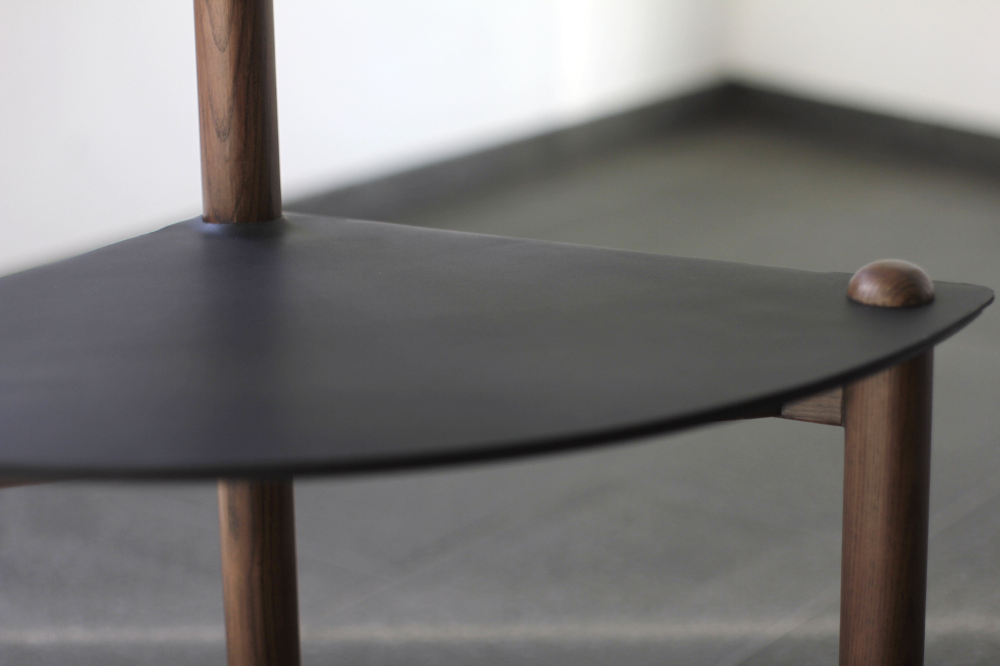

  

  

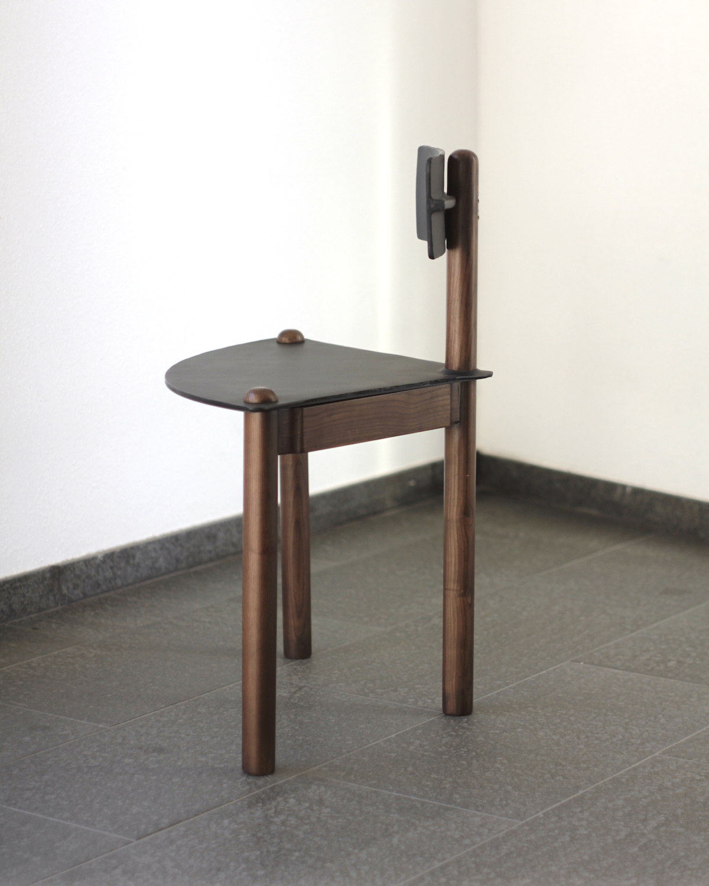

  

  

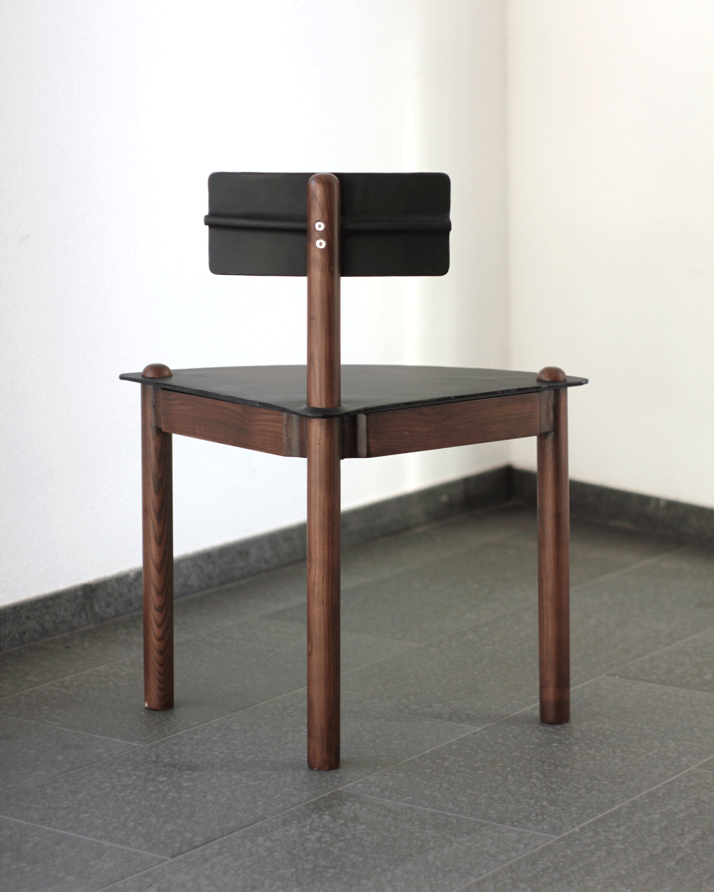

  

  

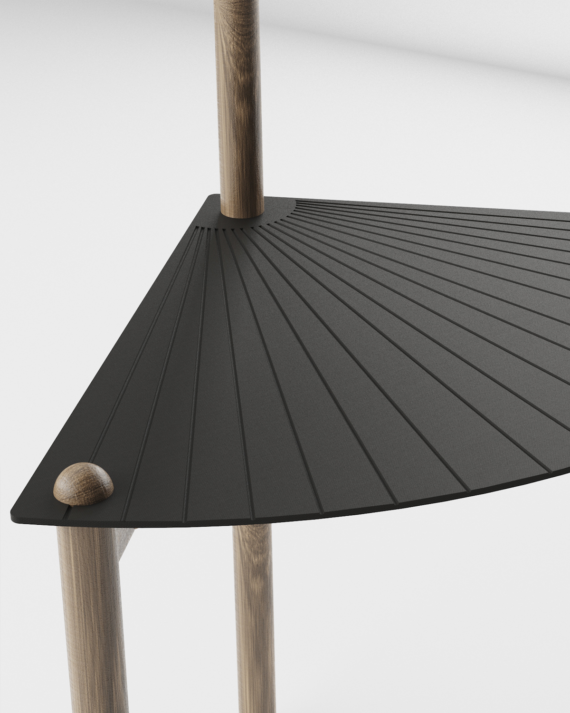

  

  

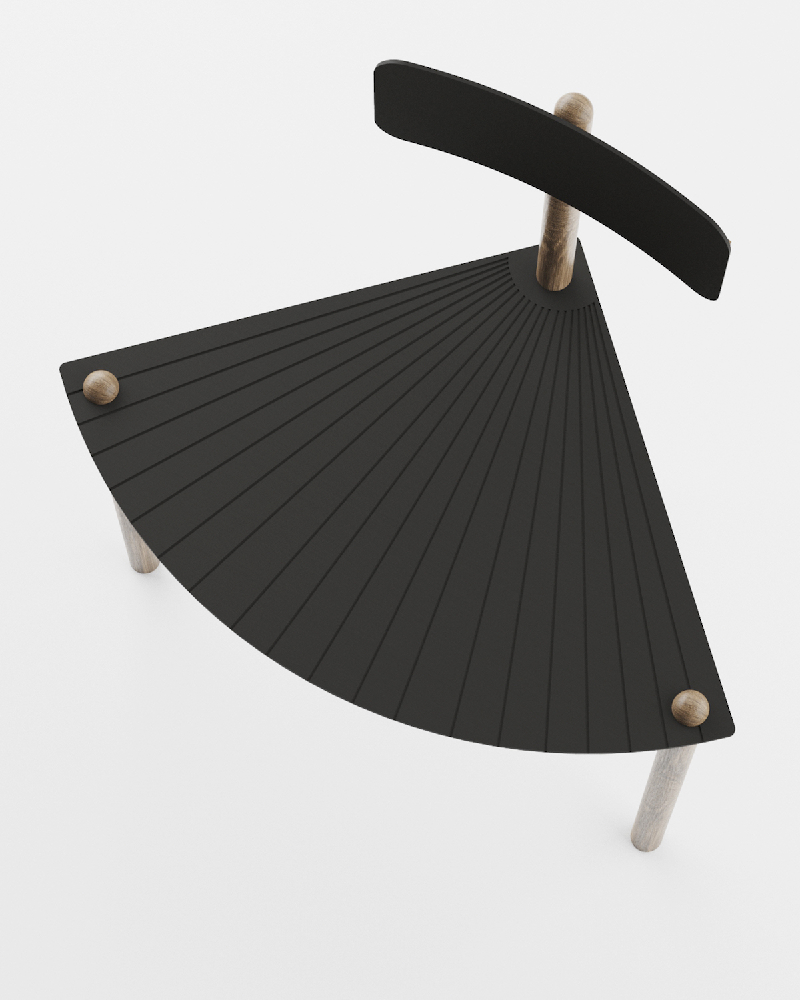

  

# Process發展過程

Wood Craftsmanship

木作工藝

  
    Ginkgo is made from wood, with its curved seat carefully shaped and assembled into a simple geometric structure. The design focuses on preserving the clarity of the leaf-inspired silhouette while allowing the natural grain and texture of the wood to remain visible. Through woodworking and precise geometric construction, the chair brings together natural forms and practical furniture-making.
  
  
    銀杏椅以木材製作，透過曲面座板的加工與組裝，形成簡潔的幾何結構。設計著重於呈現銀杏葉啟發的座面輪廓，同時保留木材原有的紋理與質感。透過木作工藝與精確的幾何構成，將自然造形轉化為兼具實用性與材料特色的家具。
  

  

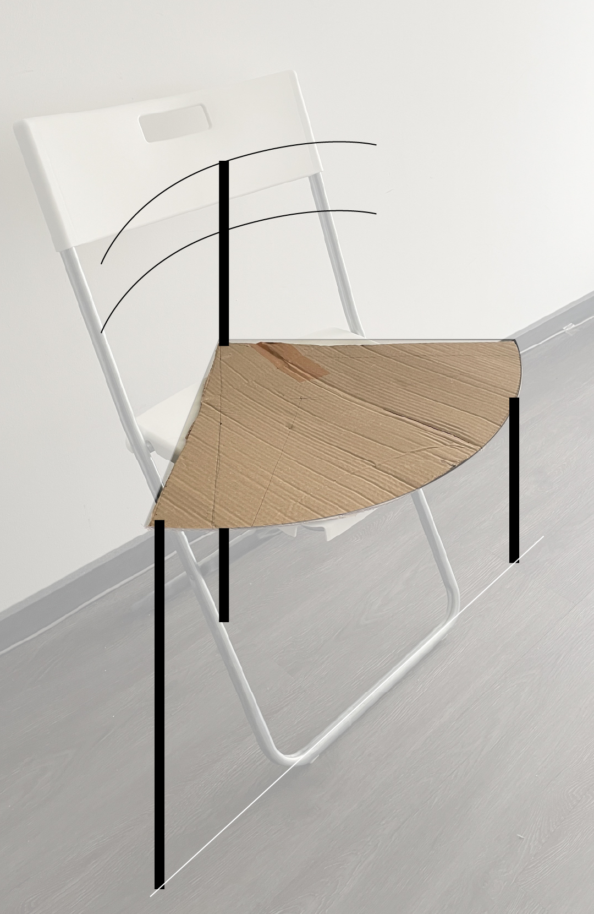

  

  

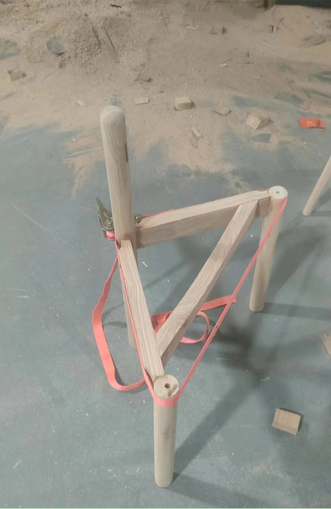

  

  

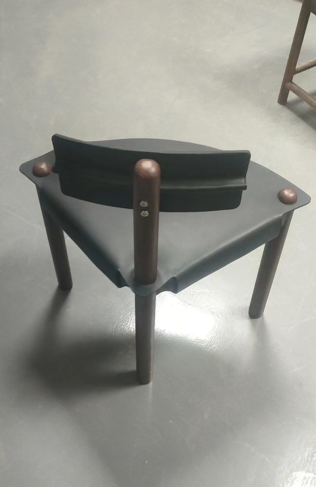

  

# Special edition鋁製版本

Exhibition Exclusive

展覽限定

  
    The exhibition-exclusive edition reinterprets Ginkgo entirely in aluminum, replacing the original wooden construction with a metal structure while retaining its distinctive quarter-circle seat. The change in material gives the chair a different visual and tactile character, highlighting the contrast between the organic inspiration of its form and the industrial nature of aluminum. This edition extends the exploration of Ginkgo through contemporary metal fabrication.
  
  
    展覽限定版本將銀杏椅重新以全鋁材製作，取代原有的木製結構，同時保留具有辨識度的四分之一圓座面。材料的轉換使作品呈現不同的視覺與觸覺特性，凸顯自然造形與工業金屬之間的對比。這個版本透過當代金屬加工技術，進一步探索銀杏椅在不同材料中的造形表現。
  

  

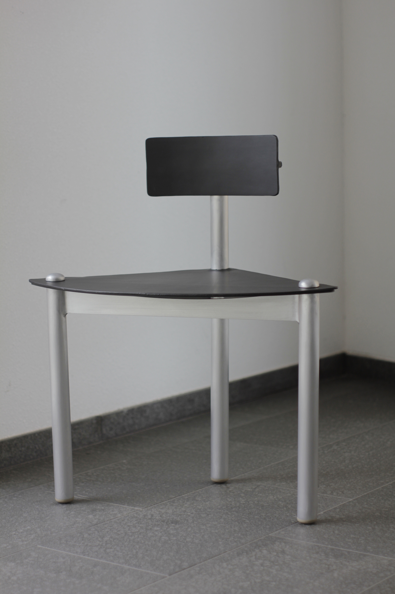

  

 

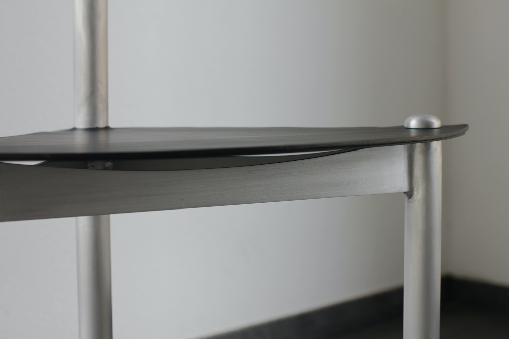

  

  

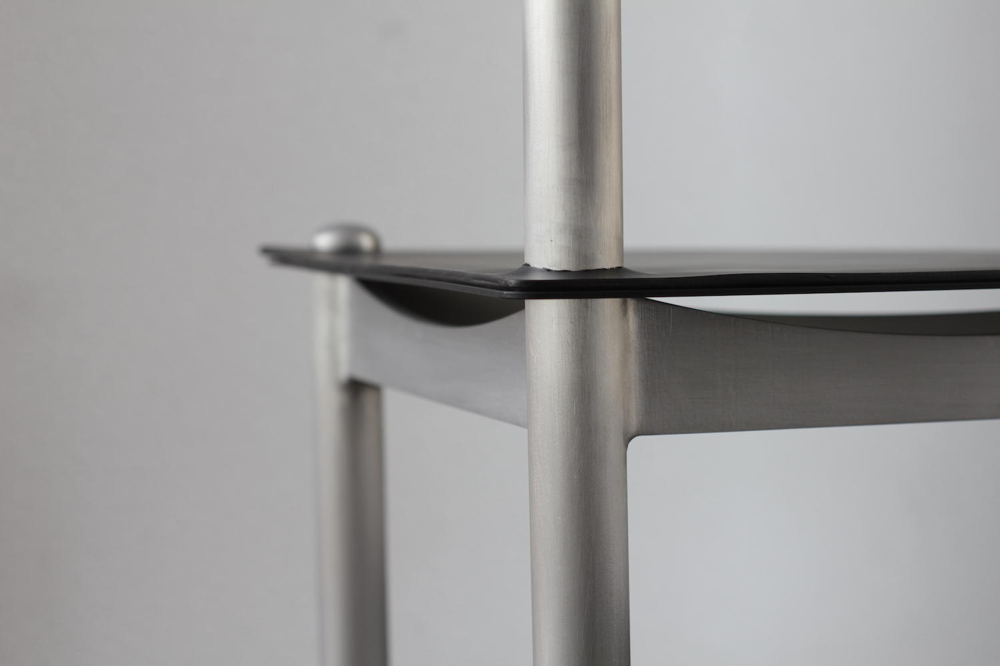

  

  

Further reading延伸閱讀

  <a href="../Waterfall/"><u>Waterfall</u></a> - Aluminum shelf inspired by flowing water 
  <a href="../Rift/"><u>Rift</u></a> - Aluminum space divider juxtaposing  industrial geometry with stones 

