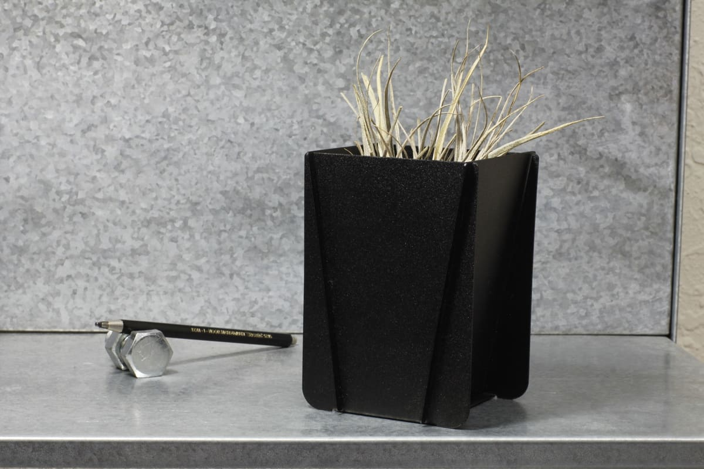
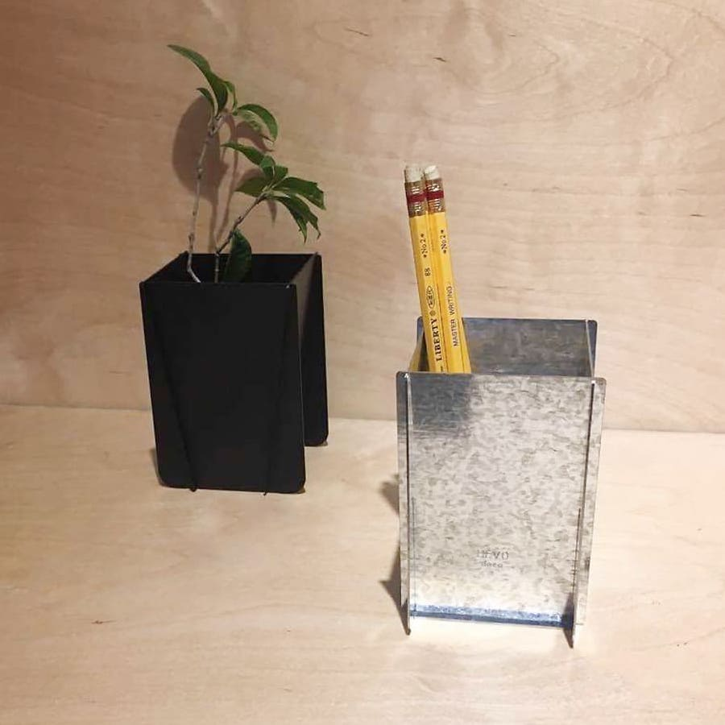
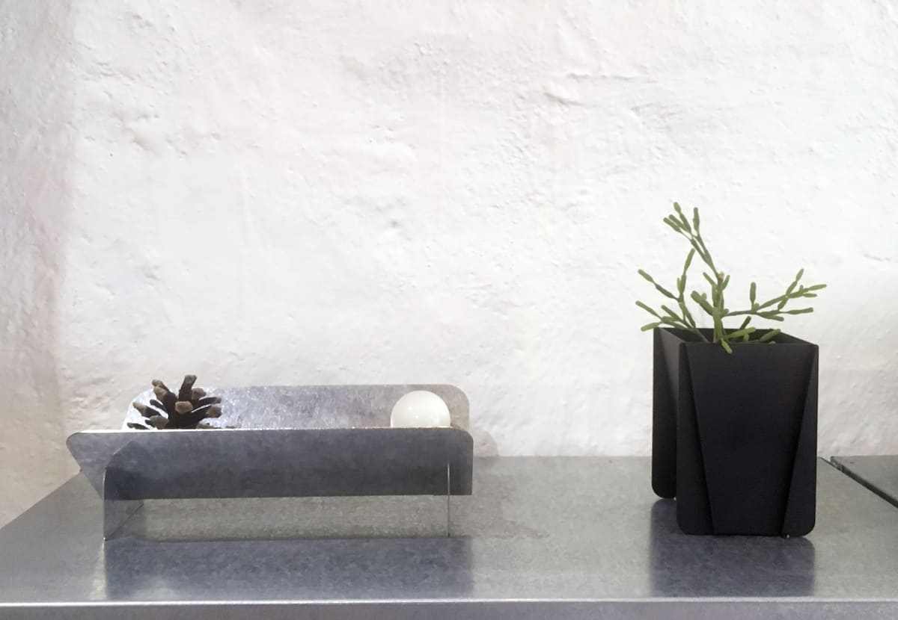
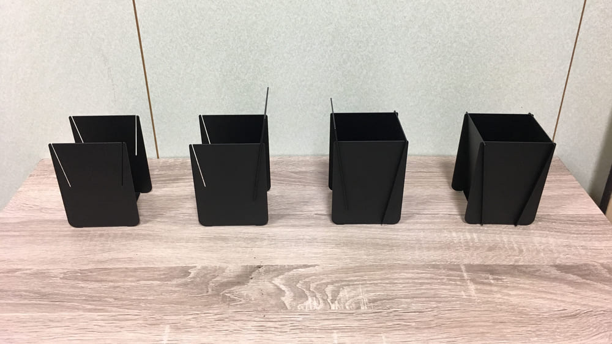
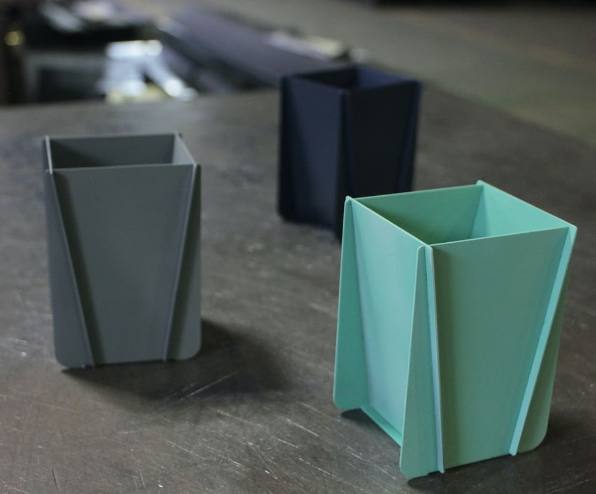
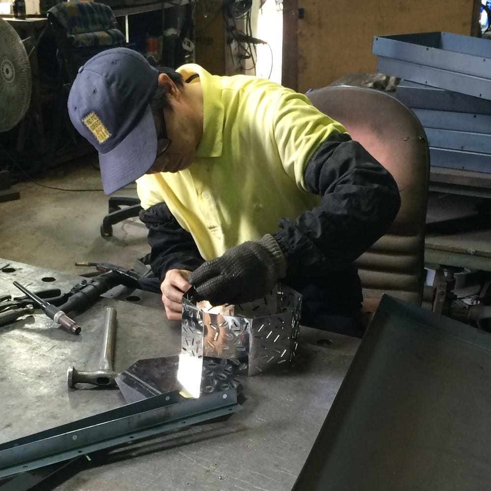
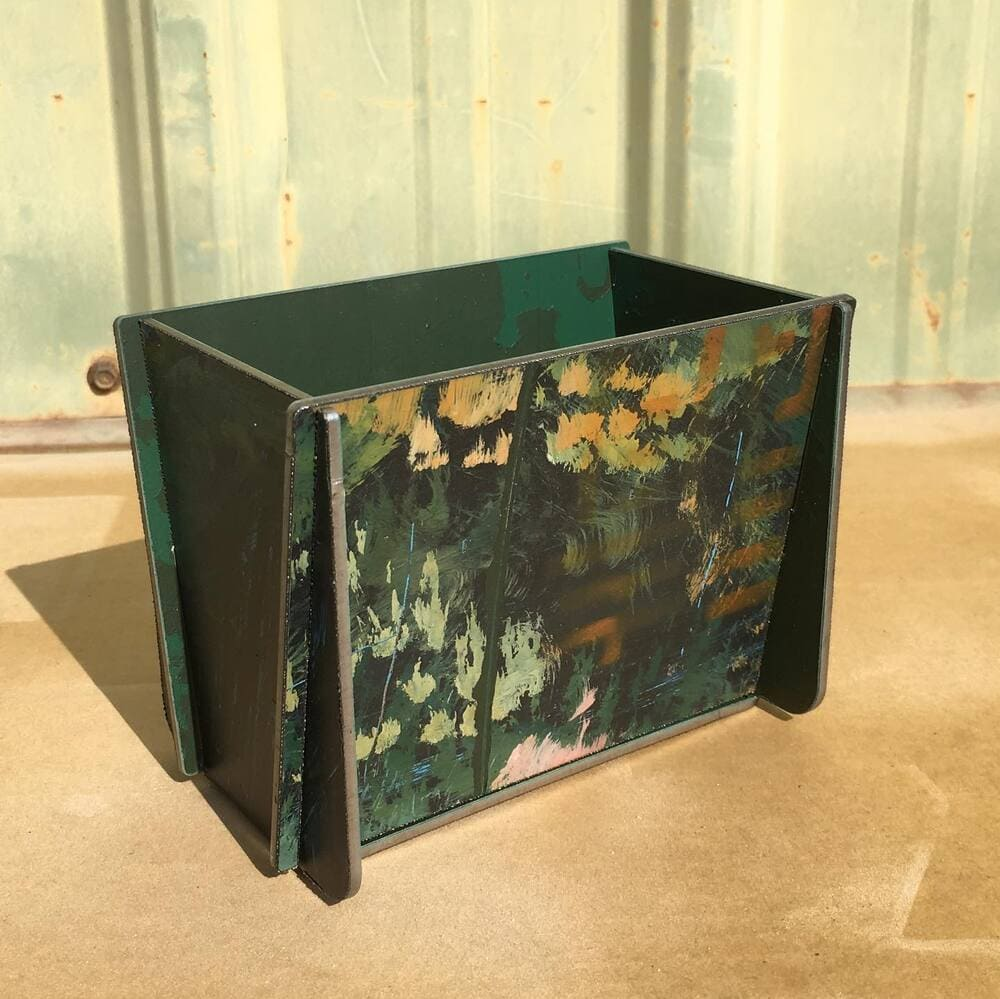
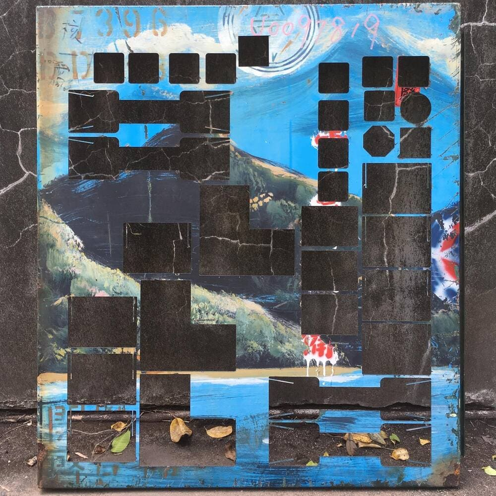
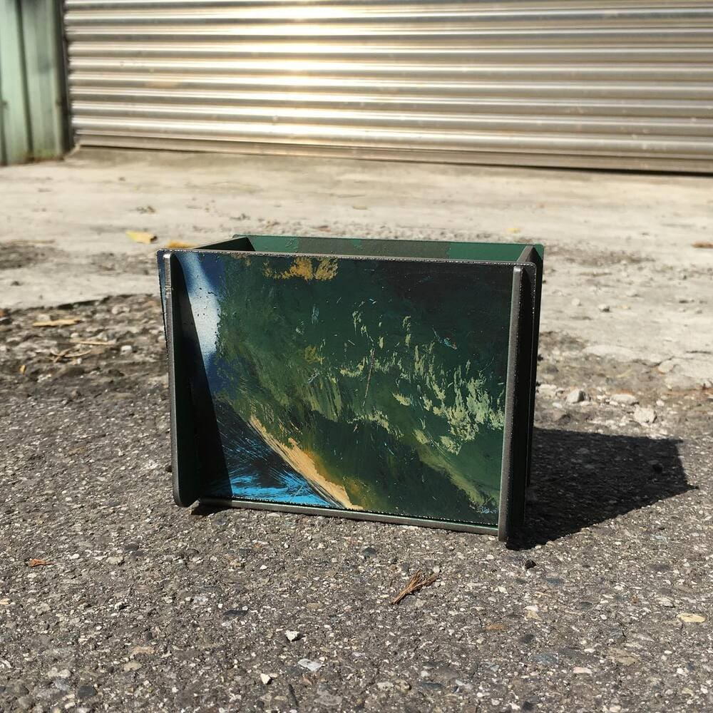

# Concept概念

  Industrial Geometry

  工業幾何

  
    This is a project that works with a 25-year-old OEM factory in Taiwan. This local factory fabricates the machine's shell and structure for living. The concept is based on what they have already been doing and uses the material they are familiar with. It was inspired by large material dispensers. The hopper has an ergonomic slanted design, which makes reaching for a pen effortless.
  

  
      這項作品與台灣一家擁有 25 年製造經驗的 OEM 工廠合作開發。工廠長期專注於機械設備的外殼與結構製造，這次則將既有的加工技術與材料應用延伸至日常用品。<u>Hopper / 料斗筆筒</u>的設計靈感來自工業料斗，將原本用於引導物料集中流動的傾斜結構，轉化為方便拿取筆具的造形。作品以工廠熟悉的材料與製程為基礎，探索工業構件如何透過設計轉化為日常物件。
  

  

  

  

  

  

  

  

# Process製作過程

  Sheet Metal Manufacturing

  板金加工

  
    A project working with a 25-year OEM factory based in Taiwan. The factory is skilled at laser cutting, metal sheet folding, and welding, allowing for the creation of precise slots with minimal bending to form a container. With a range of colors from galvanized steel sheet to powder coating, the factory can provide a variety of options, and Erco Lai engaged into the process closely. Furthermore, they are able to produce complex geometries and shapes with their laser cutting technology, providing a level of precision that is difficult to match with any other production method.
  

  
    這是一個與台灣一家擁有 25 年經驗的 OEM 工廠合作的專案。工廠擅長雷射切割、金屬板材折彎與焊接，能夠透過精確的開槽與最少量的折彎形成容器結構。從鍍鋅鋼板到粉體塗裝，工廠也能提供不同的表面與色彩選擇，本專案則深入參與整個製作過程。此外，他們也能透過雷射切割技術製作複雜的幾何與形狀，提供其他生產方式難以達到的精確度。
  

  

  

  

  

  

  

  

  

# Special Edition特別版本

  With TPCreative

  變電箱計畫

  
    The Electrical Transformers Reusing Project, from container to container, strived to work with TPCreative together to revalue retired/obsolete components from the power grid system. As the first step, Erco Lai decided to give the painted electrical transformers new lives.
  

  
    從「變電鄉」的概念出發，與台電文創合作，探索電力系統退役設備的再利用可能。計畫將目光投向街頭常見、色彩鮮明的變電箱外殼，重新思考這些工業構件在原有功能結束後，如何轉化為日常生活中的物件。以「從一個容器到另一個容器」為構想，設計將退役變電箱的彩繪金屬外殼作為材料起點，保留其原有的色彩與工業特徵，並透過重新構成，探索它們作為新容器的可能性。
  

  

  

  

  

  

  

  

Further reading
延伸閱讀

            <a target="_blank" href="https://www.wowlavie.com/article/ae1801263"><u>LaVie</u></a>
            - Magazine report of Folding Factory

