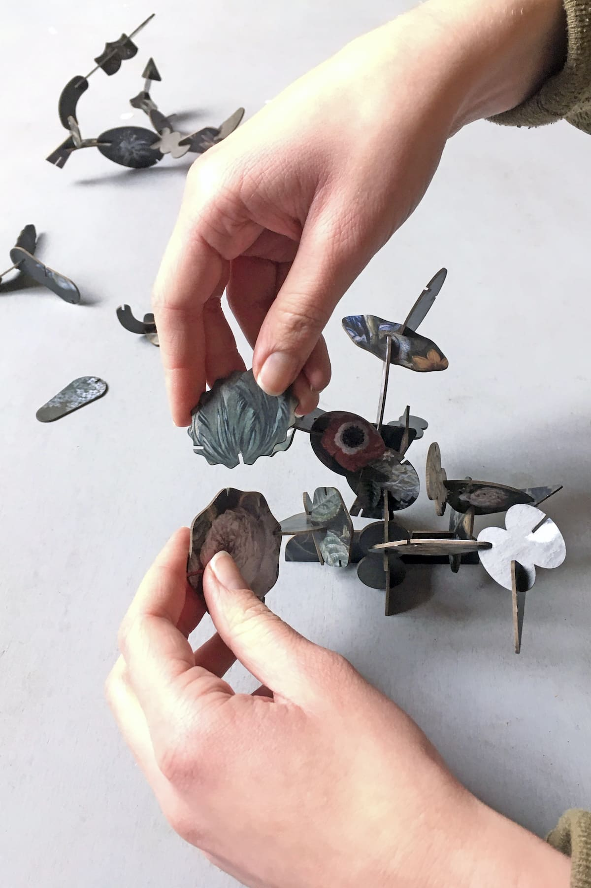
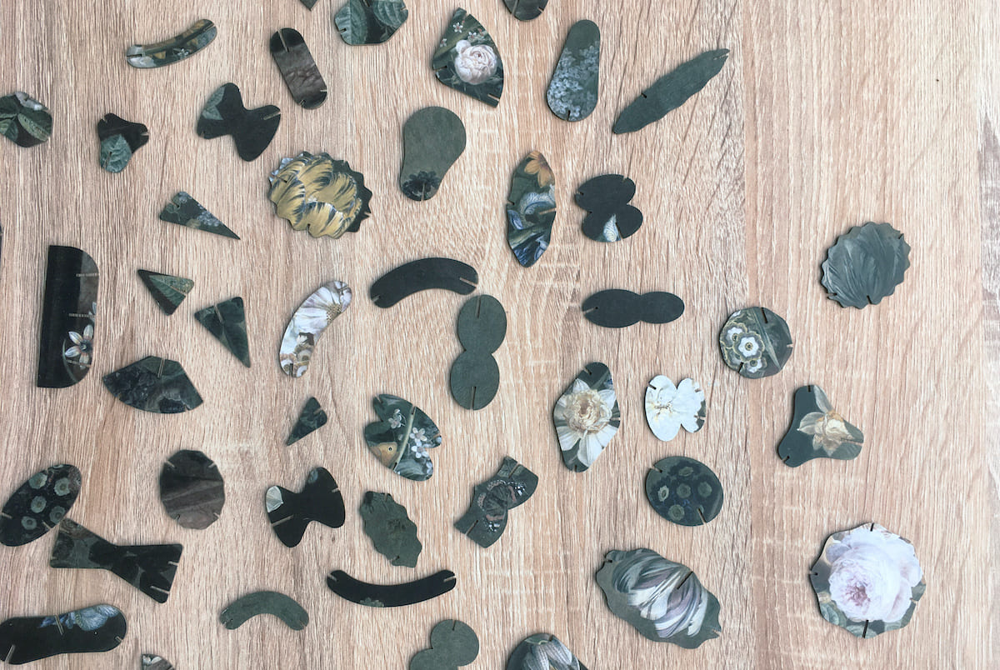
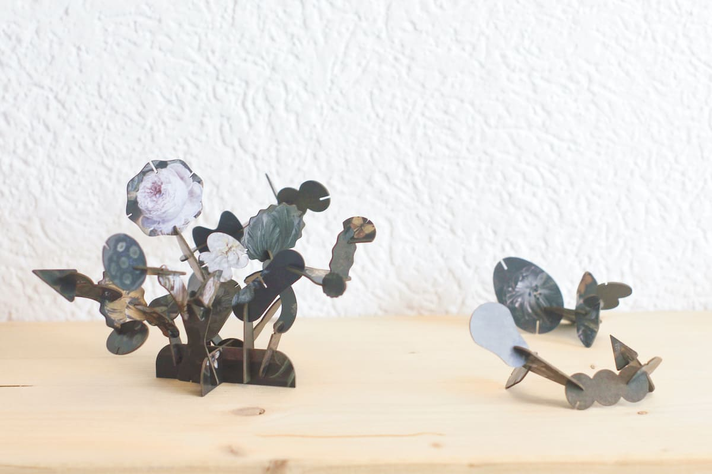
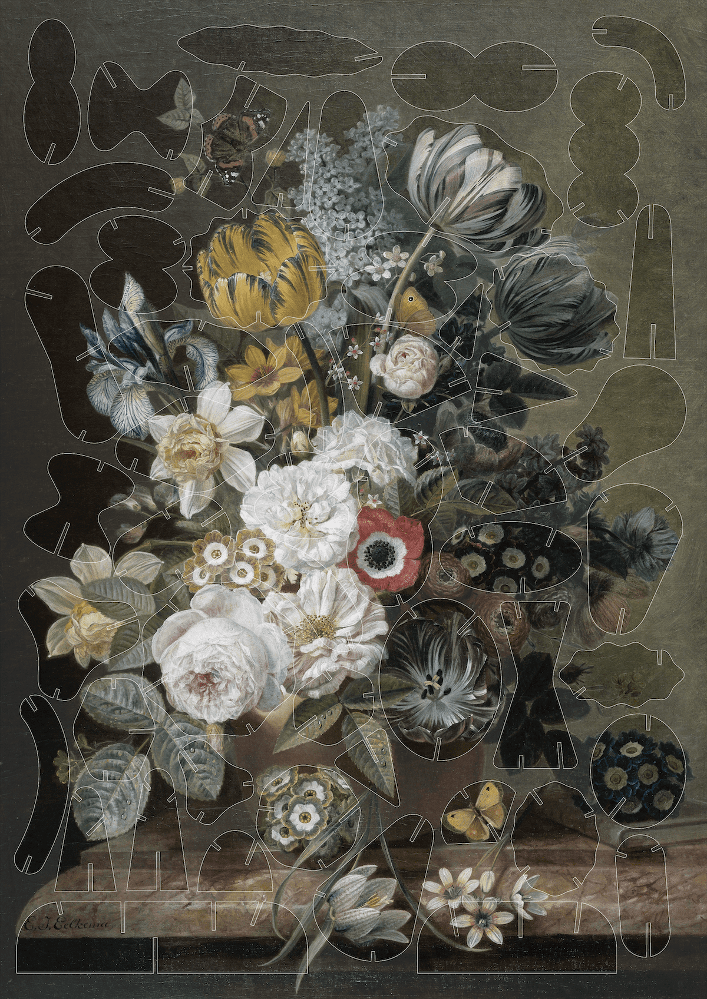

# Introduction簡介

  Make flowers alive

  讓花朵活起來

  
    Ikebana is the Japanese art of flower arrangement and can be translated to “making flowers alive”. The floral composition painted by Eelke Jelles Eelkema has a vivid aesthetic which gave Erco Lai the idea that it could be astonishing to bring the flower painting to life using the technique of Ikebana. Thus, he dismantled the painting into different shapes and added small slots, with which it is possible to join the parts back together like a 3D puzzle.There is no right or wrong way to complete this puzzle. Instead, everyone can freely decide how to arrange the floral-shaped pieces which are also the attempt in Ikebana. To use the whole painting wisely, he started by cutting out shapes from the flowers in the center and worked my way to the border, in which the background has a remarkable texture.
  

  
    Ikebana 是日本的插花藝術，可以翻譯為「讓花朵活起來」。Eelke Jelles Eelkema 所繪製的花卉構圖具有鮮明而生動的美感，讓 Erco Lai 想到，若以 Ikebana 的方式將這幅花卉畫作重新帶入立體空間，或許能產生令人驚豔的效果。因此，他將畫作拆解成不同的形狀，並加入小型卡榫，使各個部分能夠像 3D 拼圖一樣重新組合。這個拼圖沒有正確或錯誤的完成方式，每個人都可以自由決定如何排列這些花朵形狀的零件，而這個自由組合的過程本身也成為一種 Ikebana 的實踐。為了充分利用整幅畫作，他從中央的花朵開始切割出不同形狀，逐步向畫面的邊緣延伸，而背景本身則保留了具有特色的紋理。
  

  

  

  

  

  

  Video

  

    <iframe
      src="https://player.vimeo.com/video/390597905?h=903cb1d503"
      style="position:absolute;top:0;left:0;width:100%;height:100%;"
      frameborder="0"
      allow="autoplay; fullscreen; picture-in-picture"
      allowfullscreen>
    </iframe>
  

  

  

  

  

# Inspiration靈感

  Stilleven

  靜物畫

  
    Still Life with Flowers, the painting of Eelke Jelles Eelkema. Furthermore, this concept of 3D puzzle can also apply to other paintings with flowers and make a series of products, like another painting of Eelke Jelles Eelkema as well and the painting of Balthasar van der Ast. It can be produced as a souvenir with die cutting or as an online service with an algorithm for users customizing shapes and downloading layout.
  

  
    《Still Life with Flowers》是 Eelke Jelles Eelkema 的作品。此外，這種 3D 拼圖的概念也可以延伸至其他以花卉為題材的畫作，進一步發展成一系列產品，例如 Eelke Jelles Eelkema 的其他作品，以及 Balthasar van der Ast 的畫作。它可以透過模切製作成紀念品，也可以發展成線上服務，讓使用者透過演算法自訂形狀並下載版型。
  

  

  

  

