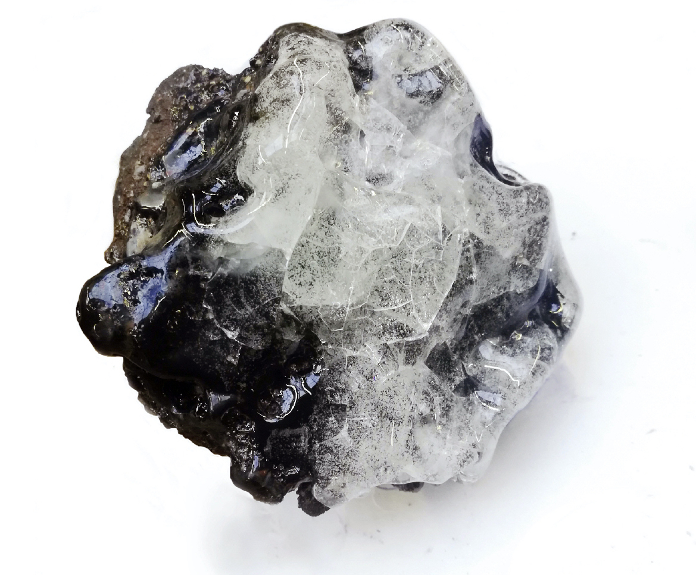
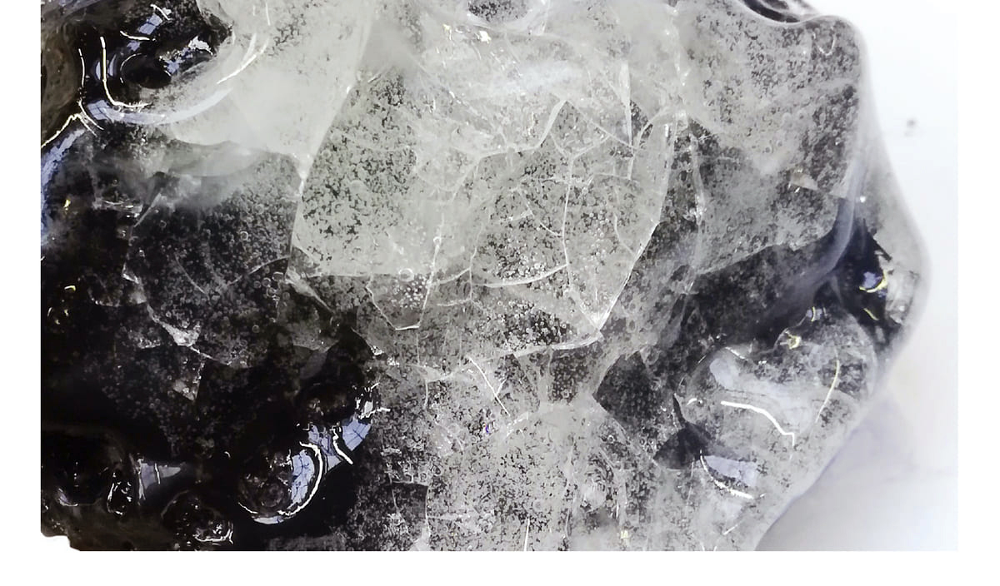
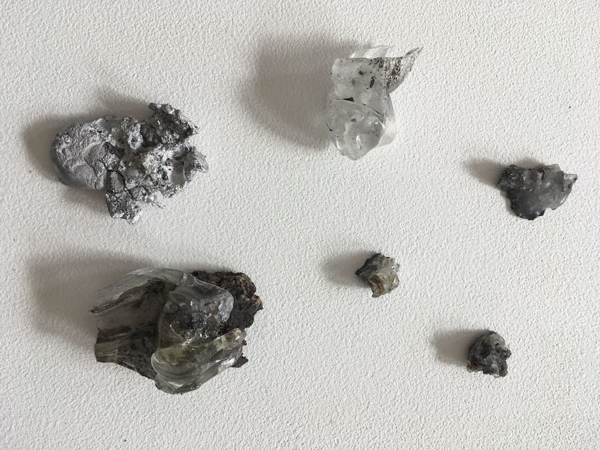
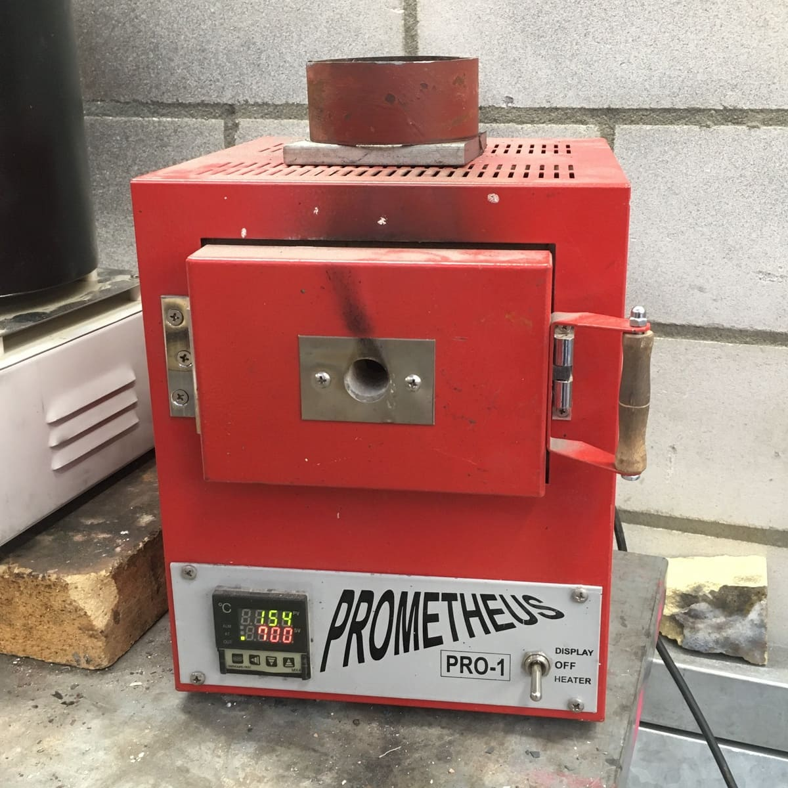
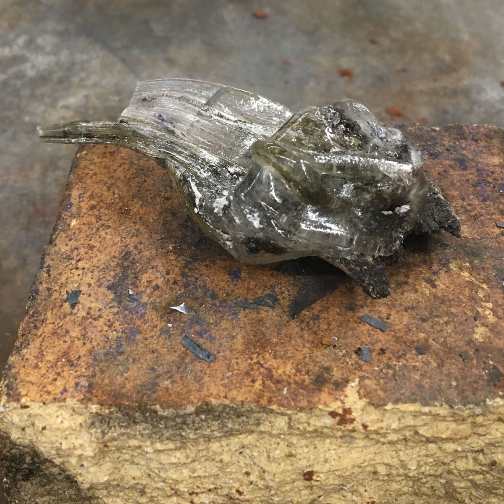
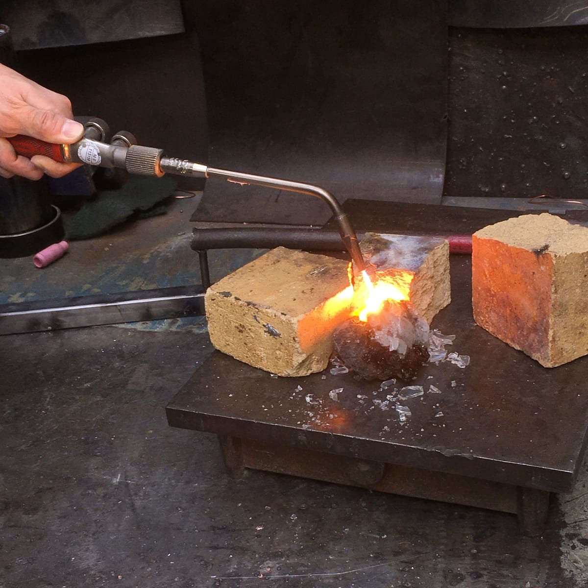
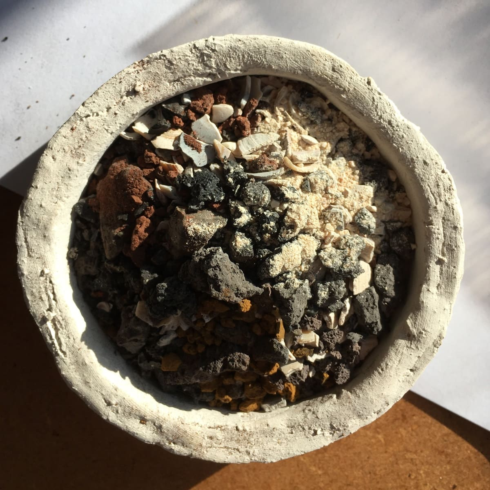
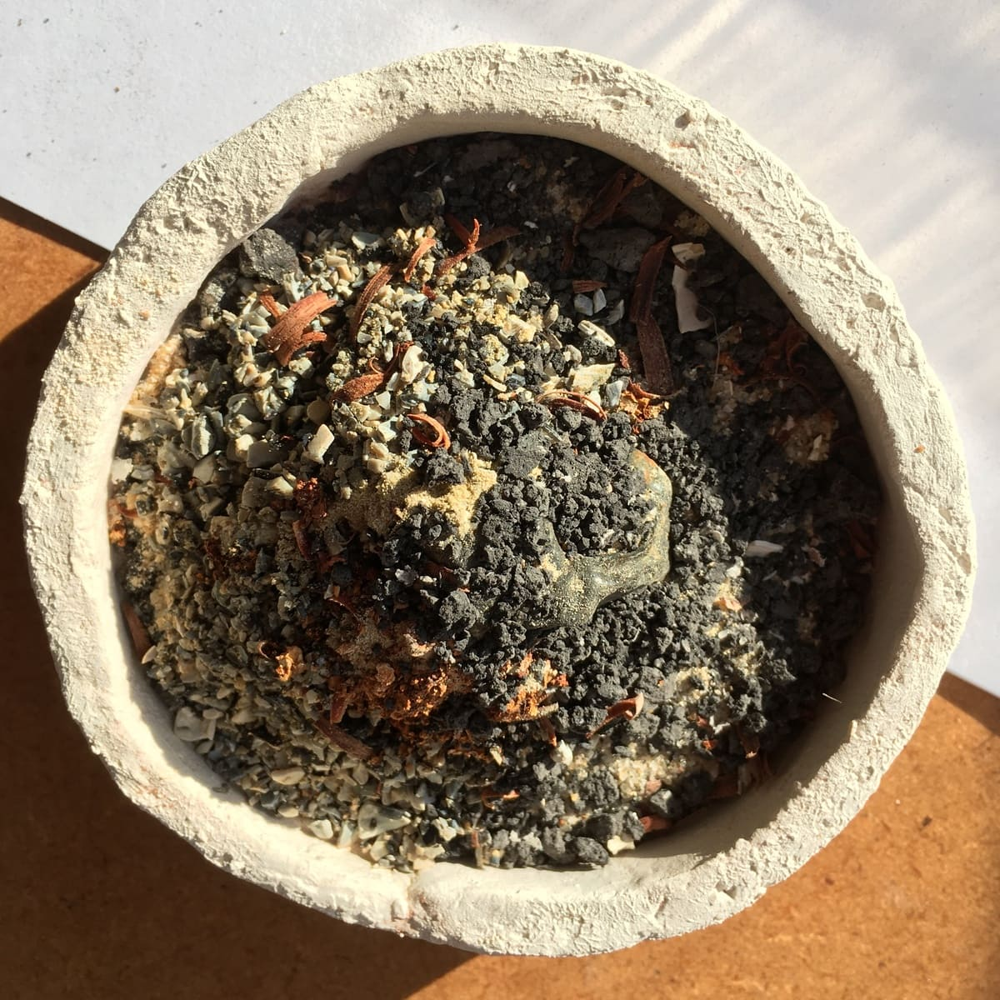

# Introduction概念簡介

  Nothing gets lost, everything transforms

  萬物不滅，唯有轉化

  
    Developed in collaboration with Lucie Ponard, this project explores how the Japanese concept of mono no aware (物哀) can be expressed through material transformation. Often associated with an awareness of impermanence, mono no aware describes a bittersweet appreciation of fleeting beauty and the knowledge that nothing remains unchanged. Using lava stone as a starting point, the research investigates how changes in material states can become visible through textures and gradual transitions. By experimenting with heat and the interaction of different substances, the project seeks to translate an intangible emotion into physical forms that reveal the processes of transformation.
  

  
      這項實驗計畫與 Lucie Ponard 合作開發，試圖透過材料轉化，呈現日本美學概念「物哀」（Mono no aware）所描述的情感。物哀與對無常的感知密切相關，指的是人們在欣賞短暫之美的同時，也意識到事物終將改變或消逝，因而產生的一種細膩而帶有感傷的情緒。研究以火山岩作為材料起點，探索如何透過不同物質狀態之間的漸變，讓轉化的過程呈現在材料表面。藉由加熱與不同物質之間的相互作用，試圖將抽象的情感轉譯為可感知的形態與紋理，使材料本身留下變化的痕跡。
  

  

 

  

  

  

  

# Process實驗過程

  Reheating

  重新熔融

  
      The experiments brought together materials including tin, glass, slag, and lava stone, investigating how they respond to heat and interact with one another. Using a kiln and a torch, the materials were reheated and partially melted to explore different forms of bonding, surface transformation, and material transition. Rather than shaping each material independently, the process investigates how their physical properties and responses to heat might contribute to the formation of new textures and connections.
  

  
    實驗收集了錫、玻璃、爐渣與火山岩等材料，觀察它們在加熱過程中的反應，以及不同物質相互結合的可能性。透過窯爐與噴火槍進行重新加熱與局部熔融，探索材料之間的黏結、表面變化及不同物質狀態的過渡。研究並非將每種材料分別塑造成預設形狀，而是觀察它們各自的物理特性與受熱反應，如何共同形成新的紋理與連結方式。
  

  

  

  

  

  

  

  

  

  

  

  

  

  

  

# Imagination延伸想像

  Faking Nature

  模擬自然

  
      The research also opens a speculative connection to Taoist philosophy, particularly its ideas of naturalness and wu wei (無為), often understood as acting without unnecessary force or interference.Drawing upon the Taoist view of human life as part of a continually changing natural order, the project imagines manufacturing as a garden-like system, where materials circulate, interact, and transform according to their own properties and environmental conditions.
        
      Rather than proposing a return to the Stone Age, this vision imagines a different kind of technological future: one in which people develop sophisticated tools and objects while working more closely with natural rhythms and using resources according to their needs.It raises a broader question of how manufacturing might become less about imposing predetermined forms upon matter and more about participating in its ongoing transformation.
  

  
      這項研究也延伸出與道家思想之間的連結，特別是「自然」與「無為」的觀念。無為並非完全不採取行動，而是強調順應事物的本性，避免不必要的強制與干預。從道家將人視為自然變化一部分的思想出發，研究進一步想像：如果我們將製造系統視為一座庭園，讓材料如同自然環境中的物質一般，在不同條件下流動、交換與轉化，會形成什麼樣的生產方式？這並不是主張人類回到石器時代，而是試圖想像另一種技術未來：人們依然擁有精良的工具與製造能力，卻能更貼近自然運作的節奏，依照實際需求取得與使用資源。在這樣的想像中，製造不再只是將預設的形態強加於材料之上，而是嘗試理解物質自身的變化，並參與其持續生成的過程。
  

  

  

  

Further reading
延伸閱讀

    <a href="en/Biorock"><u>Biorock</u></a>- design research of mineral formation 
    <a href="en/Neo-Stone-Age"><u>Neo Stone Age</u></a>- design research of geopolymerization  

