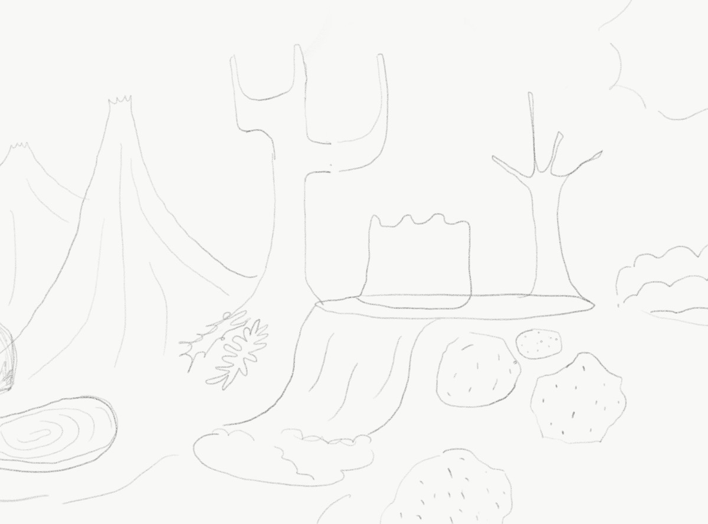

# Introduction簡介

  Nothing gets lost, everything transforms.

  沒有任何東西消失，一切都在轉化。

  
    This project works with Lucie Ponard. We tried to materialize an emotion named "mono no aware" (物哀). It is a Japanese expression of the ephemeral nature of beauty – the quietly elated, bittersweet feeling of having been witness to the dazzling circus of life – knowing that none of it can last. We decided to use lava stone as the main material and start to experiment, trying to create gradient texture from one state to another.
  

  
    這個專案與 Lucie Ponard 合作。我們嘗試將一種名為「mono no aware」（物哀）的情感物質化。這是一個用來描述美之短暫性的日文概念——一種在見證生命絢麗景象之後，帶著安靜欣喜與苦樂交織的感受，同時也明白這一切都不可能永久存在。我們決定以熔岩石作為主要材料，開始進行實驗，嘗試創造從一種狀態逐漸轉變至另一種狀態的漸變質地。
  

  

![Lava and...]../../assets/Lava-and-/l-0.jpg)

  

  

![Lava and...]../../assets/Lava-and-/l-0 2.jpg)

  

  

# Process製程

  Reheating

  重新加熱

  
    They collected various materials, ranging from tin, glass, slag and lavastone, and attempted to combine them by partly melting them down. To accomplish this, they experimented with a variety of methods, from using a kiln to using a torch. As they did so, they sought to create a new shape or connection through the reheating process. As they tested and tried different techniques, they hoped to eventually find a successful combination of materials that would yield the desired result.
  

  
    他們收集了各種材料，包括錫、玻璃、爐渣與熔岩石，並嘗試透過部分熔化的方式將它們結合。為了完成這個過程，他們實驗了不同的方法，從使用窯爐到使用火炬加熱。在這些實驗中，他們試圖透過重新加熱的過程創造新的形狀或連結。隨著不斷測試與嘗試不同的技術，他們希望最終找到一種成功的材料組合，以產生所期望的結果。
  

  

  

![Lava and...]../../assets/Lava-and-/l-1.jpg)

  

  

![Lava and...]../../assets/Lava-and-/l-4.jpg)

  

  

![Lava and...]../../assets/Lava-and-/l-5.jpg)

  

  

![Lava and...]../../assets/Lava-and-/l-6.jpg)

  

  

![Lava and...]../../assets/Lava-and-/l-7.jpg)

  

  

![Lava and...]../../assets/Lava-and-/l-8.jpg)

  

  

# Imagination想像

  Faking Nature

  模擬自然

  
    It reminds Erco Lai of Taoism and it is saying a similar concept. 
    In this ancient eastern philosophy, Taoism can be considered a lifestyle looking for harmony with the universal pattern. Also, it emphasizes Wu Wei (無為), which means action without intention, and naturalness. During that time and based on the theory, Toaists considered our human body as a garden with changing seasons in a balance. What if, we can imagine our manufacturing unit as a garden with a flowing system. He is not proposing that we go back to the Stone Age but futuristic cavemen with well-made stone tools and objects, following the natural rhythm, acquiring only the resource we need. By this means, this idea can provide a speculation for modern society.
  

  
    這讓 Erco Lai 聯想到道家思想，其中也傳達了類似的概念。 
    在這套古老的東方哲學中，道家可以被視為一種尋求與宇宙運行規律和諧相處的生活方式。同時，它也強調「無為」，也就是不帶意圖的行動，以及自然性。在當時以及這套理論之下，道家思想將人的身體視為一座具有季節變化並維持平衡的花園。如果我們可以把製造單元想像成一座具有流動系統的花園呢？他並不是主張我們回到石器時代，而是想像一群擁有製作良好的石器與物件、遵循自然節律的未來穴居人，只取得我們所需要的資源。透過這種方式，這個想法可以成為對現代社會的一種推測。
  

  

  

  

Further reading
延伸閱讀

    <a href="en/Biorock"><u>Biorock</u></a>- design research of mineral formation 
    <a href="en/Neo-Stone-Age"><u>Neo Stone Age</u></a>- design research of geopolymerization  

