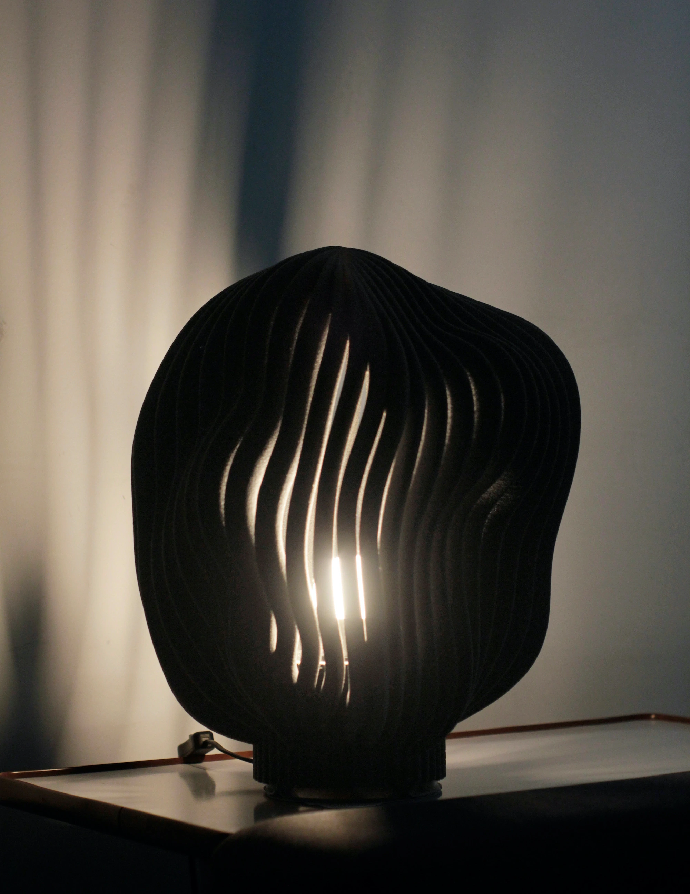
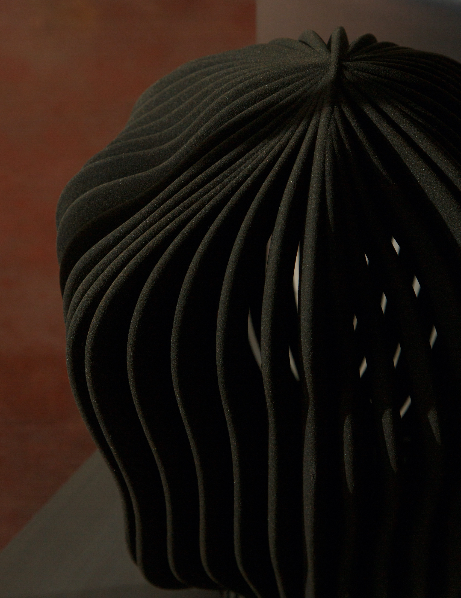
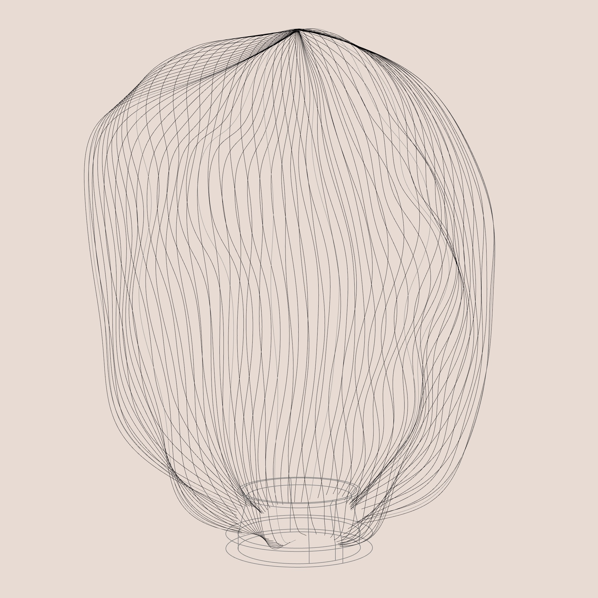
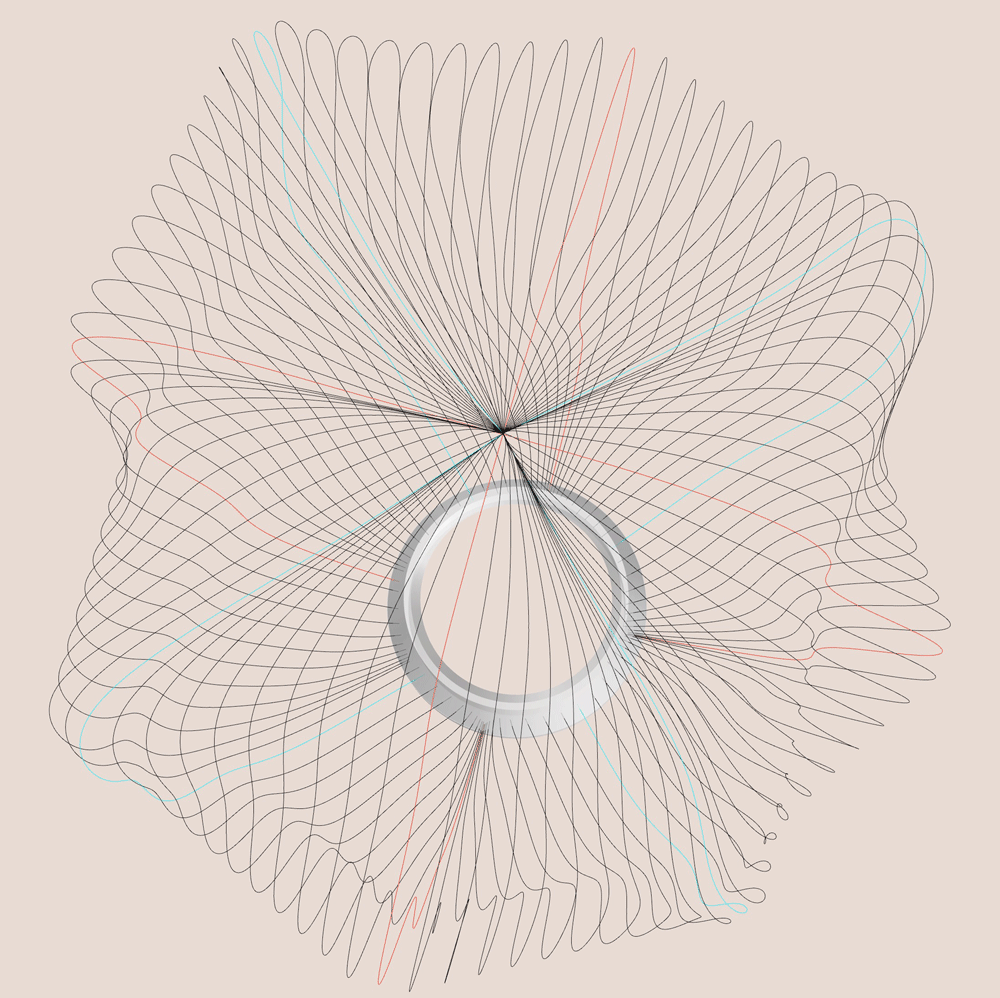
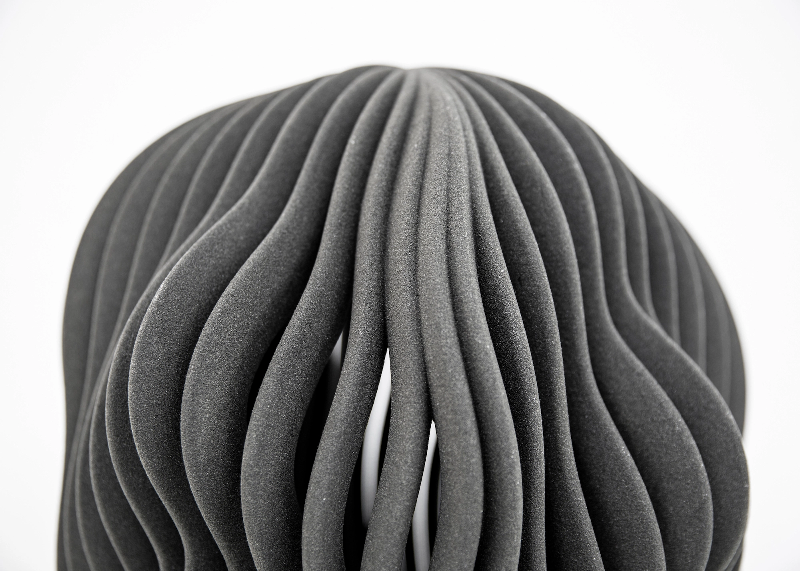
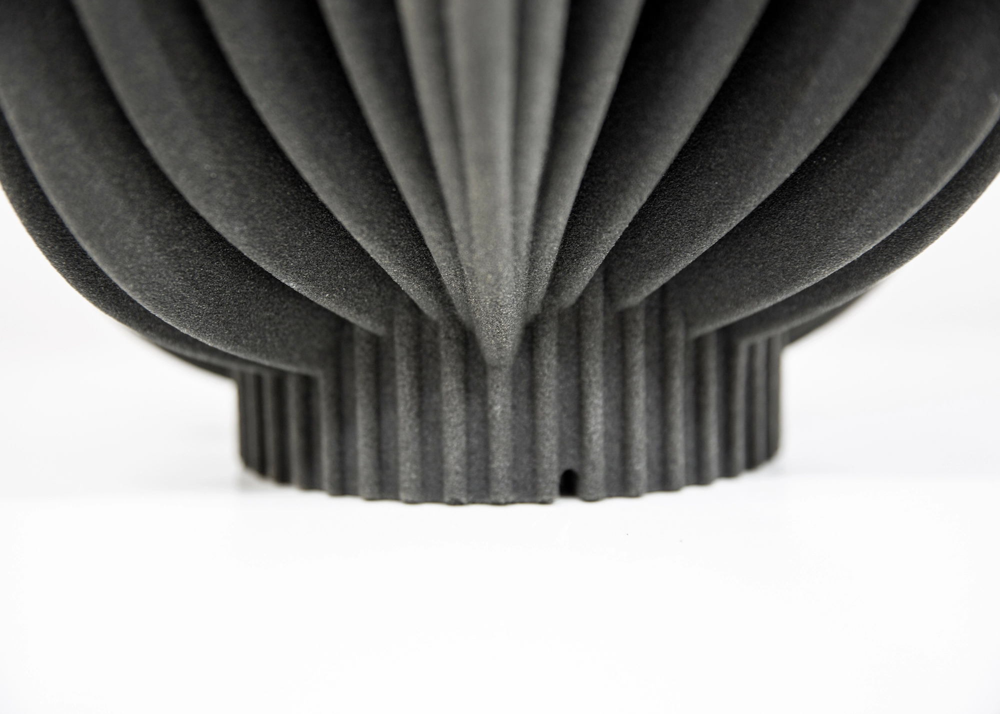
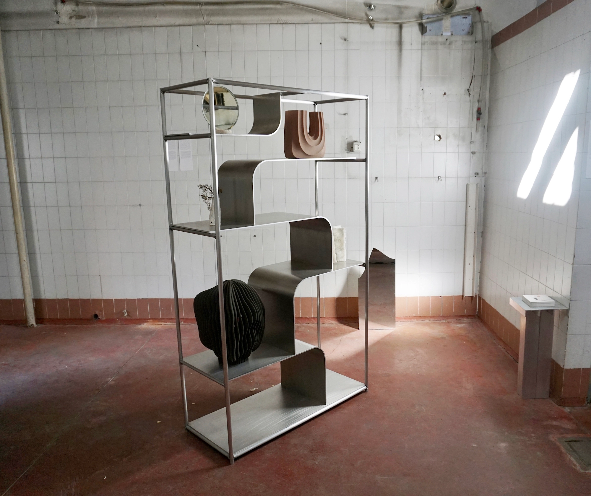
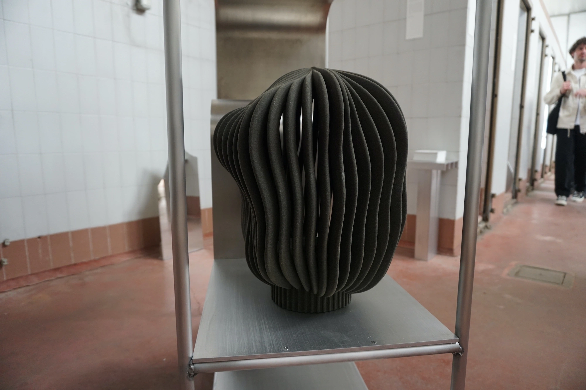
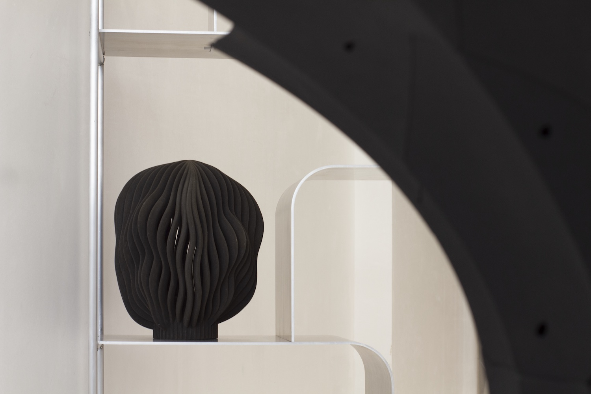
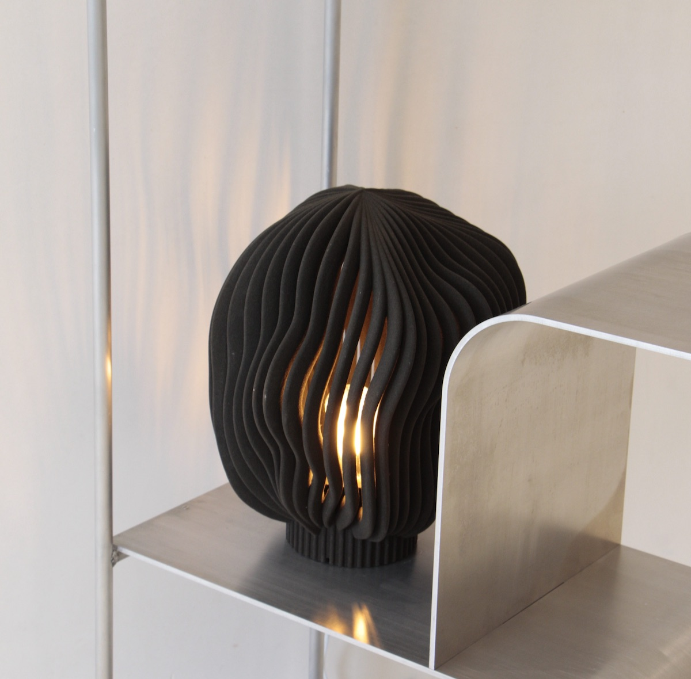

# Concept概念

  Man-made stone

  人造石

  
    Magma is a lamp shade created using 3D sand printing. Inspired by the natural formations of volcanic magma, this lamp shade features intricate textures reminiscent of molten lava. The sand printing technology allows for precise detailing and unique patterns, resulting in a one-of-a-kind lamp shade that showcases the fusion of nature-inspired aesthetics and modern fabrication methods. With its captivating design and warm glow, Magma adds a touch of artistic elegance and modernity to any interior space.
  

  
    Magma 是一件以 3D 砂列印製作的燈罩。作品受到火山岩漿自然形成的形態啟發，燈罩呈現出讓人聯想到熔融熔岩的細緻紋理。砂列印技術使精細的細節與獨特的圖案得以實現，形成獨一無二的燈罩，展現自然啟發的美學與現代製造方法之間的融合。其引人注目的設計與溫暖的光線，為室內空間增添一種藝術感與現代氣息。
  

  

  

  

  

  

# Process製程

  Future craft

  未來工藝

  
    Manufactured by Sandhelden and recognized as binder jetting, this innovative technique enables Erco Lai to fully explore the realm of creative form generation. By utilizing binder jetting technology, Erco Lai gains the flexibility and precision needed to push the boundaries of design, crafting intricate and imaginative forms that might be challenging or even impossible through traditional methods. Furthermore, this approach creates an engaging dialogue between the worlds of handcrafted artistry, the properties of various materials, and the realm of contemporary design.
  

  
    由 Sandhelden 製造的這項創新技術被稱為 binder jetting，讓 Erco Lai 能夠充分探索創造性形體生成的可能。透過 binder jetting 技術，Erco Lai 獲得推動設計邊界所需的彈性與精確度，得以製作出複雜且富有想像力的形態，而這些形態透過傳統方法可能難以甚至無法實現。此外，這種方法也在手工藝術、不同材料的特性，以及當代設計之間建立起一種有趣的對話。
  

  

  

  

  

  

  

  

  

  

# Exhibitions展覽

<h6 class="col-12 lang-en">
  2023 ALCOVA
</h6>

  Duplicating Landscape, Milan

<h6 class="col-12 lang-zh">
  2023 ALCOVA
</h6>

  地景複製，米蘭

<h6 class="col-12 lang-en">
  2024 Because of JoaN
</h6>

  The Nature of something, Amsterdam

<h6 class="col-12 lang-zh">
  2024 Because of JoaN
</h6>

  The Nature of something，阿姆斯特丹

Further reading
延伸閱讀

  

  <a target="_blank" href="https://www.sandhelden.de/tafoni"><u>Sandhelden</u></a>
  - Manufacturer of the 3d sand printing  
  <a target="_blank" href="https://www.materialsource.co.uk/top-24-3d-print-projects-and-practitioners-for-2024/"><u>Material source</u></a>
  - Top 24 3D print projects and practitioners for 2024  
  <a target="_blank" href="https://drive.google.com/drive/folders/1ZkRkBVH2EVM4M20rYWLUW7ZY3ruXE2Os?usp=share_link"><u>Press kit</u></a>
  - For more Hi-Res photos
  

