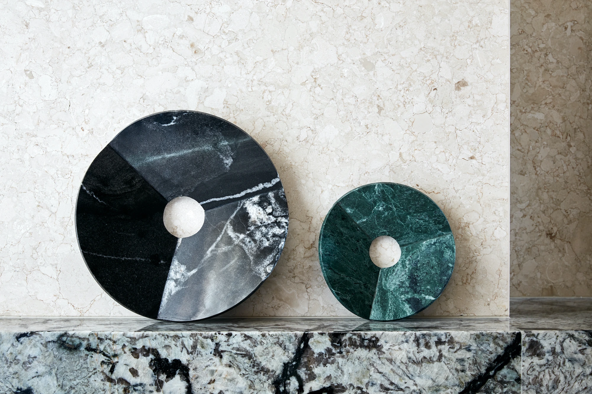
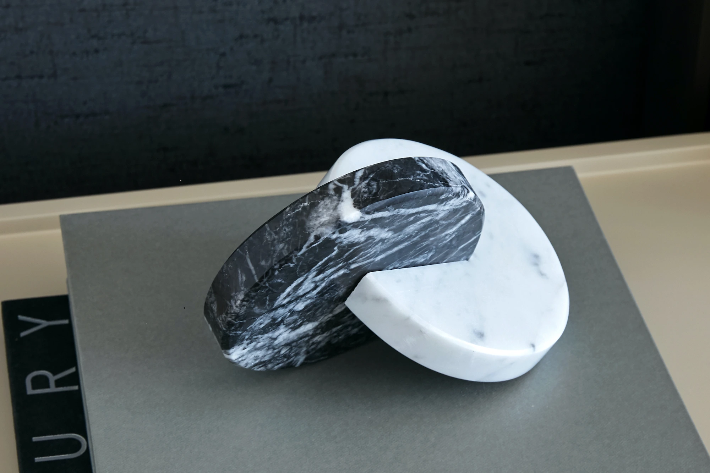
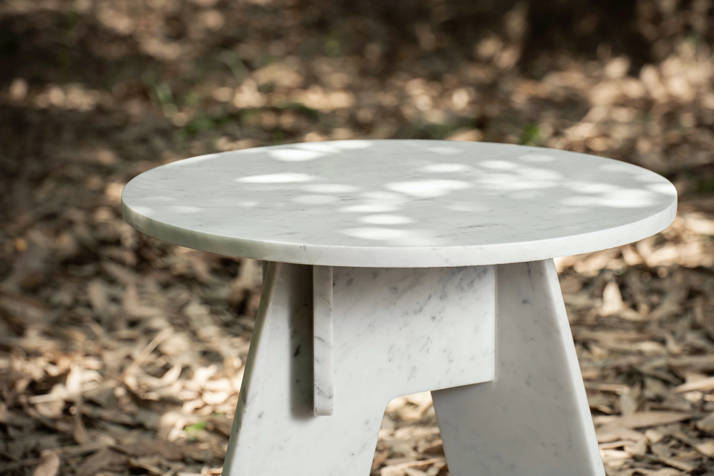
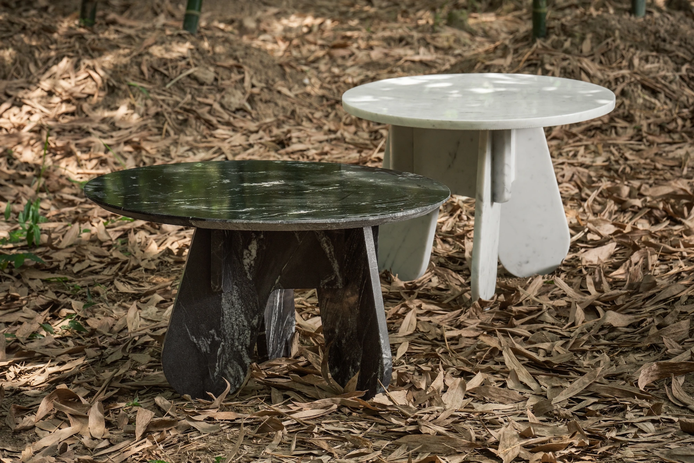
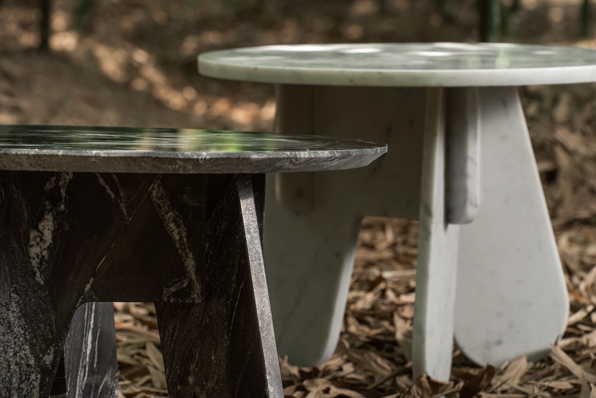
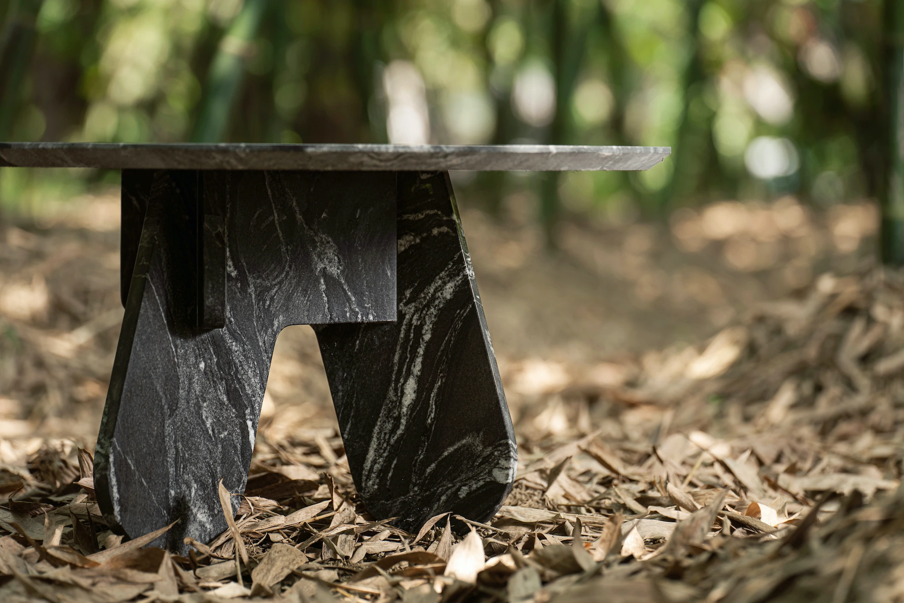
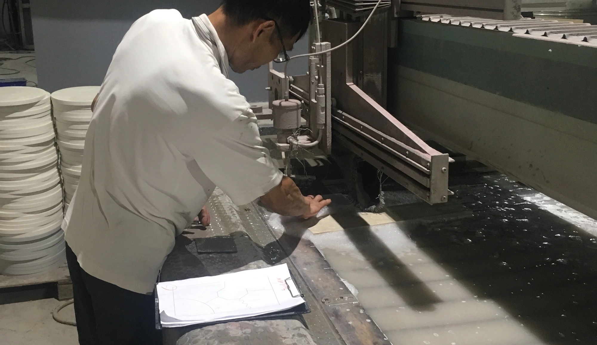
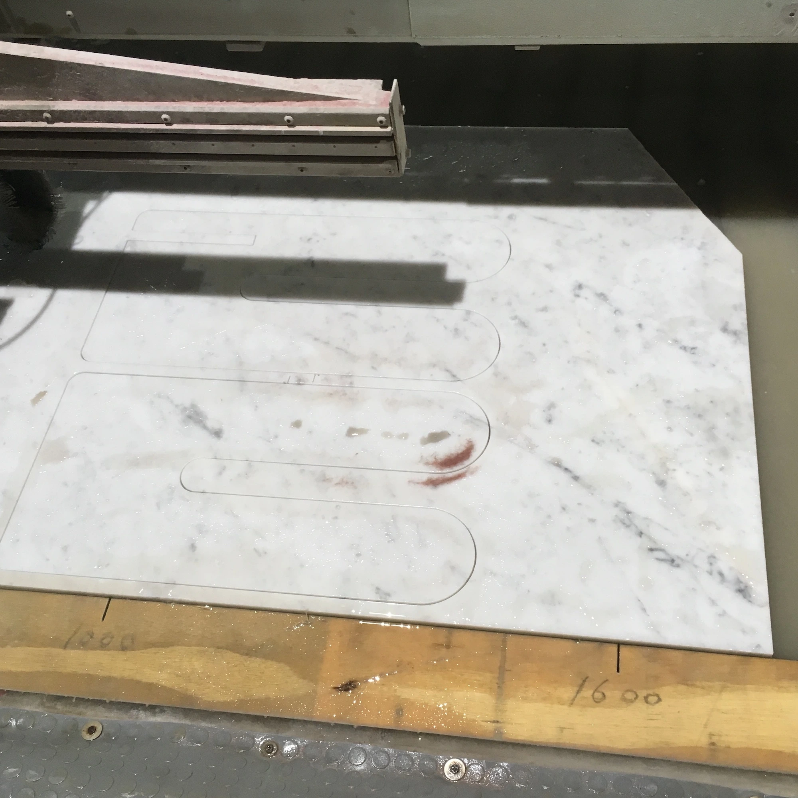
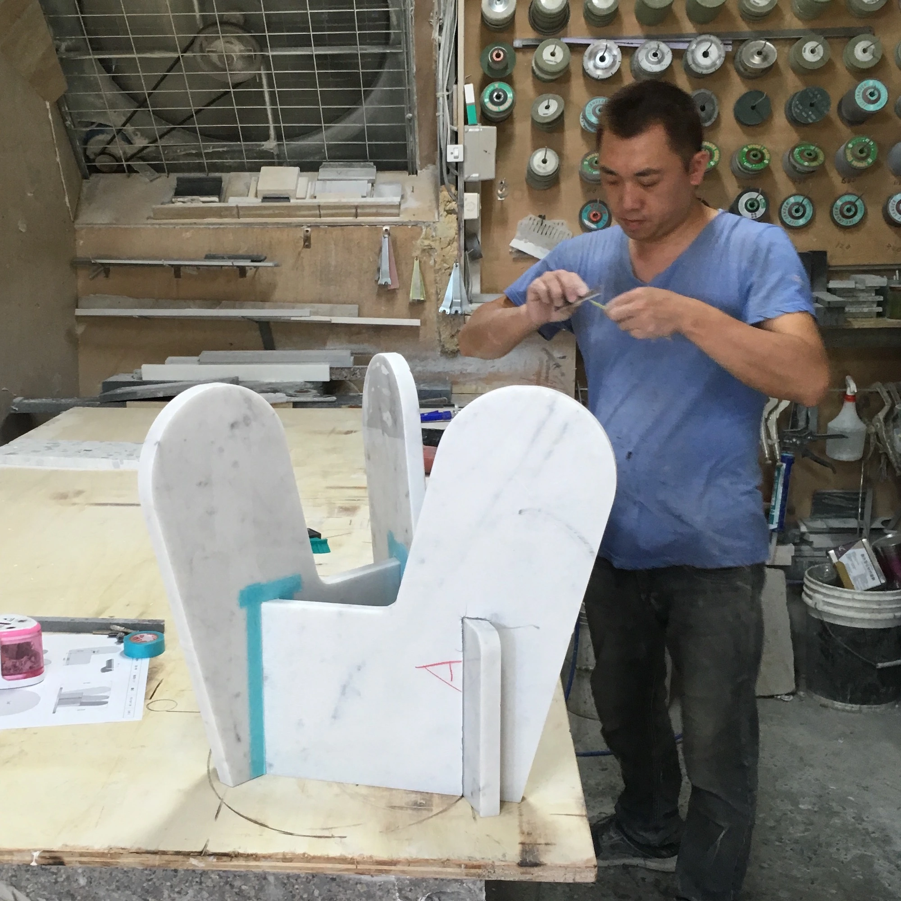
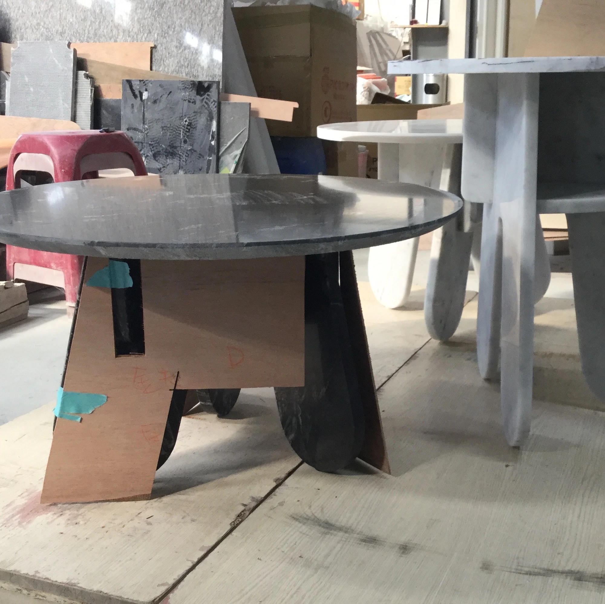

<!-- CONCEPT -->

# Concept概念簡述

Revolve

周而復始

  
    2π is a round, an end and a start.
      
    A full revolution is measured as 2π radians, returning to its starting point after completing a circle. Revolve takes this geometric principle as a starting point, exploring forms generated through rotation, loops, and continuous curves. The marble collection translates these mathematical relationships into sculptural objects, experimenting with curved surfaces and enclosed geometries. Without a distinct beginning or end, their continuous forms evoke the recurring cycles found in nature and everyday life.
  
  
    <u>Revolve / 立</u> 邊桌及其大理石系列以數學概念 2π為一圈的循環連續為出發點，探索旋轉與環繞所形成的幾何造形。透過不同曲面與環狀結構的組合，作品將圓的數學特性轉化為具體的雕塑物件。這些形態不僅呈現了幾何的連續性，也藉由沒有明確起點與終點的輪廓，回應自然與生命中反覆循環的現象。
  

<!-- OBJECTS: LOOP / OLOID -->

  

Loop

Loop / 迴

  

  

Oloid

Oloid / 伴

  

<!-- OBJECT PHOTOGRAPHY -->

  

  

  

  

  

  

  

  

<!-- PROCESS -->

# Process製作過程

Water jetting

水刀切割

  
    Revolve was developed in collaboration with a marble fabrication factory in Taiwan, combining digital design with stone-processing techniques to translate complex geometries into physical objects. The factory's experience in working with marble, together with its fabrication equipment and technical expertise, helped address the challenges of shaping the material with precision. Through an exchange between design and manufacturing, the project explored how geometric concepts could be realized within the possibilities and limitations of stone fabrication.
  
  
    Revolve系列 與台灣的大理石加工廠合作開發，結合數位設計與石材加工技術，將複雜的幾何造形轉化為實體物件。工廠提供石材處理的專業經驗、加工設備與技術支援，使設計得以在材料特性與製作精度之間取得平衡。透過設計端與製造端的合作，逐步將概念轉化為可實際製作的石材作品。
  

<!-- PROTOTYPING -->

  

Prototyping

切割現場

  

<!-- FABRICATION PROCESS -->

  

  

  

  

  

  

<!-- FURTHER READING -->

Further reading延伸閱讀

  <a href="../Fieldstone/"><u>Fieldstone</u></a> - The artificial-stones-stacked table 
  <a href="../Ginkgo/"><u>Ginkgo</u></a> - a wooden chair inspired by the form of leaves

