

# Concept概念

  Ephemeral echoes

  短暫的回聲

  
    Rift is a unique space divider within ephemeral echoes, blending minimal design with organic elements. Crafted from sleek aluminum frames enclosing locally sourced stones, it embodies the juxtaposition of solidity and transience. Each stone, weathered by time, symbolizes the fleeting nature of existence, while the aluminum frames provide stability. Viewers are drawn in by the interplay of light and shadow, encouraged to contemplate the beauty of impermanence and the enduring legacy of the natural world. In Rift, “Ephemeral Echoes” invites introspection, bridging the gap between human experience and the timeless rhythms of the earth.
  

  
    Rift 是一件以「短暫的回聲」為概念的獨特空間隔屏，將極簡設計與有機元素融合在一起。作品以俐落的鋁製框架包覆在地採集的石頭，呈現堅固與短暫之間的並置。每一塊經時間風化的石頭象徵存在的短暫性，而鋁製框架則提供穩定的結構。光線與陰影之間的交織吸引觀看者進入其中，並引導人們思考短暫之美，以及自然世界持續存在的痕跡。在 Rift 中，「短暫的回聲」邀請人們進行內省，在人的經驗與大地永恆的節律之間建立連結。
  

  

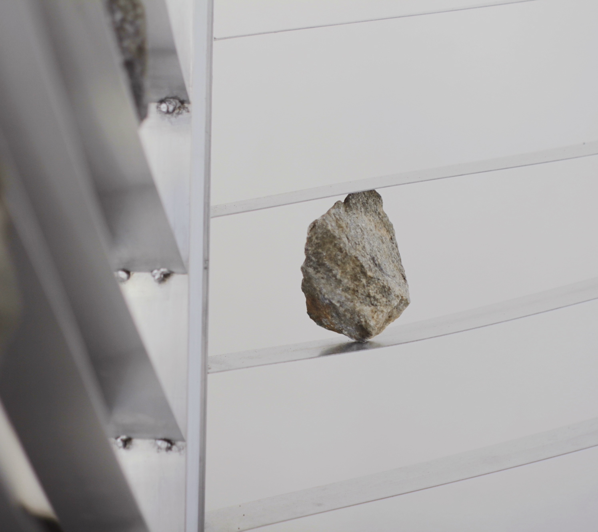

  

  

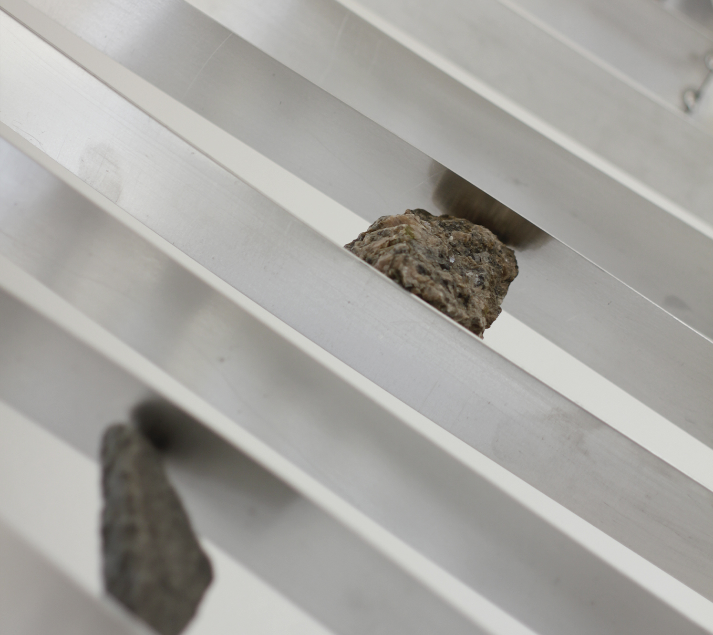

  

  

# Process製程

  Stones from the local

  來自地方的石頭

  
    Rift's versatility stems from its meticulous integration of locally sourced rocks, a process that begins with a deep exploration of the surrounding landscape to gather stones rich in texture and character. It opens collaboration to arrange the stones within Rift's aluminum frames, experimenting with different patterns, compositions, and densities. Through this organic process, Rift emerges as a stunning fusion of man-made nature, where the rugged allure of local rocks finds expression in a new perspective of contemporary design, inviting viewers to contemplate the interplay between human creativity and the timeless rhythms of the earth.
  

  
    Rift 的多樣性來自於對在地石材細緻的整合。這個過程首先從深入探索周遭景觀開始，尋找具有豐富質地與個性的石頭。接著透過協作，將石頭安排於 Rift 的鋁製框架之中，嘗試不同的排列方式、構成與密度。透過這個有機的過程，Rift 逐漸成為一種人造與自然融合的形式，讓在地石頭粗獷而獨特的魅力，以當代設計的另一種視角重新被表達，並邀請觀看者思考人類創造力與大地永恆節律之間的交織。
  

  

  

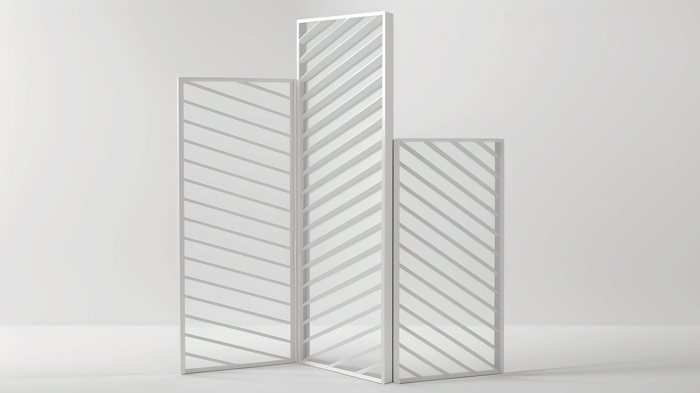

  

  

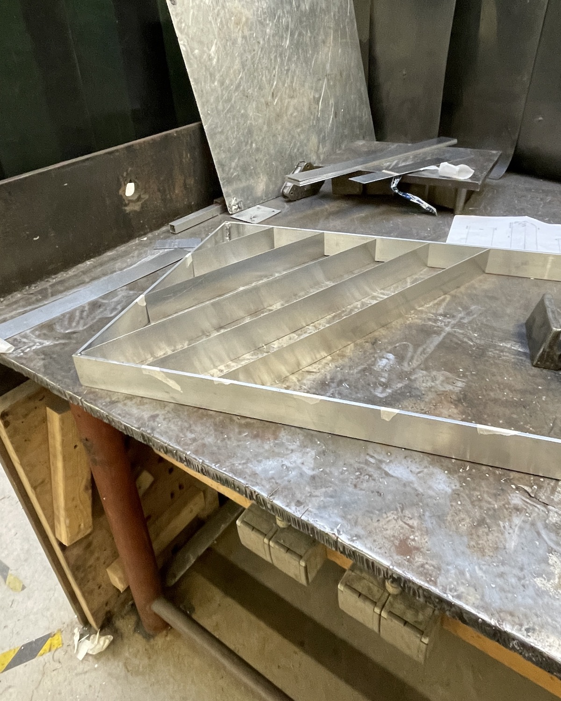

  

  

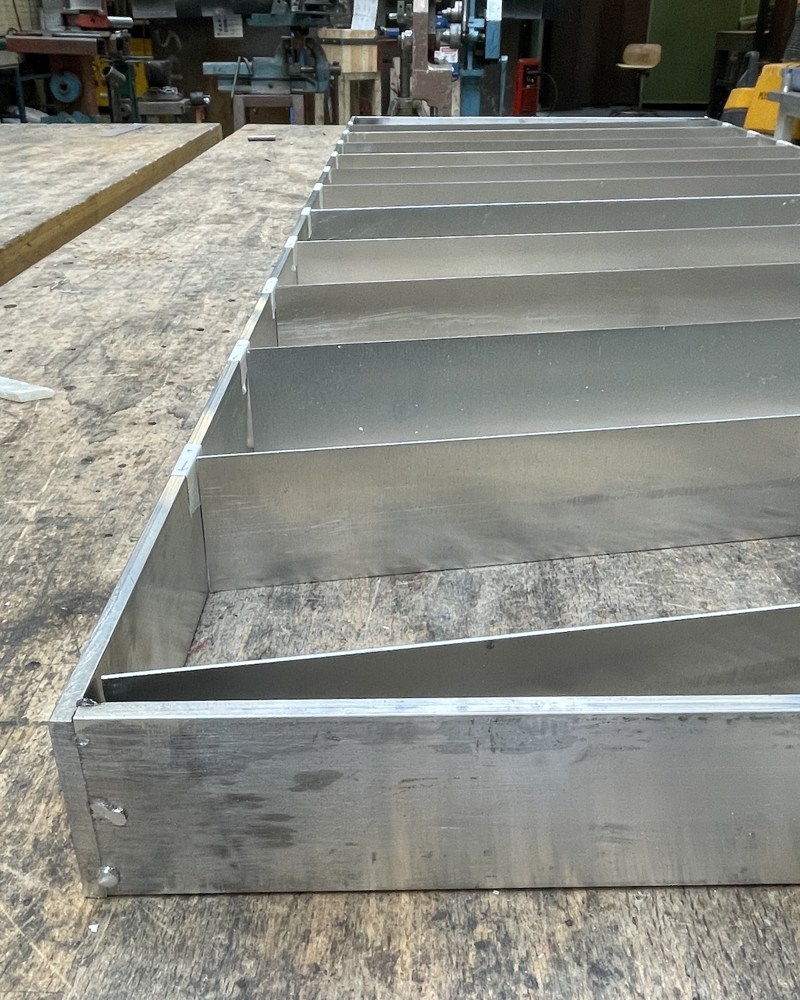

  

  

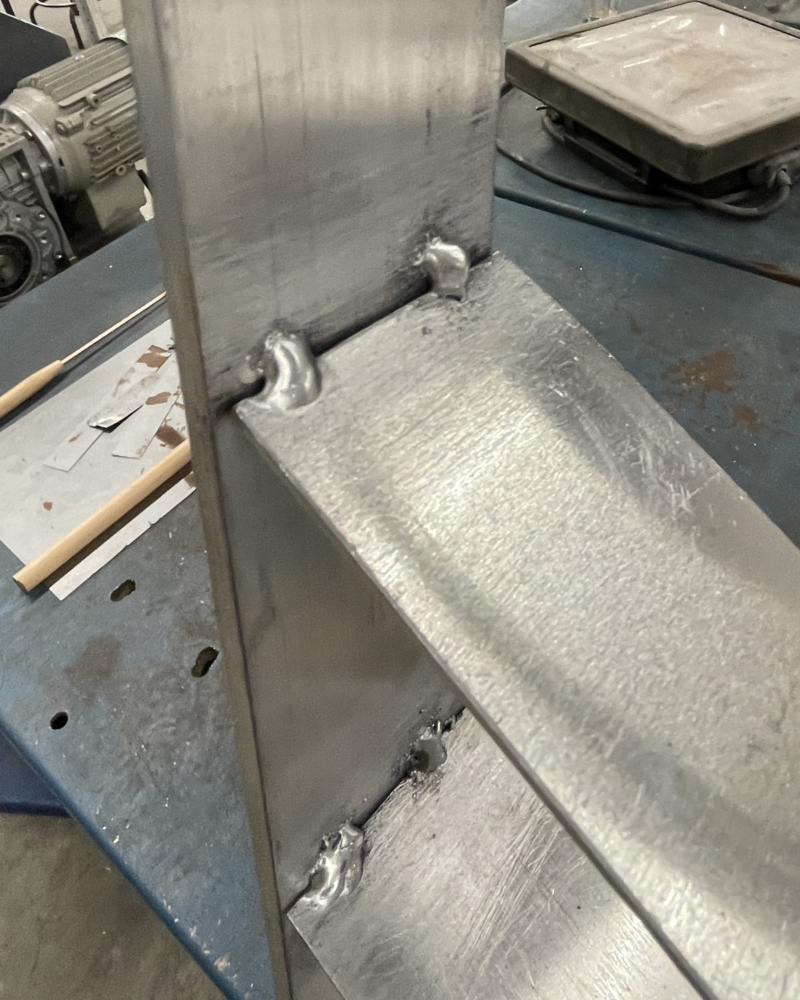

  

# Objects作品

  Rift — Space Divider

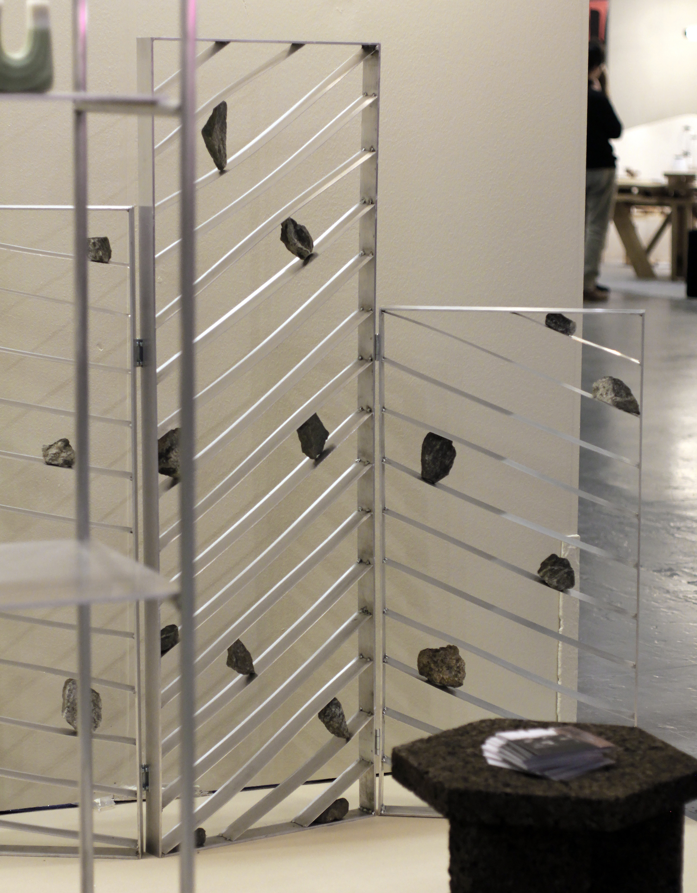

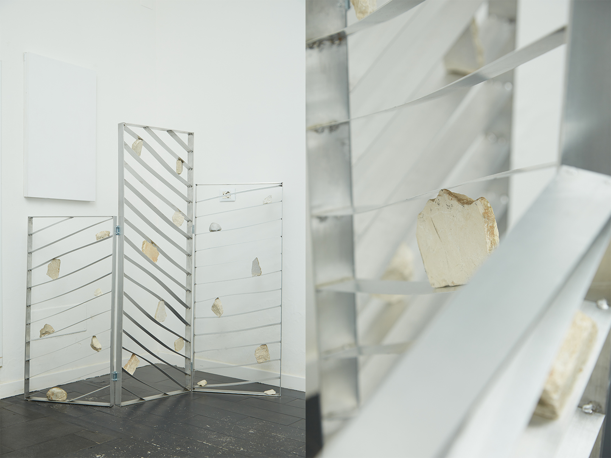

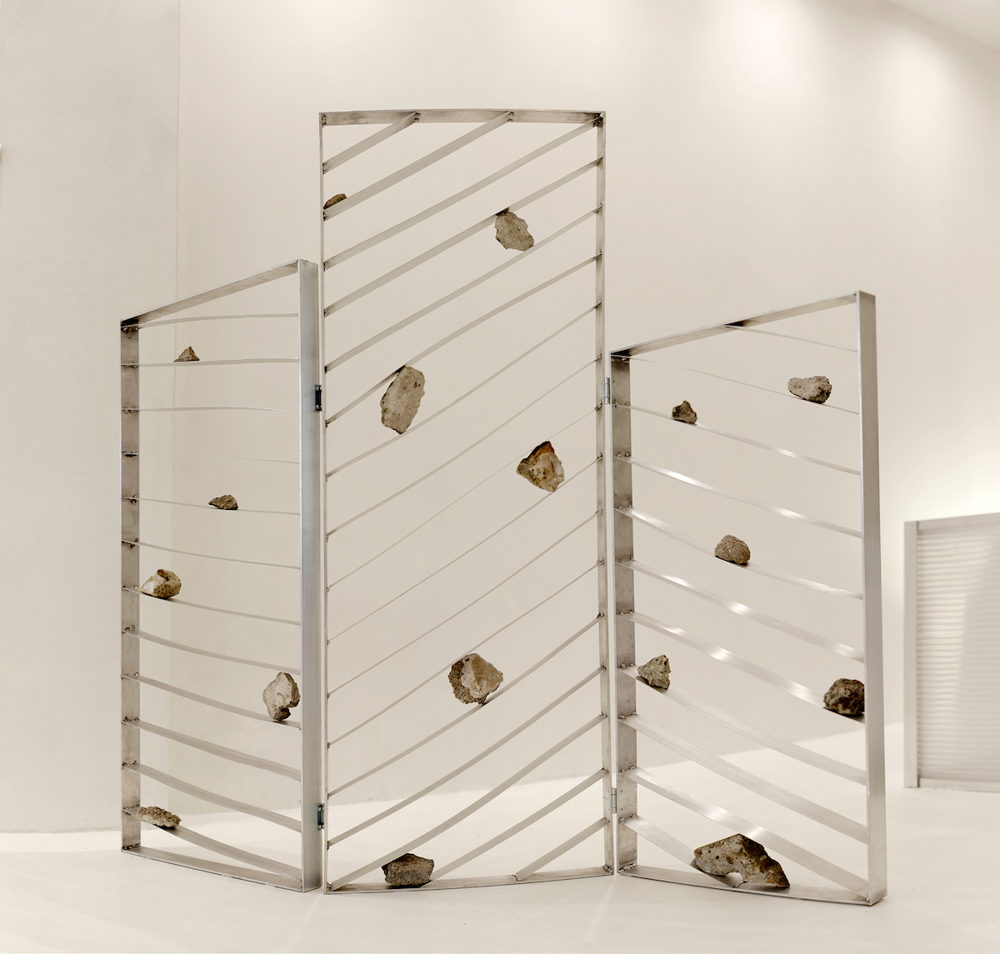

# Exhibition展覽

<h6 class="col-12 lang-en">
  2024 Greenhouse
</h6>

  Stockholm edition

<h6 class="col-12 lang-zh">
  2024 Greenhouse
</h6>

  斯德哥爾摩版本

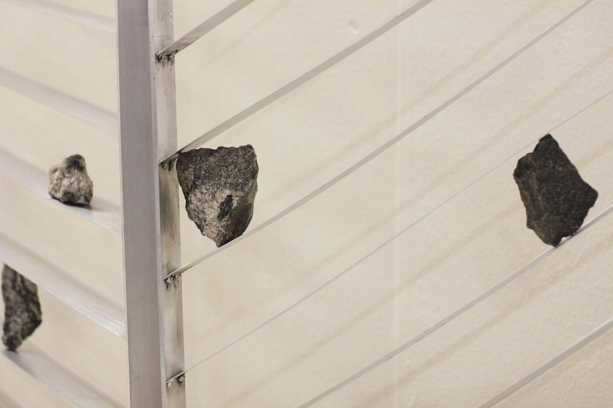

<h6 class="col-12 lang-en">
  2024 ISOLA
</h6>

  Milan edition

<h6 class="col-12 lang-zh">
  2024 ISOLA
</h6>

  米蘭版本

<h6 class="col-12 lang-en">
  2024 Because of JoaN
</h6>

  Amsterdam edition

<h6 class="col-12 lang-zh">
  2024 Because of JoaN
</h6>

  阿姆斯特丹版本

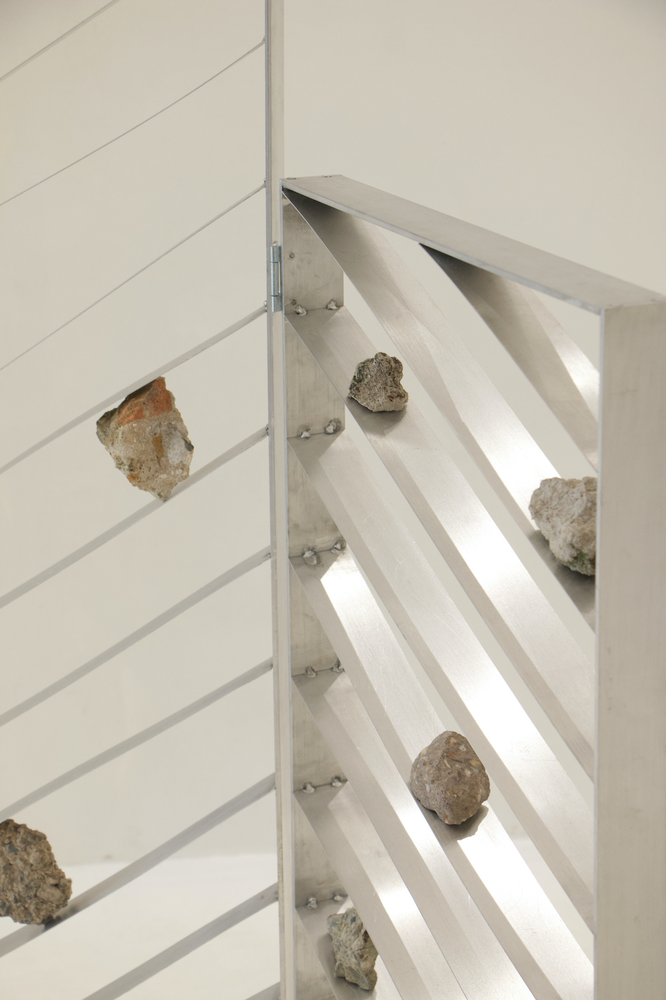

<h6 class="col-12 lang-en">
  2025 ΔDesignArt
</h6>

  Taipei edition

<h6 class="col-12 lang-zh">
  2025 ΔDesignArt
</h6>

  台北版本

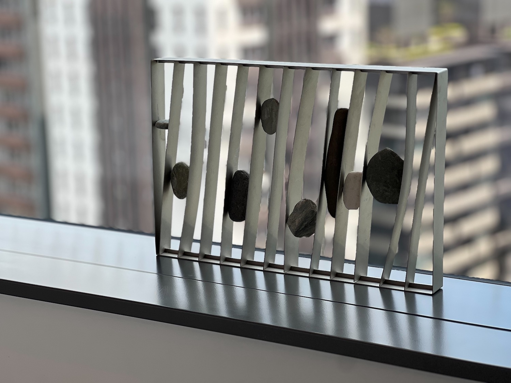

Further reading 延伸閱讀

    <a target="_blank" href="https://www.stimuleringsfonds.nl/en/news/looking-back-at-the-salone-del-mobile-2023"><u>Sight Unseen</u></a>
            - 18 New Talents at Greenhouse, Stockholm’s Showcase 
    <a target="_blank" href="https://vimeo.com/928474672?share=copy"><u>Vimeo</u></a>
            - A short demostration of building up/down 
      <a target="_blank" href="https://drive.google.com/drive/folders/1n2mZ6MEqLaVH0AYgRmHkGbGvjg7KRo1M?usp=share_link"><u>Duplicating Landscape</u></a>
            - Press kit of Stockholm furniture fair 2024 
    <a target="_blank" href="https://drive.google.com/drive/folders/1n2mZ6MEqLaVH0AYgRmHkGbGvjg7KRo1M?usp=share_link"><u>Undertone</u></a>
            - Press kit of the collective exhibition in Milan 2024 

