

# Concept概念簡介

  Stone by dripping

  滴水積石

  
      Tafoni is a collection of 3D sand-printed planters inspired by the cavities and irregular surfaces formed through the weathering and erosion of rocks. Drawing from these geological formations, the project translates naturally eroded textures into sculptural objects through digital fabrication. The layered structure of sand printing allows the forms to develop through successive deposits of material, creating a relationship between natural processes of erosion and artificial processes of accumulation. Rather than functioning as conventional watertight vases, Tafoni's porous sand-based structure allows air and moisture to pass through the material, giving the objects qualities closer to those of breathable planters. The project explores how these opposing mechanisms of erosion and accumulation can inform a new language of form-making.
  

  
   <u>Tafoni / 滴石花器</u> 是一系列以岩石風化與侵蝕所形成的孔洞、凹陷及不規則表面為靈感的砂材列印盆器。作品從自然界的地質形態出發，透過數位設計與積層製造，將岩石受到長時間侵蝕後的造形特徵轉化為具有雕塑感的日常物件。砂材列印透過材料逐層堆積形成物件，與自然界中岩石逐漸風化、侵蝕的過程形成對照。不同於一般可以盛水的花器，滴石花器保留了砂質材料的多孔特性，使空氣與水分得以穿透器壁，呈現更接近透氣盆器的材料性質。作品試圖從物質的消減與累積這兩種相反的作用中，探索新的造形生成方式。
  

  

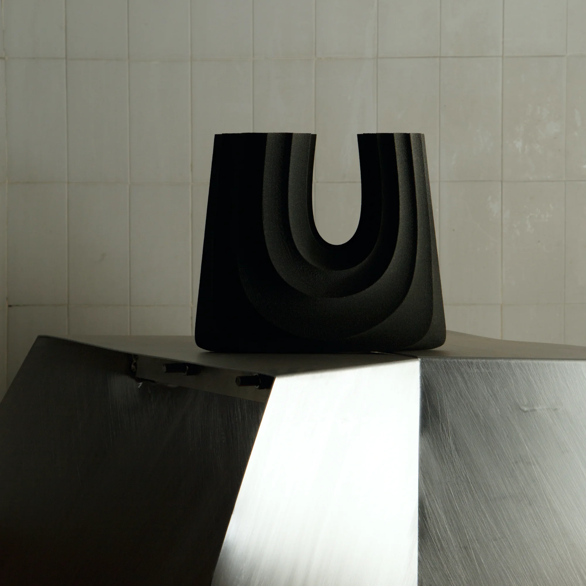

  

  

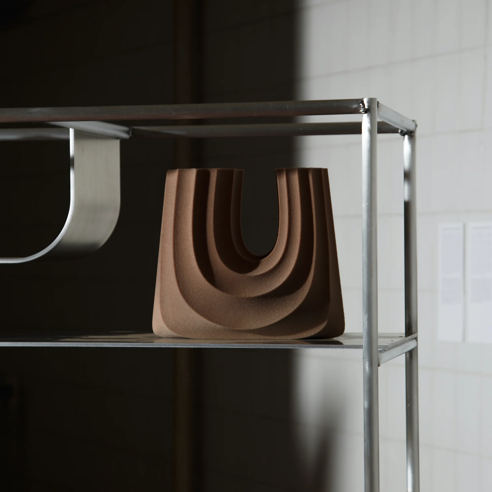

  

  

# Process製作過程

3D Sand printing

砂材列印

  
    Tafoni was developed in collaboration with Sandhelden, a German 3D sand-printing manufacturer, using binder jetting technology. This process selectively deposits a binding agent onto successive layers of sand, gradually forming three-dimensional objects. The technique allows irregular geometries, cavities, and detailed surface textures to be produced directly from digital models. By working with this process, the project translates geological formations into porous, sculptural containers, exploring the relationship between computational design, granular materials, and additive manufacturing.
  

  
    作品與德國砂材列印廠 Sandhelden 合作開發，採用黏結劑噴射成形技術（Binder Jetting），透過選擇性噴射黏結劑，逐層結合砂材，形成立體物件。這項技術能直接依照數位模型製造不規則幾何、孔洞與細緻的表面紋理。作品利用砂材積層的製造特性，將自然地質作用所形成的形態轉化為具有透氣特性的雕塑盆器，探索計算設計、顆粒材料與積層製造之間的關係。
  

  

  

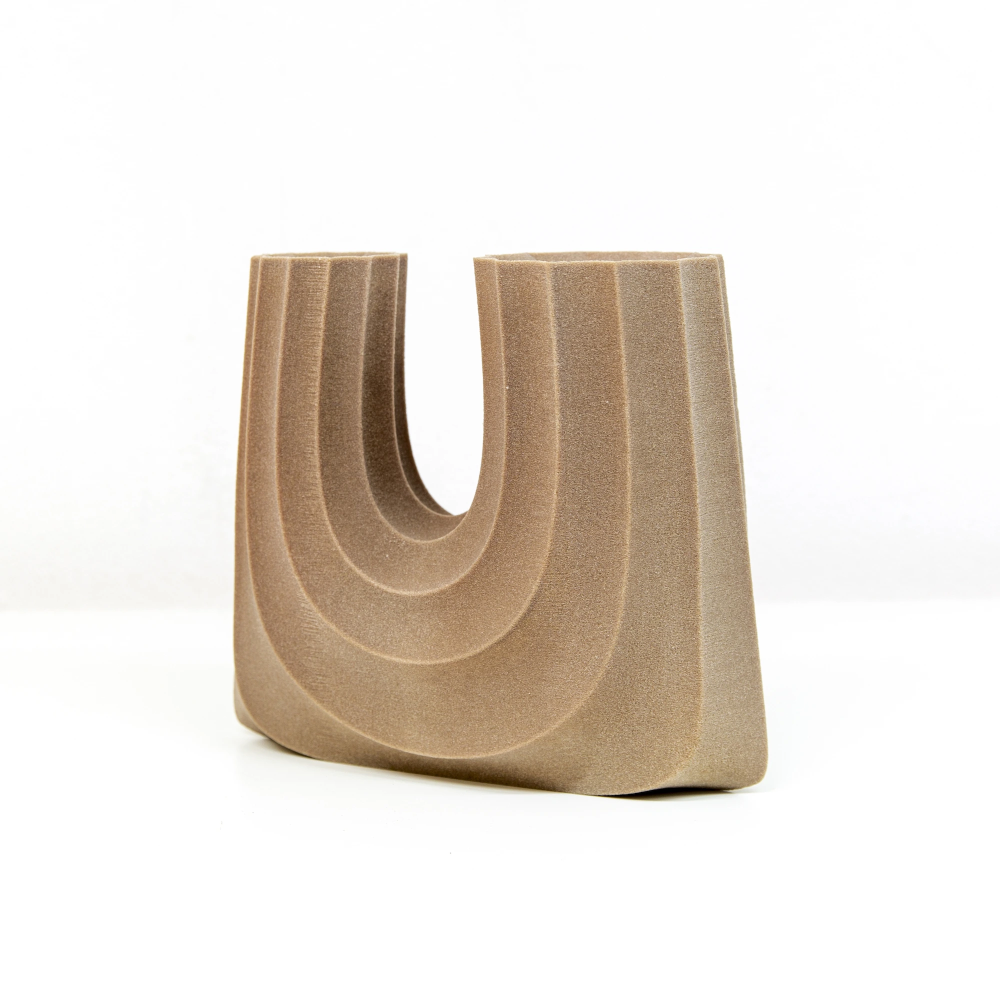

  

  

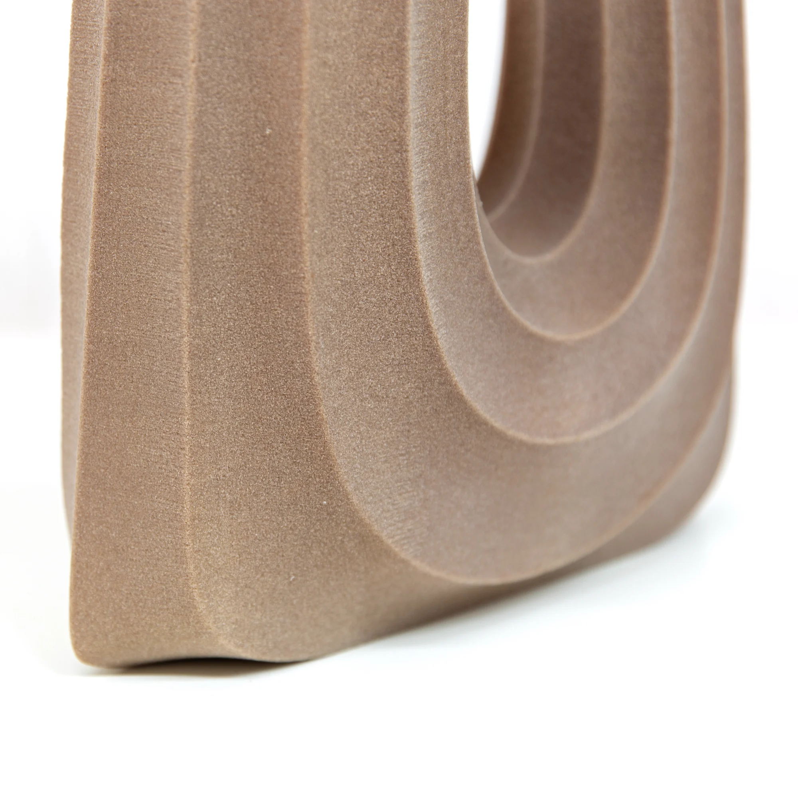

  

  

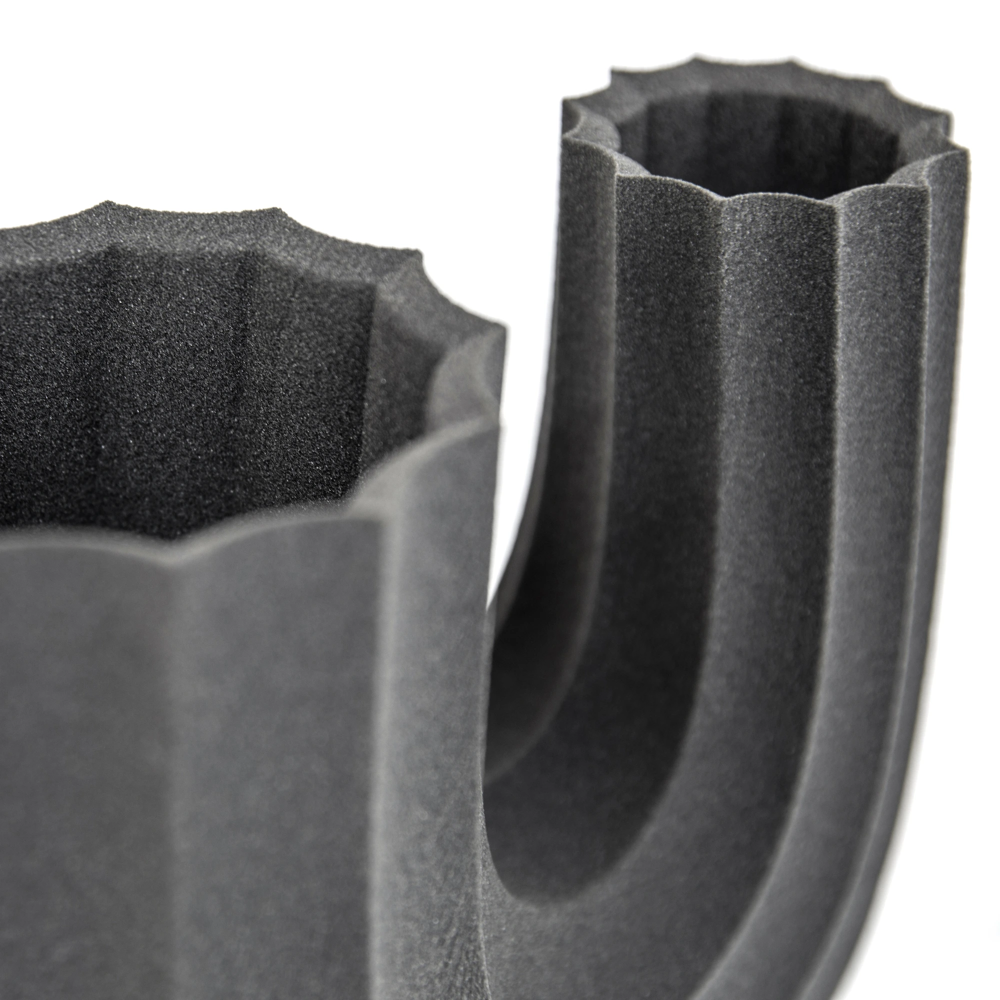

  

  

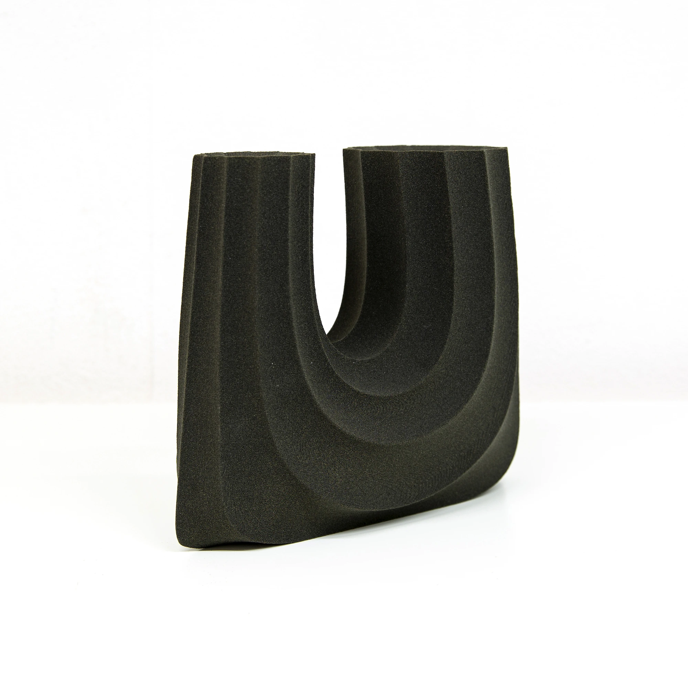

  

  

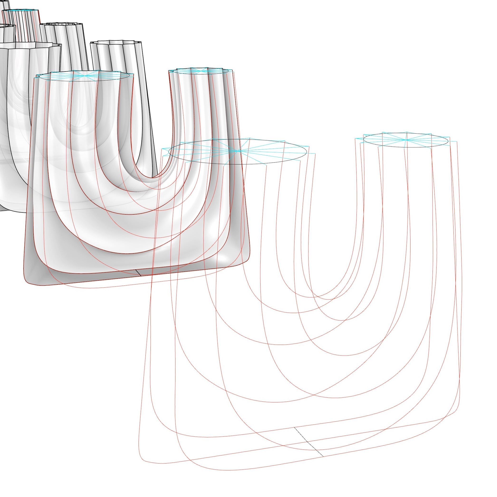

  

  

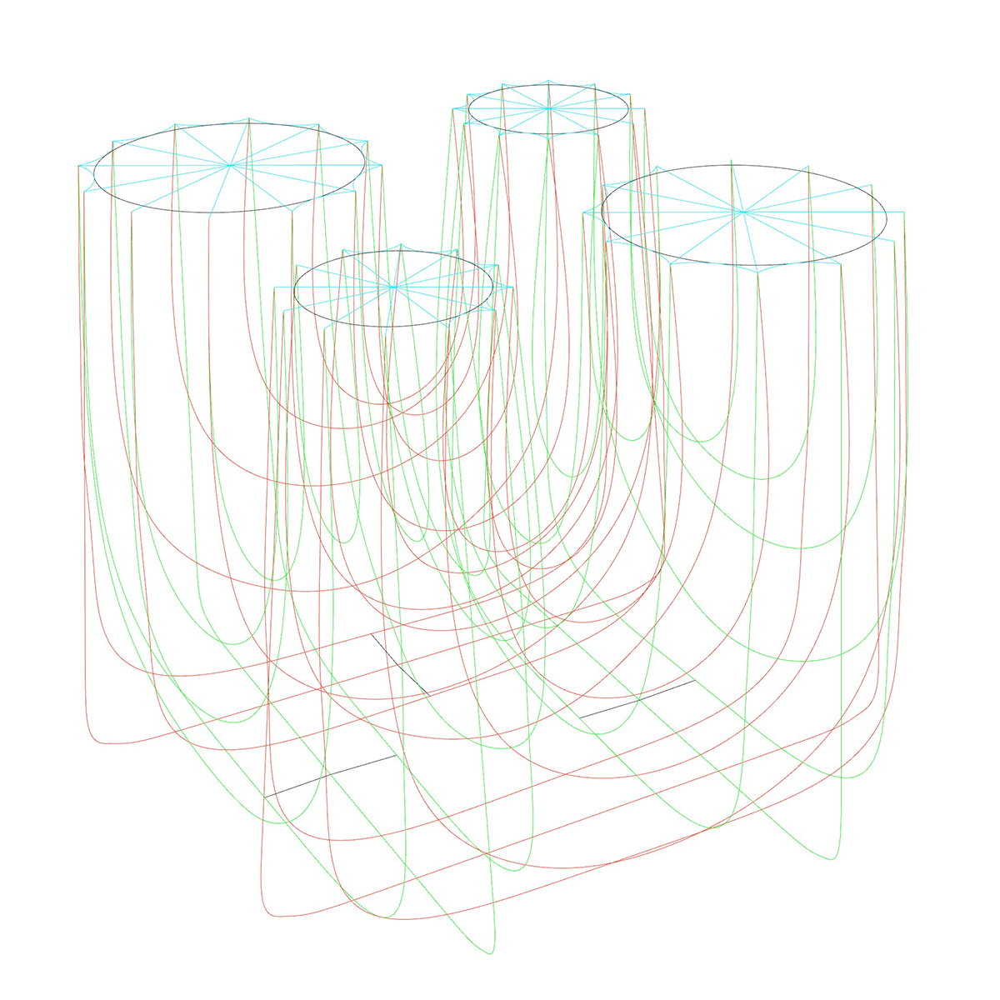

  

# Exhibition展覽記錄

<h6 class="col-12">2023 ALCOVA</h6>

Duplicating Landscape, Milan

米蘭設計週

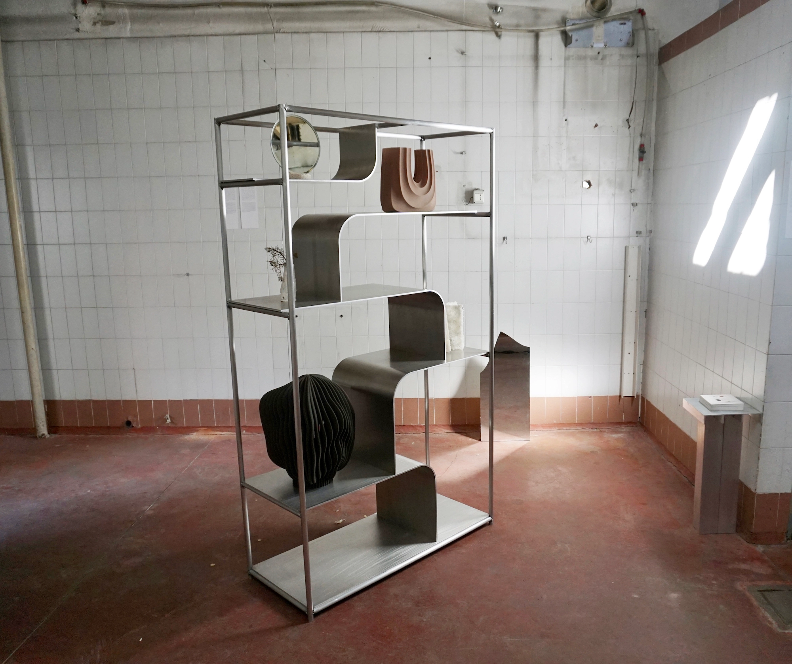

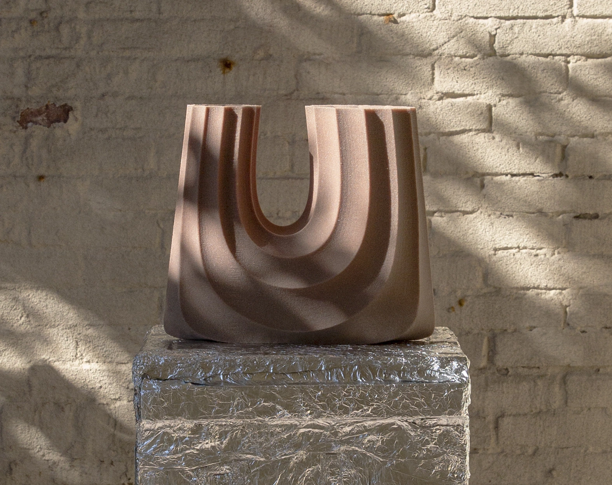

<h6 class="col-12">2023 Maison & Objet</h6>

Taiwan Crafts and Design, Paris

巴黎家居設計展

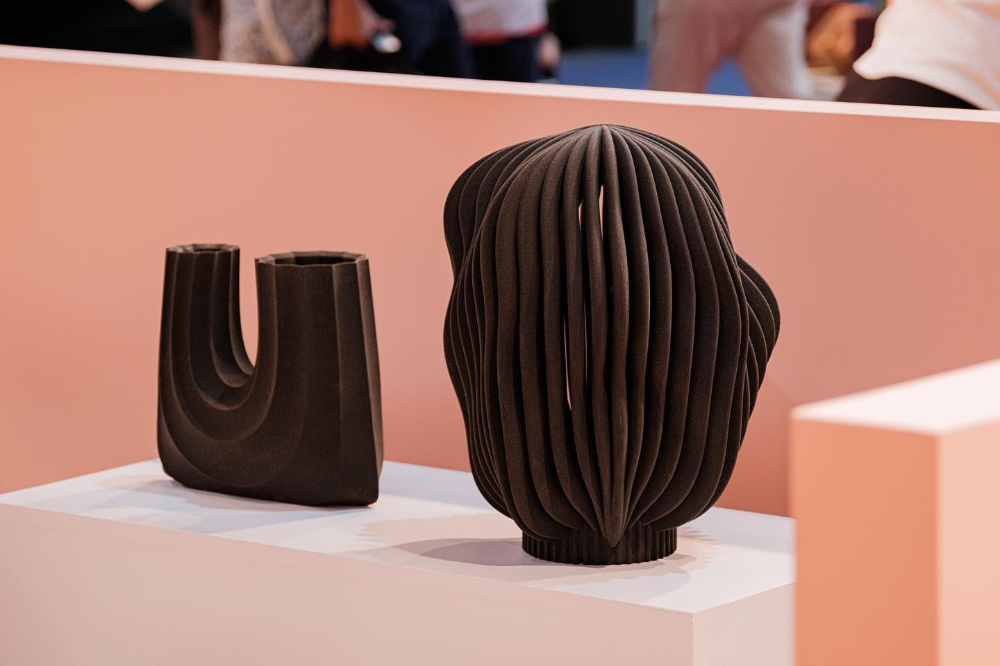

Further reading 延伸閱讀
  

            <a target="_blank" href="https://www.sandhelden.de/tafoni"><u>Sandhelden</u></a>
            - Manufacturer of the 3d sand printing  
            <a href="../Magma/"><u>Magma</u></a>
            - 3D-sand-printed lampshade inspired by volcanic lava 
            <a target="_blank" href="https://www.materialsource.co.uk/top-24-3d-print-projects-and-practitioners-for-2024/"><u>Material source</u></a>
            - Top 24 3D print projects and practitioners for 2024
          

