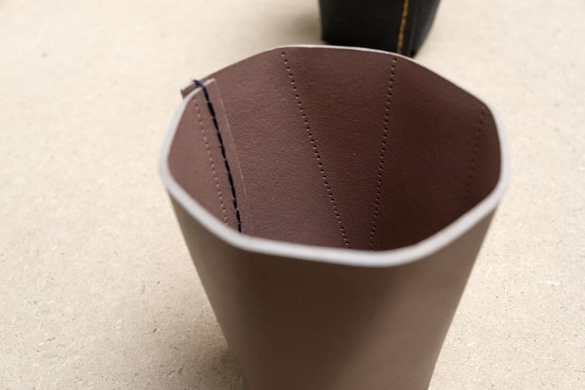
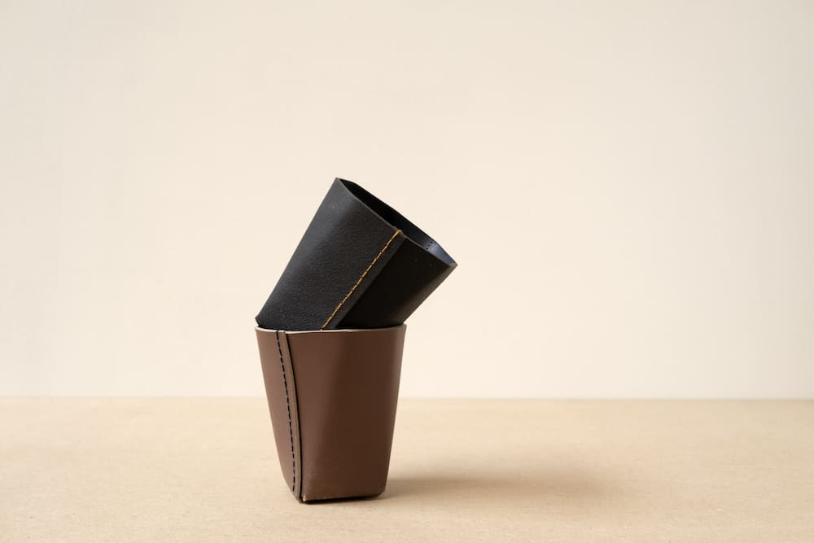
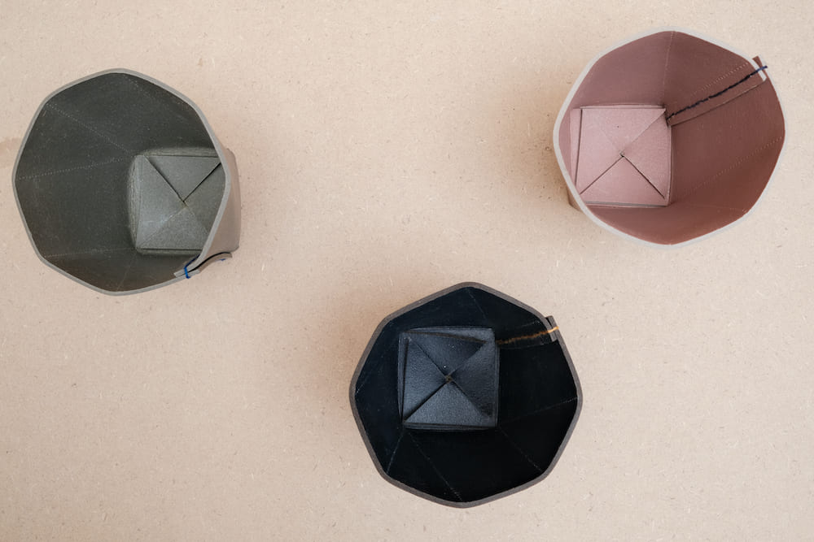
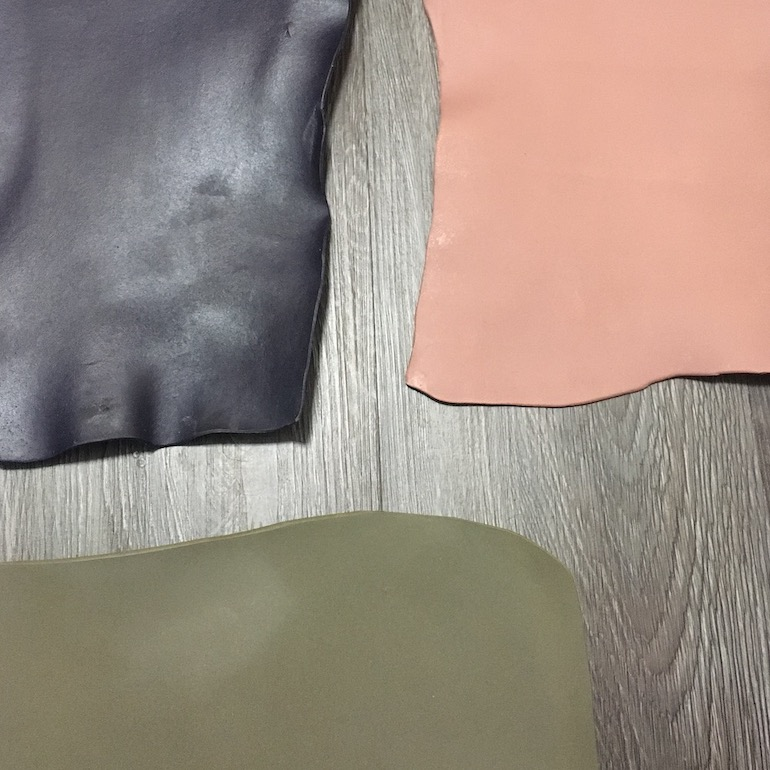
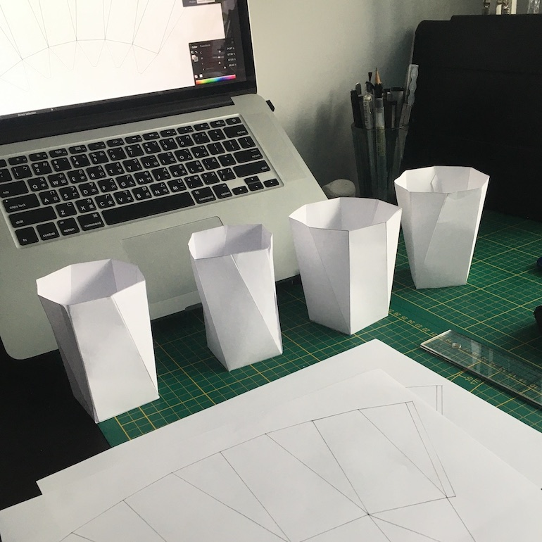
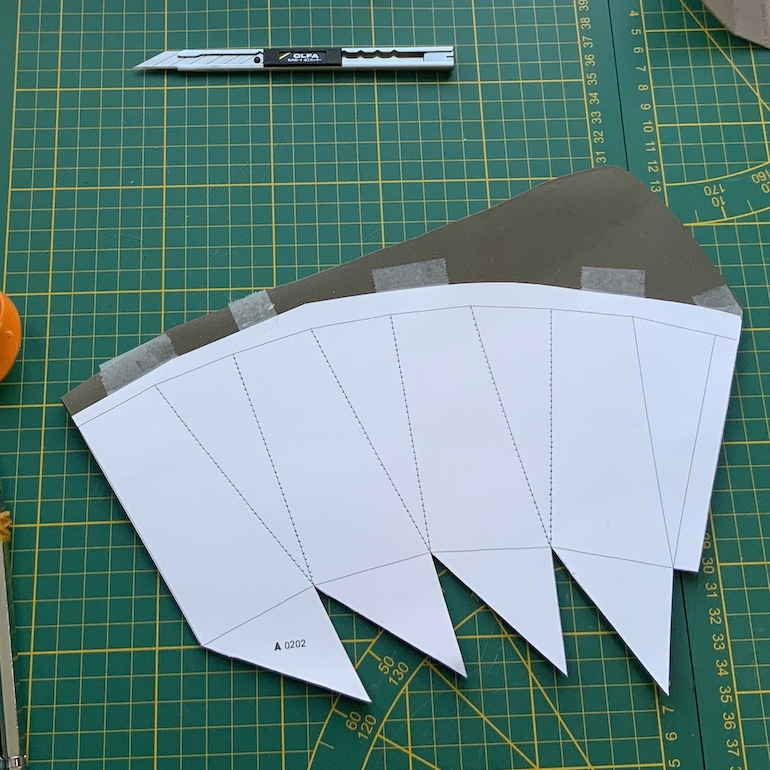
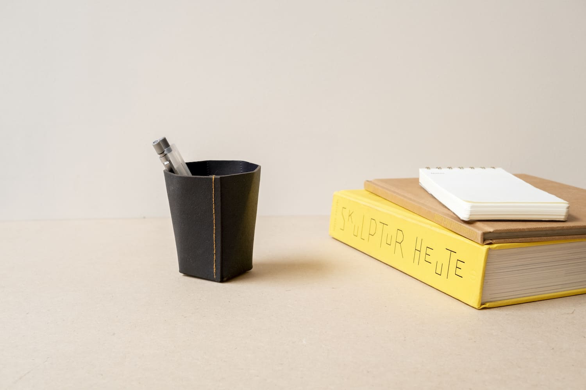
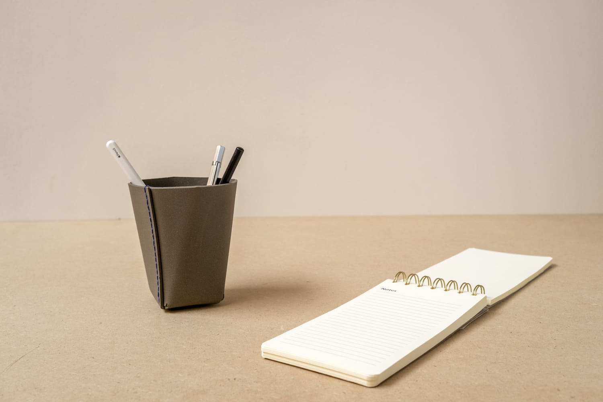
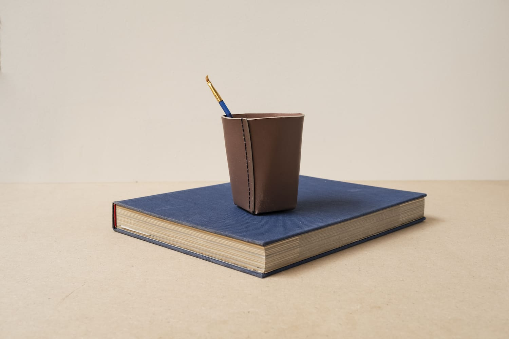
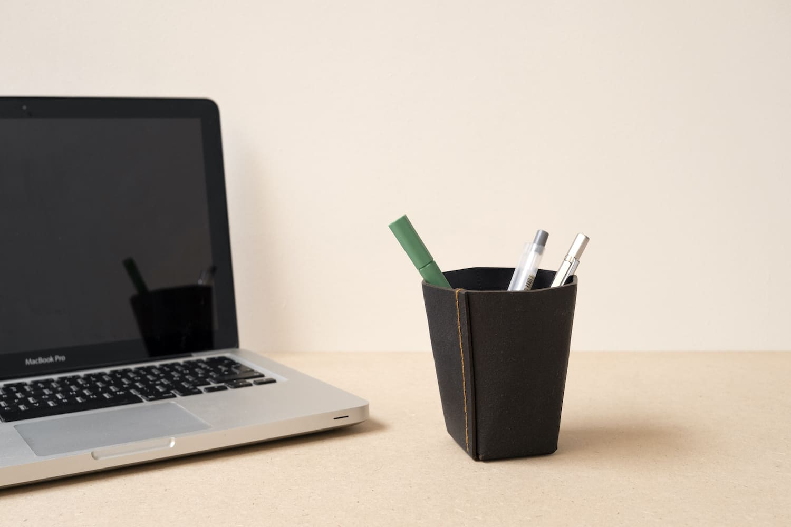

# Concept概念簡介

  Organizer

  收納容器

  
    This project works with <a target="_blank" href="https://www.biophilica.co.uk">Biophilica</a> and Bluecity. The material is Treekind®, a new plant-based, recyclable, compostable, low-resource leather alternative that is completely free of plastic polyurethane.
      
    The design of this series is like origami, formed with one piece of leather. Erco Lai would like to design beautiful home accessories that can merge into today's modern style. To show the beauty of this unique leather, Erco Lai thinks a polyhedron is a good way to show various angles and tension on the surfaces.
  

  
    本計畫與 <a target="_blank" href="https://www.biophilica.co.uk">Biophilica</a> 及 Bluecity 合作，使用 Treekind® 作為材料。這是一種新型植物基皮革替代材料，具備可回收、可堆肥及低資源消耗等特性，且完全不含塑膠聚氨酯。這個系列的設計如同摺紙，以一整片皮革摺疊成形。Erco Lai 希望設計出能夠融入現代生活風格的美觀家居用品。為了展現這種獨特皮革的特質，他選擇以多面體作為形式語言，藉此呈現不同角度以及材料表面的張力。
  

  

  

  

  

  

  

  

# Process製作過程

  
    Hand craft
  

  
    手工製作
  

  
    It contains decent craftsmanship, with features such as hand stitching, crease stamping, and weaving. The design of the piece has taken inspiration from the way in which natural objects grow and develop. For example, in the design, the bottom is a rectangle, but the top is an octagon, resulting in a gradual enlargement of the body. It is a subtle but effective way of creating a unique and interesting piece of craftsmanship. The colors and textures used in the design reflect the natural environment, giving the piece an organic look. The combination of craftsmanship and natural elements make this a truly special and eye-catching piece, perfect for any room.
  

  
    作品結合了細緻的手工藝，包括手工縫製、壓摺痕以及編織等技術。作品的造型受到自然物生長與發展方式的啟發。例如，設計的底部為矩形，而頂部則轉變為八邊形，使整個形體逐漸向外擴張。這是一種細微但有效的方式，讓作品形成獨特且具有趣味性的手工質感。設計中的色彩與紋理呼應自然環境，使作品呈現有機的視覺特徵。手工藝與自然元素的結合，使這件作品成為一件獨特而引人注目的家居物件。
  

  

  

  

  

  

  

  

  

<iframe
  src="https://player.vimeo.com/video/738298569?h=0c76ac4499&byline=0&portrait=0"
  style="width:100%; aspect-ratio:16/9;"
  frameborder="0"
  allow="autoplay; fullscreen; picture-in-picture"
  allowfullscreen>
</iframe>

  

  

  

  

  

  

  

  

  

Further reading延伸閱讀

 

            <a target="_blank" href="https://www.biophilica.co.uk"><u>TREEKIND</u></a>
            - More about the leather alternative 
            <a href="en/Hopper"><u>Hopper</u></a>
            - Accessories/pen holder in metal
          

