

# Brief創作背景
    

Artist Residency

駐村計畫

      
      At the end of 2024, the project began during an artist residency in a small harbour village in China, where the artist learned the art of fishing-net weaving from local grannies whose hands carried years of experience and stories of the sea. Inspired by the intricate structures of crab traps, the project gradually developed into a large-scale installation suspended above the water. Made from nylon threads and stainless steel, the woven structures respond to the wind, seeking to capture something of the ocean's rhythm through forms shaped by human hands.  What began as an individual design gradually became a collective exploration. As the weaving progressed, the artist's role shifted from directing the design to learning and making alongside the grannies. They brought their own sense of colour, weaving habits, and life experiences into the work, allowing unexpected patterns and forms to emerge. Through this exchange, the installation began to reflect not only its original concept, but also the knowledge and imagination of those involved in its making.
          
      
      2024 年底，作品始於中國一座海港小村的藝術家駐村計畫。駐村期間在當地向婆婆們學習傳統漁網編織技藝，她們的雙手承載著多年的勞作經驗，以及與海相伴的生活故事。受到蟹籠細密結構的啟發，作品逐漸發展成一件懸浮於水面之上的大型裝置。尼龍線與不鏽鋼構成的編織結構隨風而動，試圖透過雙手塑造的形態，捕捉海洋的某種韻律。原本提出的設計構想，隨著編織的進行，逐漸轉變為一場共同探索。創作者的角色也從主導設計，慢慢轉向與婆婆們並肩學習及製作。她們將各自對色彩的感受、編織習慣與生活經驗帶入作品，使意料之外的紋樣與形態自然浮現。在這段交流之中，裝置不再只反映最初的構想，也逐漸融入每位參與者的知識與想像。
      

 

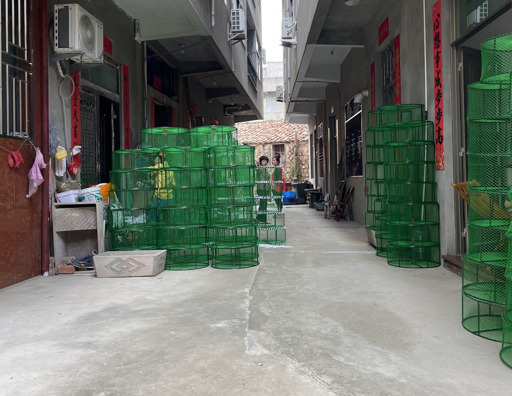
 

 

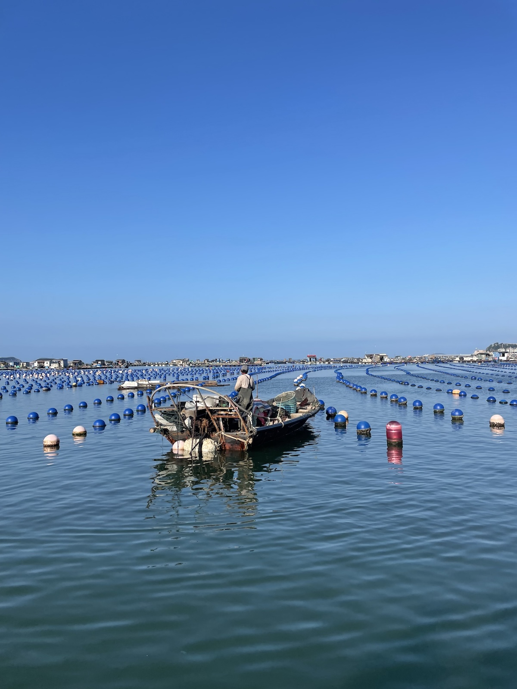
 

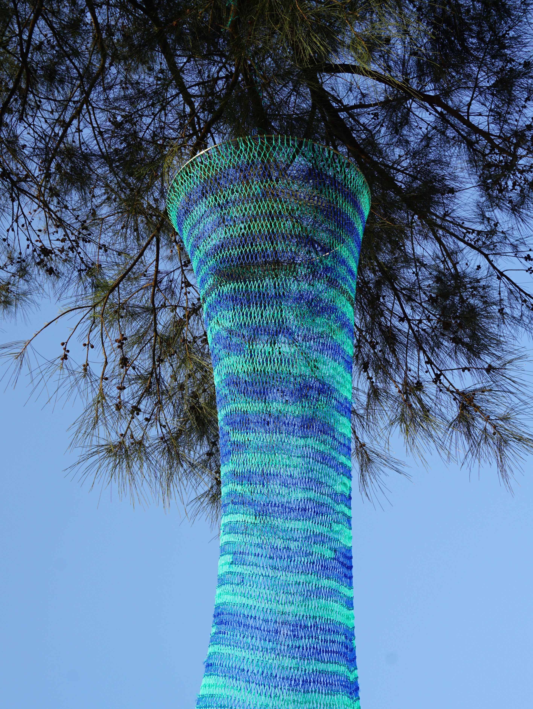
 

 

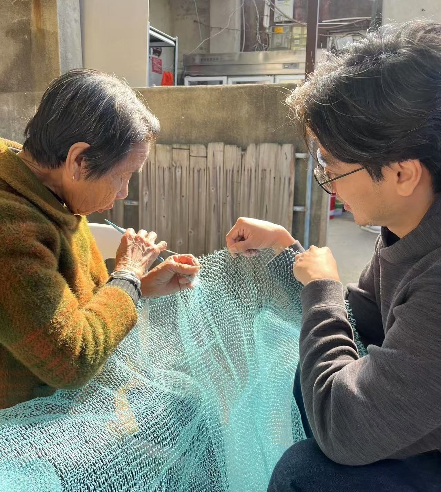
 

  

# Process製作過程

Participatory Craft

共同編織

  
  The installation took shape through constant negotiation between the intended design, the materials, and the hands working with them. The stiffness of nylon rope and the limitations of existing tools called for repeated adjustments to the weaving techniques, even leading to handmade shuttles fashioned from chopsticks. Each difficulty opened up another possibility, allowing practical improvisations to influence the work's evolving form. A series of woven net bags also emerged along the way, becoming an unexpected outcome of the shared experiments.  The ancient practice of knotting cords to record events offers a metaphor for this creative journey. Each knot and interwoven thread seems to hold a memory of time spent working together, exchanged experiences, and fragments of everyday village life. The threads became more than the material of the installation; they carry the traces of those who participated in its making. Between the original design and spontaneous discoveries, the work gradually found its own form, becoming a story woven together through many hands, local craftsmanship, and the surrounding natural environment.
  

  
      裝置的成形，是原先設計、材料特性與實際操作之間不斷協調的結果。尼龍繩的韌性與既有工具的限制，促使編織方式反覆調整，甚至利用免洗筷自製編網工具。每一次遭遇困難，也開啟另一種可能，讓製作中的即興發明逐漸影響作品的形態。過程中甚至自然衍生出一系列編織網袋，成為共同實驗中意外生長的成果，也為未來拆下替換的網籠找到了應用。「結繩記事」成為理解這段創作歷程的一種隱喻。古時，人們透過繩結記錄事件；而在這件作品中，每一次打結與交織，也彷彿記錄著共同工作的時間、彼此交換的經驗，以及村落日常生活的片段。這些細線不只是構成裝置的材料，也承載著參與者留下的痕跡。在原有設計與即興發展之間，作品逐漸長出了自己的形態，成為一段由不同的雙手、地方工藝與自然環境共同編織而成的故事。
  

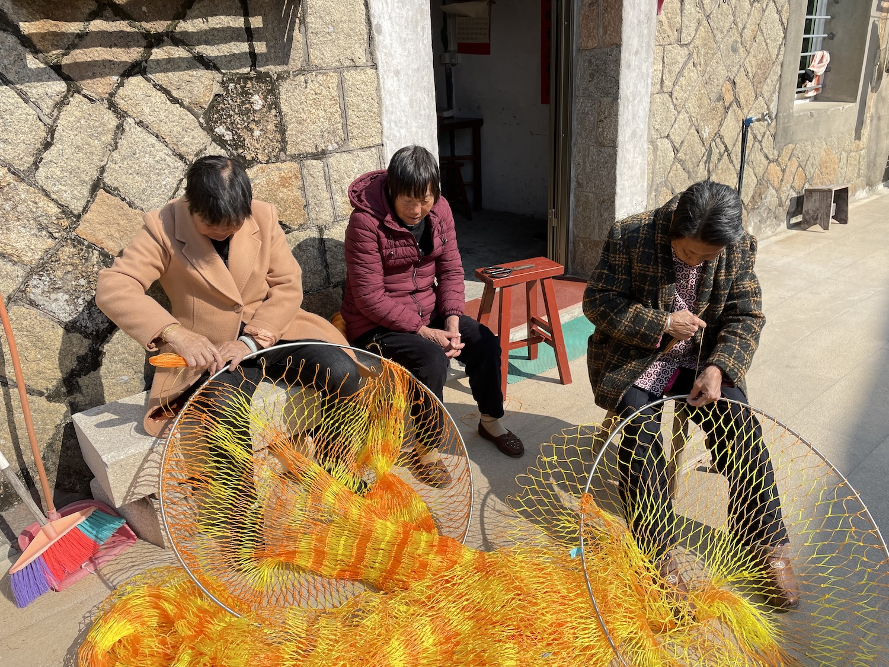
 

 

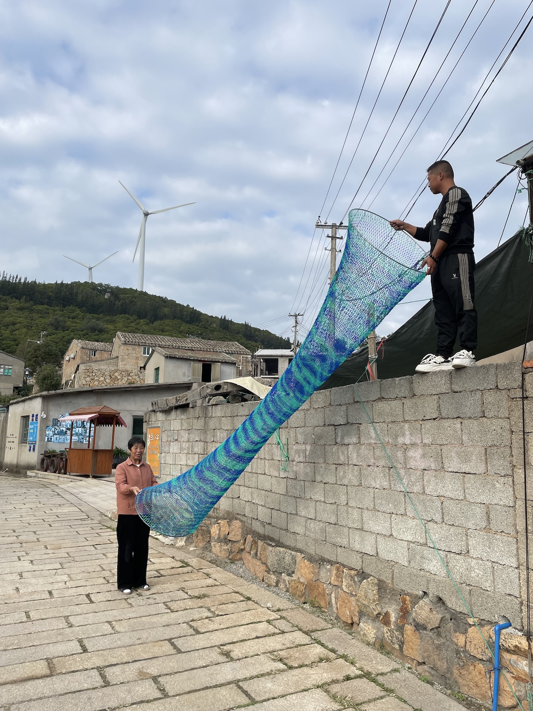
 

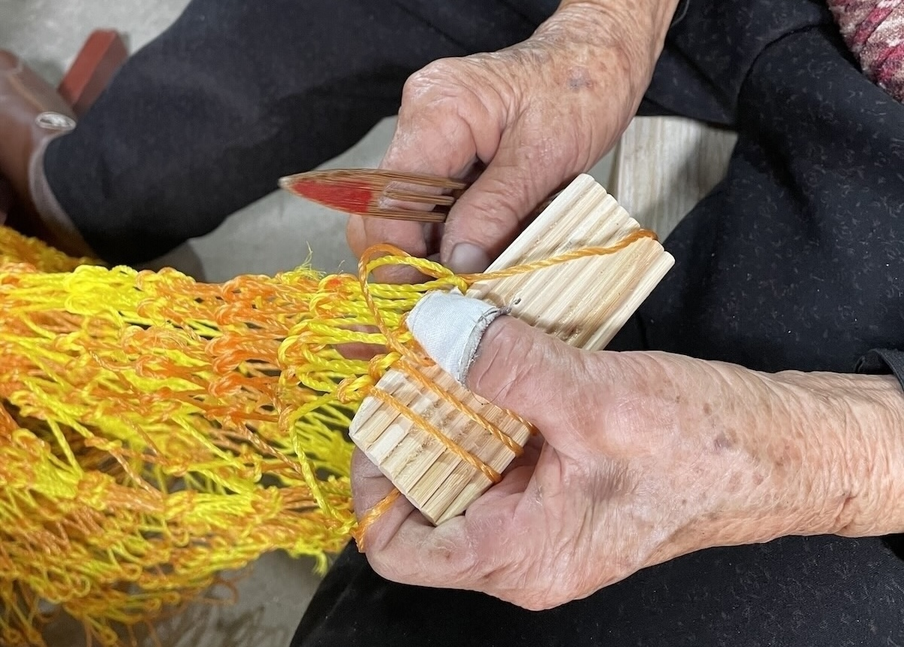
 

 

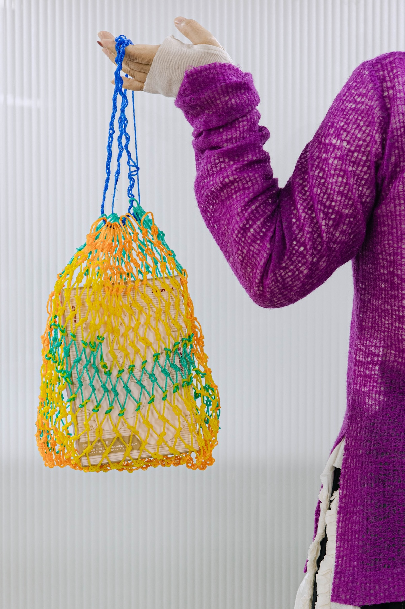
 

 

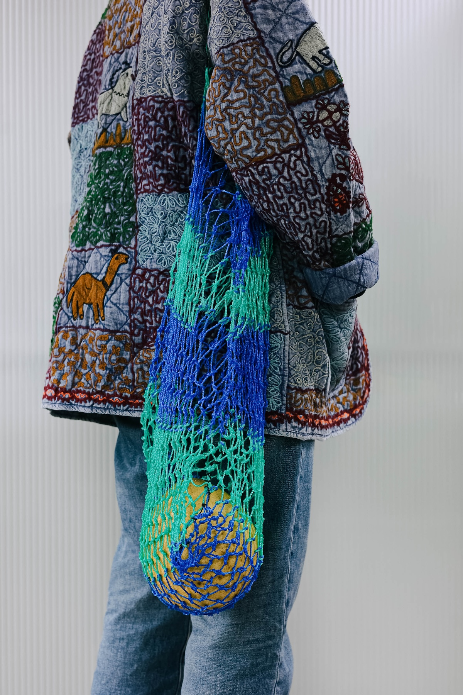
 

# Documentation現地記錄

On site

古石村

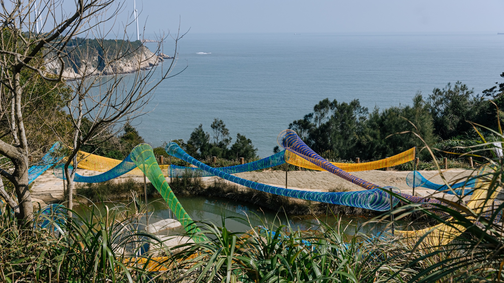
 

 

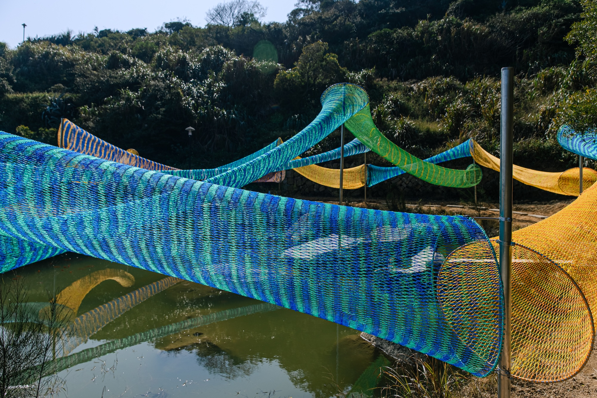
 

 

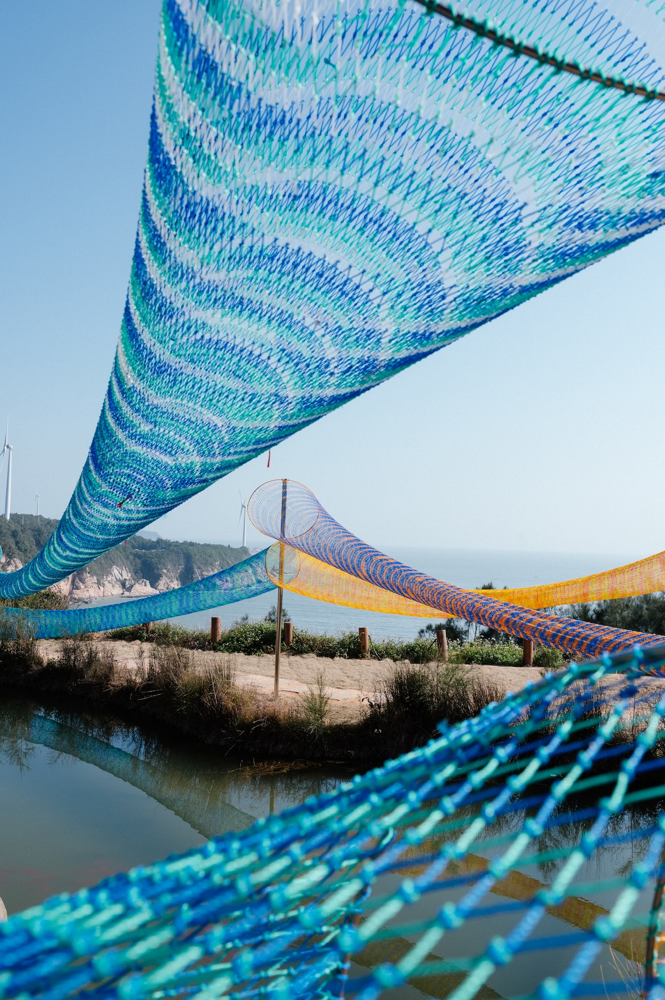
 

  

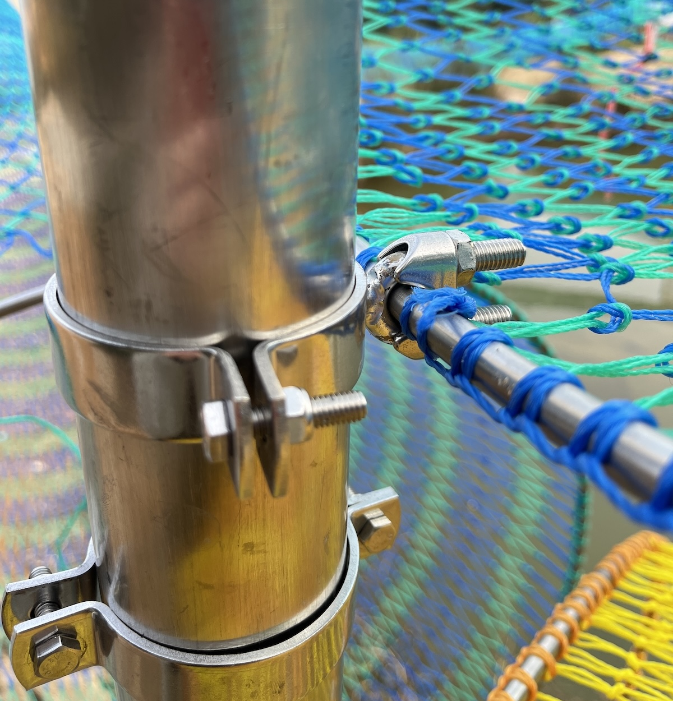
 

Further reading延伸閱讀

  <a href=""><u>Interview</u></a> - from magazine Homeland 

